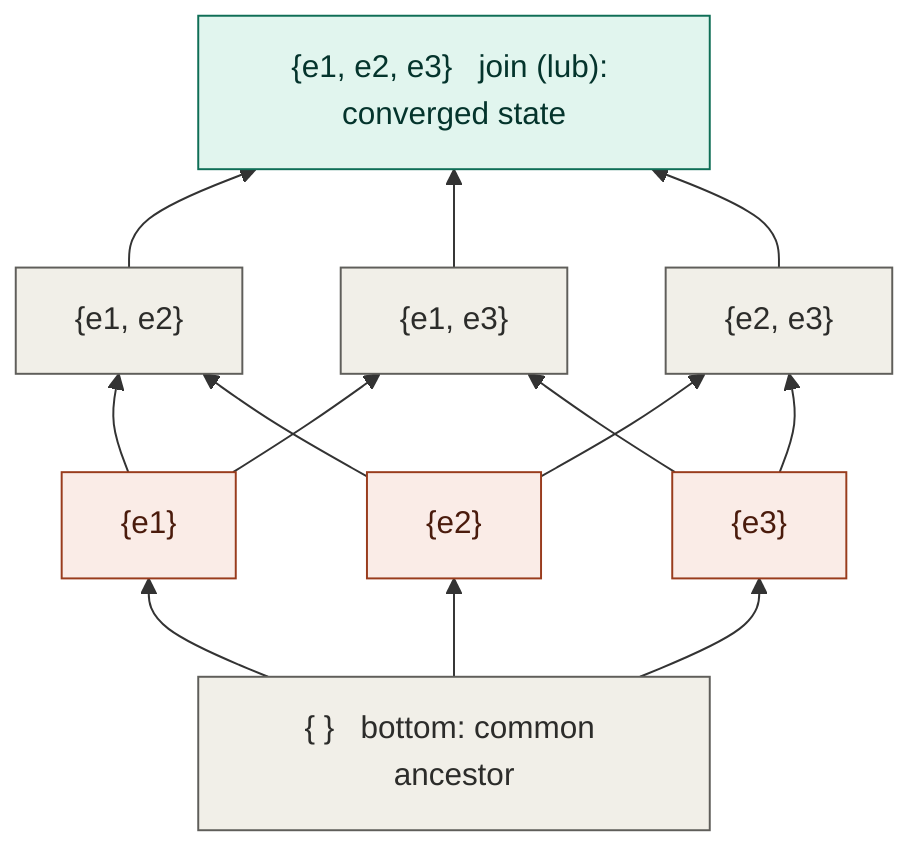
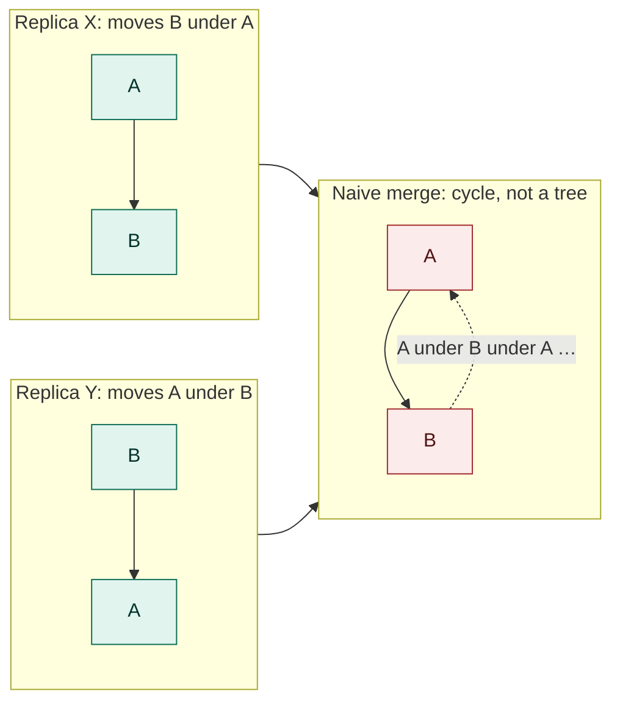
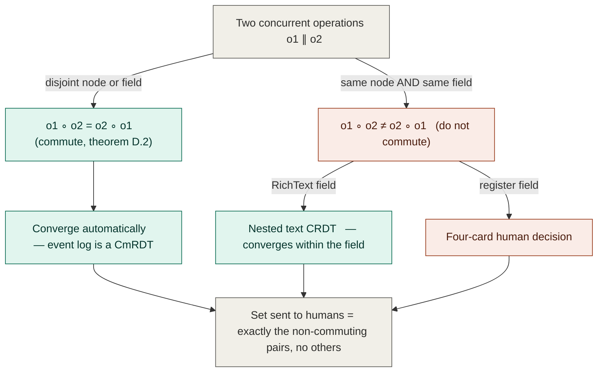
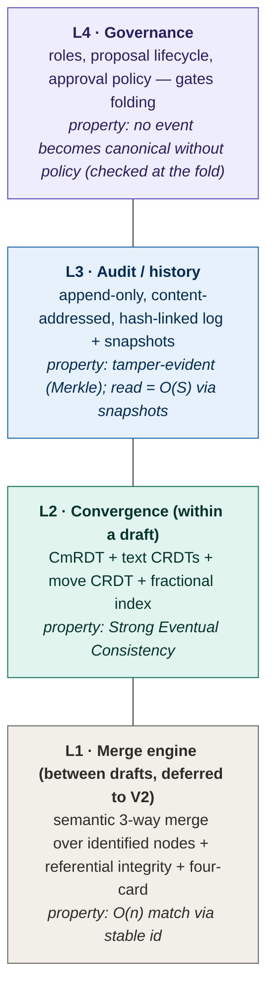
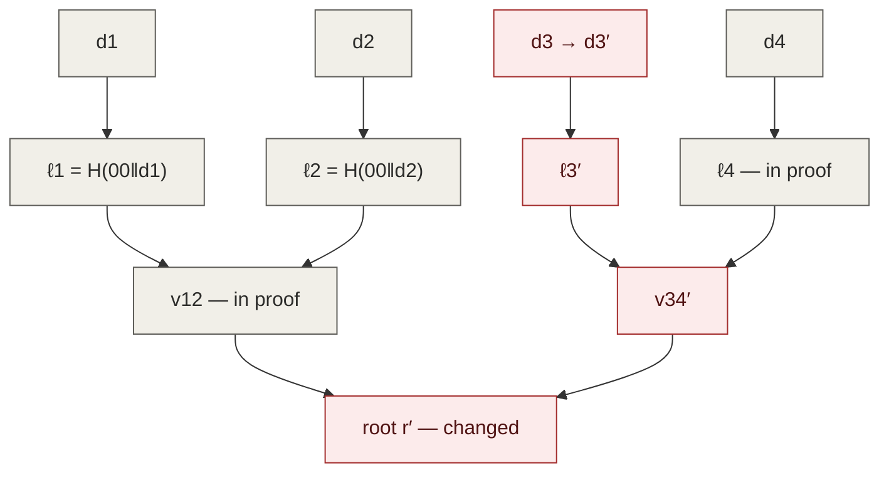

# The Research IDE Versioning, Review & Collaboration Protocol — Complete Treatment

### Volume I: the design (every approach, end-to-end) · Volume II: the mathematics (proofs, algorithms, costs)

**Project:** Verne Research IDE (agentic questionnaire authoring for ODK / Kobo / REDCap workflows)
**Companion documents:** `research_ide_assessment.md` (feasibility) · `research_ide_uiux_theory.md` (interaction theory)

---

## Reading guide for the combined document

This single document has two volumes written to be read together.

**Volume I — The Design Compendium** argues *what* to build and *why*. It establishes why a survey instrument is not a text file, surveys the theoretical foundations and prior art, builds the semantic model, presents five complete candidate architectures end-to-end, maps the strongest onto the two-tier collaboration UX, and closes with engineering, economics, a phased recommendation, and risks. It names the theorems it relies on but does not prove them. Its parts are roman-numbered (PART I–IV) with arabic sections (§1–§10).

**Volume II — The Rigorous Companion** supplies what Volume I names: the formal mathematics (order theory, logical time, CAP/SEC), the convergence proofs, the algorithms in full pseudocode, complexity and storage equations, the cryptographic basis of the audit trail, and cost formulas for every rejected pattern. Every non-trivial equation is followed by a plain-language gloss. Its parts are lettered (A–E) to stay distinct from Volume I's numbering.

A reader who only wants the recommendation and its justification can read Volume I (skip to §9 for the conclusion; read §2 and §5 to challenge it). A reader who wants to verify the claims or implement the system should read Volume II alongside — in particular §4, §6, §7 of Volume I with Parts B–E of Volume II.

The volumes were drafted in sequence, and Volume II in places *sharpened* Volume I rather than merely supporting it — most notably proving that the human-adjudication boundary is forced by the commutativity theorem rather than chosen (Volume II, §D.2), and that the audit guarantee reduces to a standard cryptographic assumption (Volume II, §E.2). Where the two appear to differ in emphasis, Volume II is the more considered statement. The central claim both volumes orbit, stated once here: **a survey instrument is not a text file, and the most consequential design decision is not which merge algorithm to use but how stable identity is assigned to items and fields.**

---

# VOLUME I — THE DESIGN COMPENDIUM


## 0. How to read this document

This is a design compendium, not a specification. Its job is to lay out the full solution space for "Git-like" editing, appending, and reviewing inside the Research IDE, so that the eventual decision is made with the whole landscape visible rather than by defaulting to the first plausible library.

The argument runs in four movements. **Part I** (§1–§2) establishes the problem and the underlying science: what a version-control system actually *is* once you strip away Git's command-line surface, and the mathematics of diffing, merging, causality, and convergence that any honest design must reckon with. **Part II** (§3) surveys prior art — the systems we are standing on the shoulders of, and where each one's ideas transfer or fail to transfer to our domain. **Part III** (§4–§6) builds the semantic model specific to survey instruments and then presents five complete, end-to-end candidate architectures, mapping the strongest one back onto the two-tier collaboration UX already designed. **Part IV** (§7–§10) covers engineering, economics, and a concrete phased recommendation, followed by formal appendices.

A reader who only wants the conclusion can skip to §9. A reader who wants to challenge the conclusion should read §2 and §5. A reader implementing it needs §4, §6, §7, and the appendices.

The central claim, stated once up front so the rest can argue for it: **a survey instrument is not a text file, and the single most consequential design decision is not which merge algorithm to use but how stable identity is assigned to items and fields.** Get identity right and most merge problems become tractable; get it wrong and no algorithm rescues you.

---

# PART I — THE PROBLEM AND THE SCIENCE

## 1. Why versioning a survey instrument is its own problem

### 1.1 The impedance mismatch

Git versions bytes arranged in lines. Its diff, its merge, its conflict markers, its storage — all of it assumes the atom of change is a line of text and the structure of a document is the sequence of its lines. This assumption is spectacularly successful for source code and spectacularly wrong for structured documents.

A survey instrument, in our system, is a typed tree: an instrument contains sections; sections contain items and nested groups; an item carries a type, a variable name, a label (often in several languages), a choice list, skip-logic and constraint expressions, and metadata such as which validated module it belongs to. The meaningful units of change are *these* — "the third choice of question 4 was relabelled," "a skip condition was added to question 7," "the PHQ-9 module was inserted as a block" — not "line 142 changed."

If you store this tree as serialized text (XLSForm rows, XML, JSON) and version the text, every tool you build inherits the impedance mismatch. Reordering two questions looks like a large deletion and a large insertion. Reformatting whitespace produces phantom diffs. A three-way merge can produce a syntactically corrupt instrument — a dangling skip reference, a duplicated variable name — because the line-merger has no idea what a variable name *is*. Worst of all, the conflict presented to the researcher is a wall of `<<<<<<<` markers in a format they never chose to read. The UX theory document already identified this as the core failure mode; this document explains why it is structural, not cosmetic, and what to do instead.

The correct atom of change is the *typed tree node*. The correct diff is a *tree diff*. The correct merge is a *structural, type-aware merge*. The correct conflict is a *semantic conflict surfaced at item granularity*. Each of these is a harder problem than its text-based cousin, and each has its own literature, which §2 develops.

### 1.2 What we actually want from "Git-like"

"Git-like" is a feeling more than a specification. When researchers and engineers ask for it, they want some subset of: a complete and trustworthy history (nothing is ever silently lost); the ability to see what changed, when, and by whom; the ability to work in parallel without overwriting each other; the ability to develop a variant in isolation and bring it back; and the ability to review changes before they land. They emphatically do *not* want: a staging area, a detached HEAD, rebasing, the reflog, or a mental model that takes a week to learn. The engineering challenge is to deliver the first list without importing the second.

It helps to name the capabilities precisely, because different architectures deliver different subsets cheaply:

| Capability | Plain-language meaning | Git's name for it |
|---|---|---|
| **History** | Every prior state is recoverable | commit log |
| **Attribution** | Who changed what, when, and why | blame / author |
| **Diff** | A legible description of a change | diff |
| **Concurrent editing** | Two people edit at once, no clobber | (Git punts to merge) |
| **Isolation** | Develop a variant without disturbing the main line | branch |
| **Integration** | Bring a variant's changes back | merge |
| **Review** | Approve changes before they land | pull request (external to Git) |
| **Provenance** | Tamper-evident record for audit/IRB | signed commits |

The last row is unusual and worth flagging early: a research instrument used for human-subjects data collection has compliance weight. An ethics board, a journal reviewer, or a replication auditor may need to know exactly which version of the instrument a given respondent saw, and that the recorded history has not been edited after the fact. This pushes us toward append-only, tamper-evident history as a *requirement*, not a nicety — a constraint that meaningfully narrows the architecture space (§5).

### 1.3 Requirements specific to research instruments

Five domain requirements shape everything downstream.

**Referential integrity is sacred.** Skip logic and constraints reference other items by variable name (`${hours_outdoors} >= 4`). The instrument is therefore not just a tree but a tree with a *dependency graph* laid over it. A version-control operation that breaks a reference — renaming a variable that something depends on, deleting an item another item's logic needs — must be either cascaded or refused. Text merge cannot do this; the system must understand the graph.

**Validated modules are atomic.** A scored instrument like the PHQ-9 is only valid if its items are unaltered and complete. The versioning system must be able to treat a module as a locked, indivisible unit — editable only by detaching it (and thereby flagging that the score is no longer comparable to the literature). This is a type of node with special merge rules: essentially "no merge, replace-or-reject."

**Field deployment is offline-first and low-bandwidth.** The intended users — icddr,b units, IPA, J-PAL South Asia, enumerator teams across LMIC settings — work in conditions where connectivity is intermittent and metered. This makes *offline editing with later reconciliation* a first-class scenario and makes the *byte cost of synchronization* an economic variable, not an afterthought (§7.2, §8.3). Architectures that require a live server to mediate every keystroke are disqualified for the field tier even if they are fine for the design tier.

**Multiple languages are structural, not metadata.** A label exists in English and Bangla (and possibly more). Translations have their own review lifecycle, can diverge, and must be merged independently. The data model must treat a label as a small map of language→string with its own per-language history, which interacts with merge.

**The reviewers include an AI agent.** The methodologist agent produces suggestions that must enter the same review pipeline as a human's, with the same attribution and the same accept/reject lifecycle. This is less a storage constraint than a uniformity constraint: the protocol must not have a privileged "machine edit" path that bypasses review. Whatever represents a human suggestion must also represent an agent suggestion.

These five, together with the compliance requirement from §1.2, are the rubric against which §5's architectures are scored.

## 2. Theoretical foundations

This section develops the science any serious design must reckon with. It is deliberately mathematical where the mathematics is load-bearing, because several of the candidate architectures in §5 live or die on properties proven (or disproven) here.

### 2.1 What a version-control system is, formally

Strip away the surface and a VCS is a structure for talking about three things: **state** (what the document is now), **history** (the lineage of states that produced it), and **identity** (which parts of one state correspond to which parts of another). Almost every hard problem in the field is really a problem of identity in disguise — diffing is "find the correspondence between two states," merging is "reconcile two states that share an ancestor," and the quality of both depends entirely on getting correspondence right.

Formally, it is useful to model history as a directed acyclic graph (DAG) of versions. Each node is a complete state (or enough information to reconstruct one); each edge points from a version to the version(s) it derived from. A linear history is a path; a branch is a fork; a merge is a node with two parents. This DAG-of-versions model is shared by Git, Mercurial, Darcs, and most modern systems, and it is the right mental model for our review workflow regardless of which storage mechanism we choose underneath.

### 2.2 Snapshots, deltas, and content-addressed storage

There are two ways to store a history: keep every full state (snapshots) or keep a base state plus the changes between states (deltas). Snapshots are simple and fast to read but storage-heavy; deltas are compact but require replaying a chain to reconstruct a state. Real systems blend the two: Git conceptually stores snapshots but physically compresses them into delta-packed files; RCS and older systems stored reverse deltas.

Git's deeper idea is **content-addressed storage**. Every object — a file blob, a tree, a commit — is named by the cryptographic hash of its content. Two identical files anywhere in history are stored once. A tree's hash depends on the hashes of its children, so a commit's hash transitively fixes the entire state of the project. This makes the version graph a **Merkle DAG**: a directed acyclic graph in which every node's identifier is a hash over its content and its children's identifiers.

Two consequences matter enormously for us. First, the structure is **tamper-evident for free**: you cannot alter any historical state without changing its hash and therefore the hashes of everything that descends from it, which immediately satisfies the IRB/audit provenance requirement of §1.2. Second, it gives **cheap structural sharing**: an instrument that differs from its predecessor by one choice label shares every unchanged item, section, and module by hash, so history storage grows with the *size of changes*, not the *size of the document times the number of versions*. Any architecture we choose should keep this property; it is one of the few pieces of Git we want almost unaltered.

The cost is that content addressing fixes identity to *content*. If a node is named by its content hash, then editing the node creates a new node with a new name — which is exactly what we want for storage but exactly what we must *not* conflate with the *logical* identity of a survey item. Question 4 is still question 4 after you relabel its third choice; its content hash changed but its item identity did not. Holding these two notions of identity apart (content identity for storage, logical identity for the domain) is a recurring theme and a frequent source of bugs in naïve designs.

### 2.3 The sequence-diff problem

Before tree diffing, understand sequence diffing, because it is a building block and because its mathematics recurs.

Given two sequences, the canonical formalization of "what changed" is the **shortest edit script**: the minimum number of insertions and deletions that transform one into the other. This is dual to the **longest common subsequence** (LCS): the longest sequence of elements appearing in both, in order, not necessarily contiguously. The elements not in the LCS are precisely what was inserted or deleted.

The LCS has a clean dynamic-programming solution. For sequences `A` of length `m` and `B` of length `n`, let `L(i,j)` be the LCS length of the first `i` of `A` and first `j` of `B`:

```
L(i,j) = 0                              if i = 0 or j = 0
       = L(i-1, j-1) + 1                if A[i] = B[j]
       = max(L(i-1, j), L(i, j-1))      otherwise
```

This is `O(mn)` time and space — fine for small inputs, too slow for large ones. The breakthrough is **Myers' algorithm** (Eugene Myers, *An O(ND) Difference Algorithm and Its Variations*, 1986), which finds the shortest edit script in `O(ND)` time where `D` is the size of the edit script — the length of the *difference* itself. When two versions are similar (small `D`), this is nearly linear. Myers' insight was to reframe the problem as finding the shortest path through an "edit graph" using a greedy frontier indexed by diagonals; it is the algorithm Git and most diff tools actually run.

The **Levenshtein distance** generalizes the edit script to allow substitutions as well as insertions and deletions, giving the familiar edit-distance metric. The recurrence is the same shape as LCS with a substitution term added. This matters to us mainly at the level of *word-level diffing inside a single label* — when we show a researcher that "hottest months" became "April to September," we are running a small Levenshtein-style diff on the label text to render the highlight. The interactive prototype already does a crude version of this.

The lesson sequence diffing teaches, which we carry into trees: **diff quality is correspondence quality**. The algorithm's job is to find the *best* alignment, and "best" is defined by a cost model. Different cost models produce different, equally valid diffs. There is no canonical "the diff"; there is only the diff under a chosen cost function. We will get to choose that cost function for our domain, which is an advantage text tools don't exploit.

### 2.4 The tree-diff problem

Now the real problem: our documents are trees, and we need to diff and merge trees.

The classical formalization is **tree edit distance**: the minimum-cost sequence of node insertions, deletions, and relabellings that transforms one ordered, labelled tree into another. The seminal algorithm is **Zhang–Shasha** (1989), which solves ordered tree edit distance in roughly `O(n³)` time for trees of `n` nodes (more precisely, bounded by the product of tree sizes and the squares of their depths/leaf counts). Tai (1979) gave the first algorithm at much worse complexity; later work (Demaine et al., 2007) brought the worst case down to `O(n³)` with a proof of optimality for the general class of decomposition algorithms.

Two facts about tree edit distance are decisive for our design.

**Fact one: ordered tree edit distance is polynomial; unordered is NP-complete.** If the children of a node have a meaningful order (as the items in a section do — question order matters), the problem is tractable. If the children are an unordered set (as the choices in some analyses might be treated, or tags), then computing the minimal edit distance is NP-complete (Zhang, Statman, Shasha, 1992). This tells us to *keep order meaningful wherever we can* and to treat genuinely unordered collections (like a set of choices where order is cosmetic) with set-specific logic rather than throwing them at a general tree-diff.

**Fact two: naïve tree edit distance does not detect moves.** The classical model has insert, delete, relabel — but not *move*. Moving a subtree (dragging question 5 above question 3) is modelled as deleting it in one place and inserting it in another, which both inflates the diff and destroys the correspondence we care about ("this is the same question, relocated"). Detecting moves turns the problem NP-hard in general, so practical systems use heuristics. **GumTree** (Falleri, Morandat, Blanc, Martinez, Monperrus, 2014), the most influential practical AST-differ, runs in two phases: a top-down phase that greedily matches the largest identical subtrees, then a bottom-up phase that matches "container" nodes when enough of their descendants are already matched, recovering moves and renames that the pure edit-distance model misses. Its lesson — *match first, then derive edits from the matching* — is the right architecture for our differ.

But here is the pivotal observation, and the bridge back to §2.2: **all of this heuristic matching is only necessary because the differ has to reconstruct identity that the editor threw away.** GumTree works hard to guess that "this node in tree A is the same logical node as that node in tree B" because source-code ASTs carry no stable IDs. *We do not have to throw identity away.* If every item and field in our instrument carries a stable, persistent identifier that survives edits (assigned at creation, never reused, never changed by relabelling or moving), then the matching phase is trivial — match by ID — and the diff collapses to a near-linear comparison of correspondingly-identified nodes. This is why §1's central claim holds: **stable identity converts an NP-hard-ish heuristic problem into bookkeeping.** Architectures that assign and preserve node IDs (§5, Approaches B, C, D, E) get good diffs almost for free; an architecture that versions serialized text (a degenerate version of Approach A) is condemned to GumTree-style guessing forever.

### 2.5 Three-way merge and its failure modes

Merging is reconciling two versions that diverged from a common ancestor. The dominant technique is the **three-way merge**: given the two divergent versions and their most recent common ancestor (the *merge base*, found as the lowest common ancestor in the version DAG), classify each region as changed-on-neither (keep), changed-on-one-side (take that side), or changed-on-both (conflict). The classical text implementation is `diff3`.

Three-way merge has a precise, limited correctness guarantee and a large informal failure surface. Its guarantee is roughly: if a region was changed on at most one side, the merge is unambiguous. Its failures are everything else:

**Textual false conflicts.** Two people edit adjacent lines; `diff3` flags a conflict though the changes are independent. Conversely, **textual false agreements**: two people make textually identical but semantically incompatible edits and the merger silently accepts. Both stem from the merger reasoning about lines, not meaning.

**Semantic conflicts that are textually invisible.** This is the dangerous class for us. Reviewer A deletes question 3. Reviewer B, on their branch, adds skip logic to question 7 that reads `${q3_answer} == 'yes'`. Neither edit touches the other's text; a text merge produces a clean result that is a *broken instrument* — question 7 references a question that no longer exists. No line-based system can catch this, because the conflict lives in the dependency graph, not in the text. A type-and-graph-aware merger can and must (§4.5). The existence of this class is, by itself, a strong argument against any text-based approach.

**The merge base may be wrong or absent.** Octopus histories, criss-cross merges, and cherry-picks can make the lowest common ancestor ambiguous; Git uses a recursive merge strategy that synthesizes a virtual merge base from multiple candidates. We can largely avoid this by keeping our history topology simple (the UX deliberately limits branching to "alternative drafts"), which is a case where a UX constraint buys an engineering simplification.

The takeaway: three-way merge is the right *skeleton*, but it must operate over the typed tree and the dependency graph, with a domain-specific classification of what counts as a conflict, not over text. §4.4 specifies those semantics.

### 2.6 Causality and logical time

To merge correctly — indeed, to even know whether two edits are concurrent or one happened after the other — the system needs a notion of time that survives offline work and clock skew. Wall-clock timestamps are insufficient: two enumerators' tablets disagree on the time, and "later timestamp wins" silently discards edits. The field's answer is **logical clocks**.

**Lamport timestamps** (Leslie Lamport, *Time, Clocks, and the Ordering of Events in a Distributed System*, 1978) assign each event a counter such that if event `a` causally precedes `b`, then `L(a) < L(b)`. They give a consistent total order but cannot, by themselves, distinguish "concurrent" from "ordered" — the converse does not hold.

**Vector clocks** (Fidge and Mattern, independently, 1988) fix this. Each replica keeps a vector of counters, one per replica; the partial order on vectors exactly captures causality, so two versions are *concurrent* precisely when neither vector dominates the other. This is what lets a merge engine ask the crucial question: "did these two edits know about each other, or were they made independently?" — which determines whether they merge cleanly or conflict.

Vector clocks have a scaling wart: the vector grows with the number of replicas ever seen, which is awkward when "replicas" are dozens of field tablets. **Version vectors** are the same idea applied to whole-object versions; **dotted version vectors** (Preguiça, Baquero, et al.) refine them to handle the server-mediated case efficiently, attaching a precise "dot" to each write so the system can represent concurrent values without vector bloat. **Hybrid logical clocks** (Kulkarni, Demirbas, et al., 2014) combine a logical counter with physical time so that timestamps are both causally correct *and* close to wall-clock (useful for human-readable history and for "show me everything from last Tuesday").

For us: any architecture with offline editing (the field tier) needs real causality tracking, and the choice among vector/version/dotted variants is an engineering optimization, not a fundamental one. An architecture that is always server-mediated (the design tier, online) can sometimes use a simple server-assigned sequence number and sidestep the whole apparatus — a reason the hybrid design in §5E uses different machinery in different tiers.

### 2.7 Conflict-free replicated data types (CRDTs)

CRDTs are the most important idea of the last fifteen years for our problem, so this subsection is the longest. A CRDT is a data type engineered so that concurrent replicas can be merged *automatically and deterministically* into a consistent result, with no coordination and no conflicts — by construction, not by heuristics.

**The algebra.** The foundational case is the state-based CRDT (a *convergent* replicated data type, CvRDT). Its set of possible states forms a **join-semilattice**: a partially ordered set in which any two elements have a least upper bound (a *join*, written ⊔). The merge function *is* the join. Because the join operation is, by the lattice axioms, **commutative** (`a ⊔ b = b ⊔ a`), **associative** (`(a ⊔ b) ⊔ c = a ⊔ (b ⊔ c)`), and **idempotent** (`a ⊔ a = a`), it does not matter in what order, how many times, or via what path replicas exchange and merge their states — they provably converge to the same value, namely the join of everything they have all seen. This property is **Strong Eventual Consistency** (SEC): replicas that have received the same set of updates are in the same state, with no consensus protocol required. The result is due to Shapiro, Preguiça, Baquero, and Zawirski (2011), who unified earlier scattered constructions and proved the general theorem.

There are two dual formulations. **State-based (CvRDT):** replicas ship their whole state and merge by join; robust against lost and reordered messages, but shipping whole states is expensive (deltas mitigate this). **Operation-based (CmRDT):** replicas ship operations, which must be designed to *commute* when concurrent; cheaper on the wire but requires a reliable causal-delivery channel. The two are theoretically equivalent in power. Our field tier, with its lossy connectivity, leans toward state/delta-based robustness; our design tier, with a reliable channel, can use op-based efficiency.

**The catalogue.** Simple CRDTs compose into complex documents. Counters (grow-only and positive-negative); registers (last-writer-wins, using a logical clock to pick a winner — note this *does* discard a concurrent value, a deliberate loss; or multi-value, which keeps all concurrent values for the application to resolve); grow-only sets; two-phase sets; observed-remove sets (OR-Set, which correctly handles concurrent add/remove by tagging each addition with a unique token); and maps that contain other CRDTs as values. A survey item maps neatly onto a CRDT map: the label is a register or a text CRDT, the choice list is an ordered-set CRDT, the type is a register, and so on. This compositionality is why CRDTs are attractive for structured documents.

**The hard part: sequences.** The deep difficulty is ordered sequences — the list of items in a section, or the characters in a label being co-typed. The problem is assigning stable positions to elements such that any two replicas can independently insert "between" two positions and agree on the result. Naïve integer indices fail immediately under concurrency. The literature is a genealogy of solutions:

- **WOOT** (Oster et al., 2006): the first correct character-level CRDT, using "between" relationships among unique character IDs; correct but heavy.
- **Treedoc** (Preguiça et al., 2009): positions as paths in a binary tree, so "between" is always expressible by descending one level; needs periodic rebalancing.
- **Logoot** (Weiss et al., 2009) and **LSEQ** (Nédelec et al., 2013): positions as variable-length identifiers from a dense identifier space, with allocation strategies to keep IDs from growing too fast.
- **RGA** (Roh et al., 2011): replicated growable array, using timestamped insertion points; widely implemented.
- **YATA** (Nicolaescu et al., 2016): the algorithm behind **Yjs**, optimized for the common editing patterns and for performance at scale.

**The interleaving anomaly and Fugue.** A subtle but real defect haunted many sequence CRDTs: when two replicas concurrently insert *runs* of elements at the same position (Alice types "abc," Bob types "xyz," at the same spot), some algorithms interleave them into "axbycz" — garbage no human intended. Characterizing and fixing this is recent work; **Fugue** (Weidner and Kleppmann, 2023) defines "maximal non-interleaving" and gives an algorithm achieving it. For us this is mostly relevant to real-time co-typing of a single label, a comparatively rare event, but it is a reason to adopt a mature library rather than hand-roll a sequence CRDT.

**Rich text: Peritext.** Plain sequences are not enough for formatted text; concurrently applying "bold" to a range while someone edits inside that range is its own problem. **Peritext** (Litt, Lim, Kleppmann, Henry; Ink & Switch, 2021–2022) is a CRDT for rich text that keeps formatting spans consistent under concurrency. We need only a thin slice of this (labels are lightly formatted), but it is the reference if rich labels become a requirement.

**The catch for us.** CRDTs guarantee *convergence* — all replicas reach the same state — but convergence is not the same as *correctness* or *intent preservation*. A CRDT will happily converge two replicas to a state that is a perfectly consistent, perfectly broken instrument (the deleted-question-3 / dependent-question-7 scenario of §2.5 converges fine; it is just wrong). CRDTs eliminate the *low-level* merge conflict but not the *semantic* one. And critically, **CRDTs by design avoid surfacing conflicts to the user** — their whole point is automatic resolution — whereas our review workflow sometimes *wants* a conflict surfaced for a human to adjudicate (the four-card resolution UX). So CRDTs are an excellent substrate for *real-time co-editing within a single draft*, where automatic convergence is exactly right, and a poor fit for *cross-draft review*, where deliberate human adjudication is the point. This split is the seed of the hybrid recommendation.

### 2.8 Operational Transformation (OT)

OT is the older rival to CRDTs and the technology that originally powered Google Docs. The idea: replicas exchange *operations* (insert at position 5, delete at position 9), and when an operation arrives that was generated against a different prior state, the receiver *transforms* it against the operations it has since applied, adjusting indices so the intent is preserved. "Insert at 5" becomes "insert at 7" if two characters were inserted before position 5 in the meantime.

The correctness conditions are precise and famously hard to satisfy. **TP1** (transformation property 1) requires that transforming operation `a` against `b` and then applying, versus transforming `b` against `a` and then applying, yield the same state — necessary for two replicas exchanging one op each. **TP2** requires consistency when transforming an operation against a sequence of others regardless of the order in which the sequence was assembled — necessary for three or more concurrent sites. Many published OT algorithms were later found to violate TP2 in corner cases; getting it provably right is genuinely difficult, which is much of why the field drifted toward CRDTs.

The pragmatic exception is the **Jupiter** model (Nichols et al., 1995), which sidesteps TP2 by routing all operations through a central server that imposes a total order — each client only ever transforms against a linear server history, so TP2 never arises. This is exactly Google Docs' architecture: a central authority makes a hard problem easy. For our *design tier*, which is naturally server-mediated, a Jupiter-style OT is a legitimate and proven option. For the *offline field tier*, where there is no live central server during editing, OT's central-server crutch is unavailable and CRDTs are the better fit. Another input to the hybrid.

### 2.9 Patch theory

The most mathematically ambitious lineage treats *patches* — not states — as the primary objects, and asks what algebra they obey. This is the world of **Darcs** and its successor **Pijul**.

The motivating idea: a patch is a function transforming one state into another, so patches should *compose* like functions, and the interesting question is when two patches **commute** — when patch `p` then patch `q` produces the same result as `q` then `p`. If two patches commute, they are independent and can be reordered freely; merging is then "reorder the patches into a common sequence." Conflicts are precisely the patches that *don't* commute. Darcs formalized a "theory of patches" around commutation but suffered from exponential-time merges in pathological cases (the notorious "merge hell").

**Pijul** rebuilds this on firmer ground. Its theory (drawing on work by Mimram and Di Giusto, *A Categorical Theory of Patches*, 2013) models states and patches in the language of category theory: states are objects, patches are morphisms, and a merge is a **pushout** — the universal way to combine two divergent morphisms from a common source. When the naïve pushout doesn't exist (a genuine conflict), the construction is completed in a larger category that represents the conflict explicitly as a first-class state rather than as textual markers. The practical payoff is that, unlike Git, Pijul makes patches that commute *actually* commute (so cherry-picking and reordering are clean and associative), and conflicts are well-defined objects with a sound algebra rather than ad-hoc `<<<<<<<` text.

For us, patch theory is more *influence* than *implementation candidate*. Its insistence that **a conflict is a first-class state, not an error**, directly informs our four-card resolution UX — the conflict is something the system represents and carries until a human resolves it, which is precisely the Pijul stance. And its commutation lens is the right way to *think about* when two researcher edits are independent. But a full categorical patch engine is a large research-grade investment (§8.4), and the same conflict-as-state benefit is obtainable more cheaply by combining a CRDT substrate with an explicit semantic-conflict layer (§5E). We borrow the philosophy, not the machinery.

---

# PART II — PRIOR ART AND INFLUENCES

## 3. A survey of systems we are standing on

The point of this survey is not completeness but transfer: for each system, what is the idea, and does it carry into a survey-instrument IDE or not?

### 3.1 The Git family: Git, Mercurial, Fossil

**Git** contributes the Merkle DAG, content-addressed storage, and the branch/merge/three-way mental model. We adopt the storage idea (§2.2) almost wholesale and the DAG-of-versions model for the review layer. We reject its text-line atom, its exposed plumbing, and its vocabulary. Git's most relevant *negative* lesson is its learning curve: a tool whose data model is beautiful but whose interface leaks that model onto every user is a tool researchers will not adopt. The UX theory document's vocabulary-translation discipline is a direct response.

**Mercurial** is architecturally close to Git but historically friendlier, with a more uniform command surface and first-class extensibility. Its relevant lesson is that the *same* underlying DAG model can be presented far more humanely; the data model does not dictate the interface. Its *revlog* storage (interleaved snapshots and deltas with a guaranteed reconstruction bound) is a clean reference if we build custom delta storage.

**Fossil** (from the SQLite author) is instructive because it bundles version control with issue tracking, a wiki, and a forum in a single self-contained, self-hostable binary backed by a SQLite database. For our self-hosted institutional tier, Fossil's philosophy — *one auditable file, no server dependencies, batteries included* — is a strong model for the deployment story (§7, §8). It also demonstrates that storing a version DAG inside a relational database is entirely viable, which de-risks Approach A and B's storage layer.

### 3.2 The patch-theory family: Darcs, Pijul

Covered theoretically in §2.9. As prior art, they matter because they are existence proofs that a sound, commutation-based alternative to Git's model can be built and shipped, and because Pijul's conflicts-as-first-class-objects is the cleanest articulation of the stance our review UX takes. Darcs is also a cautionary tale about performance: an elegant theory with exponential worst-case merges taught the field that *algorithmic complexity of merge is a product requirement, not an academic footnote*.

### 3.3 Version control for data: Dolt

**Dolt** is "Git for data" — a SQL database with branch, diff, and merge at the level of *table rows and schemas* rather than text lines. This is the closest prior art to our problem, because a survey instrument is semi-tabular (the XLSForm survey and choices sheets are literally tables) and Dolt has already solved "diff and merge structured tabular data with a Git-like workflow."

Its key engineering idea is the **prolly tree** (probabilistic B-tree, a content-addressed search tree / Merkle search tree). A prolly tree is a B-tree whose node boundaries are determined by content-defined chunking, so that two structurally similar datasets share most of their internal nodes by hash. This gives simultaneously: efficient diff (compare trees, skip shared subtrees by hash), structural sharing (storage proportional to change size), *and* fast indexed lookup (it is still a search tree). For a system that wants both Git-like history *and* spreadsheet-like random access to a large instrument or a bank of reusable items, prolly trees are the most directly applicable storage structure in the literature. If we build Approach A or B at scale, this is the storage design to study first.

### 3.4 Immutable fact logs: Datomic

**Datomic** inverts the usual model: the database is an append-only log of immutable **datoms**, each an `(entity, attribute, value, transaction, added?)` tuple. Nothing is ever updated in place; a "change" is a new datom asserting a new value (and optionally retracting the old). The current state is a *view* derived by reducing the log; any past state is recoverable by reducing the log up to a point in time. History is not a feature bolted on — it is the substrate.

This is profoundly aligned with two of our requirements. The append-only log is *inherently* a tamper-evident audit trail (§1.2 compliance), and "what did the instrument look like when respondent #4271 answered it?" becomes a first-class query ("as-of" a transaction), not an archaeology project. Datomic is the strongest influence on Approach B. Its cost — the log grows without bound and must be indexed and occasionally compacted — is the economic theme of §8.1.

### 3.5 Real-time collaborative editors: Google Docs, Figma, Notion, Linear

**Google Docs** is the proof that Jupiter-style server-mediated OT (§2.8) scales to mass adoption. Its relevant lesson beyond the algorithm is the **suggesting mode** interaction model, which the UX theory document already adopts as Tier 1: edits as reviewable proposals attributed to an author, accepted or rejected individually. We are, in effect, rebuilding Google Docs' suggesting mode over a typed tree instead of a text rope.

**Figma** is the most instructive, because it solved real-time multiplayer over a *structured document* (a scene graph of design objects), not text — exactly our shape of problem. Figma uses a custom CRDT-flavoured system with a central server assigning authority, and — crucially for us — it later shipped **branching and merging** for design files, presenting it to non-engineer designers without Git vocabulary. Figma is the closest existing answer to "what does Git-like branching look like for a structured document aimed at non-programmers," and its branching UI is worth direct study before we design ours.

**Notion** models every document as a tree of typed "blocks," each with a stable ID — precisely the stable-identity discipline §2.4 argues for. It demonstrates that a block tree with per-block identity is a viable, popular substrate for structured documents, and that users readily accept "everything is a block" when the blocks render as ordinary prose by default (again echoing the UX theory).

**Linear** popularized the **sync engine** architecture: a local in-memory store on the client, a compact operation log synced to the server, optimistic local application, and background reconciliation. This is the modern pattern for "feels instant, works offline-ish, syncs reliably," and its shape informs our client architecture (§7.2) regardless of which merge core we choose.

### 3.6 The CRDT toolkits and the local-first movement

**Yjs** (YATA, §2.7) and **Automerge** (a JSON-CRDT) are the two production-grade CRDT libraries. Yjs is performance-optimized and battle-tested in many editors; Automerge offers a richer document model (arbitrary JSON with nested maps, lists, text, and full change history) and a notable **columnar binary encoding** (Kleppmann, 2020) that compresses operation logs dramatically by storing many operations' fields in column-major order with run-length and delta encoding — directly relevant to our bandwidth economics (§8.3). **Collabs** and **ElectricSQL** (CRDT-backed sync over Postgres) and **Replicache** (a sync-engine SDK) round out the toolkit landscape.

The intellectual umbrella is **local-first software** (Kleppmann, Wiggins, van Hardenberg, McGranaghan; Ink & Switch, 2019), whose seven ideals — fast, multi-device, offline-capable, collaborative, long-lived, private, and user-controlled — read almost as a requirements list for a field-research tool used in low-connectivity settings by institutions that care about data sovereignty. The local-first thesis is the philosophical backbone of our field tier and self-hosted tier, and CRDTs are its enabling technology. The honest counterpoint, which §5 takes seriously, is that local-first's automatic convergence is sometimes *not* what a review workflow wants.

### 3.7 Domain prior art: REDCap, Qualtrics, SurveyCTO, ODK/Kobo

The most important survey of all, because it defines the whitespace. Across the incumbent survey platforms, version control is conspicuously weak.

**REDCap** versions a project's data dictionary largely through a draft-and-commit cycle: you enter "draft mode," make changes, and commit them, sometimes with administrator approval for projects already collecting data. There is change logging and a field-level audit trail, but there is no real branching, no diff between arbitrary versions presented structurally, and no collaborative suggesting — and, as the UX theory document noted, researchers resort to encoding structure by hand in field-label HTML for want of better primitives. **Qualtrics** offers revision history and the ability to restore prior versions of a survey, but again no branch/merge and limited structural diff. **SurveyCTO** and the broader **ODK/Kobo** ecosystem version the *form* as a published artifact with a version string; the authoring-time history typically lives in whatever the author used to edit the XLSForm (often a spreadsheet with no versioning at all, or a manually-versioned file).

The pattern is clear: incumbents treat the instrument as a document to be drafted and published, with history as a safety net, not as a collaborative artifact with a first-class branching, reviewing, and merging workflow. *No incumbent offers structural diff, semantic merge, item-level suggesting, or AI-reviewer integration over a typed instrument model.* That gap — already identified commercially in the feasibility assessment — is, from the versioning angle, the specific technical territory this protocol stakes out.

### 3.8 What transfers — a synthesis

| Source | Idea we take | Idea we leave |
|---|---|---|
| Git | Merkle DAG storage, version-DAG model, three-way skeleton | text-line atom, plumbing, vocabulary |
| Mercurial / Fossil | humane presentation; DAG-in-a-database; self-contained deployment | — |
| Dolt | prolly trees; structured-data diff/merge | SQL-first interface |
| Datomic | append-only immutable fact log; as-of queries | full Datalog engine |
| Google Docs | suggesting mode; Jupiter OT for the online tier | text-only model |
| Figma | structured-document multiplayer; branching for non-engineers | proprietary internals |
| Notion | per-block stable identity; blocks-as-prose | — |
| Linear | sync-engine client architecture | — |
| Yjs / Automerge | production CRDT substrate; columnar encoding | hand-rolling our own |
| Pijul | conflict-as-first-class-state; commutation lens | full categorical engine |
| Local-first | offline-first, sovereignty, longevity ideals | dogmatic auto-merge everywhere |

---

# PART III — THE DESIGN

## 4. The semantic model for survey instruments

Before choosing an architecture we must pin down *what is being versioned*. Every architecture in §5 operates over this model; they differ only in the machinery of history, sync, and merge.

### 4.1 The canonical object model

The instrument is a typed tree with a dependency graph overlaid. Recapitulating and formalizing the model the prototype already uses:

- An **Instrument** has metadata (title, languages, settings) and an ordered list of **Sections**.
- A **Section** has a title, optional **Module** binding, and an ordered list of **Items** (and may nest sub-groups).
- An **Item** has: a stable **id**; a **type** (`integer`, `select_one`, `select_multiple`, `text`, `geopoint`, …); a **variable name** (the analysis-facing identifier, e.g. `hours_outdoors`); a **label** as a language→string map; an optional ordered **choice list**; optional **relevance** (skip-logic) and **constraint** expressions; and provenance metadata.
- A **Choice** has a stable **key**, a language→label map, and a position.
- A **Module** is a binding to a registered validated instrument (PHQ-9, GAD-7, …) with a lock flag and a citation.

Two cross-cutting structures sit on top of this tree. The **dependency graph** has an edge from item X to item Y whenever X's relevance or constraint expression references Y's variable name. The **module membership** relation marks subtrees as belonging to a locked validated instrument. Both are derived from the tree but must be consulted by the merge engine, because they are where semantic conflicts live (§4.5).

### 4.2 Stable identity — the keystone decision

§2.4 argued that stable identity is what makes diffing and merging tractable. Here is the discipline, stated as rules:

1. **Every Item, Choice, Section, and Module binding receives a globally unique, persistent id at creation** (a UUID or a collision-resistant random string). The id is assigned once and never changes.
2. **The id is independent of all content.** Relabelling an item, changing its type, moving it to another section, translating its label — none of these change its id. The id answers "is this the same question?", which is a different question from "does this question have the same content?"
3. **The id is distinct from the variable name.** The variable name (`hours_outdoors`) is *content* — analysis-facing, human-chosen, and changeable (with care, because the dependency graph references it). The id is *identity* — internal, opaque, immutable. Conflating the two is a classic and costly error: it makes renaming a variable look like deleting one question and creating another, destroying history and breaking diffs.
4. **Ids are never reused.** A deleted item's id is retired forever, so that a later "undelete" or a merge that resurrects it refers to the same logical thing.

With these rules, diffing two versions is: match nodes by id (trivial), then for each matched pair compare content fields, and classify ids present on one side only as inserts/deletes, and ids whose parent or position changed as moves. The NP-hard heuristic matching of §2.4 evaporates. This is the highest-leverage paragraph in the document: **the identity rules are more important than the choice of architecture.**

### 4.3 Granularity: what is the unit of change, history, and review?

Different operations want different granularity, and the protocol should support a *hierarchy* of grains rather than a single one.

- **Field grain** (a single label, a single expression, one choice's text): the unit of *real-time co-editing* and of the finest diffs. Two people editing different fields of the same item never conflict.
- **Item grain**: the unit of *review and suggestion* (the UX theory's Tier 1 — you accept or reject a change to question 4 as a unit) and of *semantic conflict resolution* (the four-card UX picks among whole-item versions).
- **Section / module grain**: the unit of *restructuring* (reordering, moving groups) and of *locking* (a module is locked as a unit).
- **Instrument grain**: the unit of *branching* (an "alternative draft" is a whole-instrument variant) and of *publication* (a released version that respondents see).

A well-designed protocol lets history and attribution be queried at any grain ("show me everything that ever happened to question 4" vs "show me everything in this section last week" vs "diff these two whole drafts"). The data model supports this naturally if every change record carries the id of the node it touched and the ids of that node's ancestors.

### 4.4 Typed merge semantics

The merge engine dispatches on node type. Each type has its own rule for combining two concurrent changes that share an ancestor. This is the type-aware analogue of three-way merge (§2.5).

**Scalar fields (type, variable name, required flag):** last-writer-wins by logical clock if we want automatic resolution, or *surface as conflict* if both sides changed it differently and we want human adjudication. The choice is policy, set per field: variable-name collisions should *conflict* (they have analysis consequences and dependency-graph implications), whereas the `required` flag can safely last-writer-win.

**Label maps (language→string):** merge per language independently. English changed on side A, Bangla changed on side B → clean merge, both taken. The same language changed on both sides → either a field-grain text merge (if the changes are to different parts of the string, mergeable like a tiny CRDT/diff3) or an item-grain conflict surfaced to the four-card UX.

**Choice lists:** the interesting case. Treat the choice list as an *ordered observed-remove set* keyed by stable choice id. Concurrent additions both survive (set union by id). A concurrent add on one side and reorder on the other merge cleanly (position is a separate, mergeable attribute). An add-on-one-side / remove-the-same-choice-on-the-other is resolved by OR-set semantics (the remove only removes the adds it observed, so a concurrent add survives — usually the safe choice for a survey, since silently dropping an answer option is dangerous). Relabelling a choice on both sides → field-grain conflict on that choice's label, not on the whole list.

**Expression fields (relevance, constraint):** parse to an expression tree and, ideally, merge structurally; at minimum, treat any concurrent change to an expression as an item-grain conflict, because expressions are where silent breakage hides. Never text-merge an expression — a half-merged boolean condition is worse than a conflict.

**Modules:** locked modules do not merge internally at all. If either side edited inside a locked module, that is not a merge — it is a *module detachment* event that must be surfaced ("Side A modified the PHQ-9; this breaks score comparability — keep the standard module, or accept the modified non-standard version?"). This is a domain-specific conflict class with no analogue in general VCS.

**Tree structure (insertions, deletions, moves):** match by id (§4.2). Insert on one side → take it. Delete on one side, no other change → take the delete *unless* the dependency graph forbids it (§4.5). Move (reparent or reposition) on one side → apply it; concurrent moves of the same node to different places → conflict.

### 4.5 Referential integrity as a constraint system

This is the class of conflict that text systems cannot see and that justifies the entire type-aware approach. The dependency graph (§4.1) must be checked at merge time and, ideally, continuously during editing.

The canonical hazard, restated: side A deletes item Y; side B adds or keeps a relevance expression on item X that references Y's variable name. A naïve merge produces a clean tree with a dangling reference — a broken instrument. The engine must detect that the merged state contains an edge `X → Y` with `Y` absent and **surface this as a semantic conflict**, offering the resolutions the domain allows: restore Y, remove the dependency on X, or redirect the reference. The same logic guards variable renames (rename Y's variable on one side, add a dependency on the old name on the other) and reorderings that move a referenced item *after* its referrer (a forward reference some engines forbid).

The clean way to implement this is to treat the merged candidate state as a *proposal* that must pass a **validation pass** — a set of invariants (no dangling references, no duplicate variable names, no forward references if disallowed, no broken modules, all required translations present) — before it can be committed. A proposal that fails validation does not silently commit; it produces a typed list of violations, each mapped to the items involved, which the review UX renders as resolvable conflicts. This validation pass is the same machinery whether the underlying engine is snapshot-based, log-based, or CRDT-based, which is why it can be specified once here and reused across all of §5's architectures.

### 4.6 Edit, append, review — three distinct operations

The request named three operations; the model distinguishes them precisely.

**Editing** mutates an existing node (relabel, retype, change an expression). Under stable identity, an edit is a new value for a field of a node whose id persists. In review mode, an edit becomes a *proposed* new value awaiting accept/reject.

**Appending** adds a new node (a new item, a new choice, a new section, attaching a module). Appends are the *least* conflict-prone operation — two people appending different items rarely interfere — and most architectures handle them almost for free, provided the new node gets a fresh unique id (never a reused one) and a well-defined position (the sequence-CRDT or fractional-index machinery of §2.7 gives concurrent appends a deterministic order).

**Reviewing** is the workflow of proposing, inspecting, and accepting/rejecting changes (edits or appends), possibly across a divergent draft, with attribution and an audit trail. Review is not a storage operation; it is a *protocol over* the storage operations — a state machine on change-sets (proposed → under-review → accepted/rejected/superseded) with comments and approvals attached. Critically, the protocol treats a human's proposal and the AI agent's proposal identically (§1.3): both are change-sets entering the same state machine with an author field that happens to be a person or an agent.

## 5. Five candidate architectures, end to end

Each architecture is specified along the same axes so they can be compared: **storage** (how state and history are kept), **edit/append**, **branch (alternative draft)**, **merge**, **conflict**, **review & attribution**, **offline/sync**, and a verdict against the §1 requirements. All five assume the §4 semantic model, especially stable identity and the validation pass.

### 5.1 Approach A — Snapshot + structural three-way merge ("Git-lite, server-authoritative")

**Storage.** A content-addressed object store of immutable instrument states, exactly Git's Merkle DAG (§2.2) but over the typed tree: each Item, Section, and Instrument serializes to an object named by its content hash; unchanged subtrees are shared by hash. A version is a commit object pointing at a root tree and at parent commit(s), carrying author, timestamp, and message. Branches ("alternative drafts") are named pointers to commits. Optionally back this with prolly trees (Dolt-style, §3.3) for indexed access at scale.

**Edit / append.** The client mutates an in-memory tree and, on save, writes a new commit. Because nodes carry stable ids (§4.2), the diff against the parent is computed by id-matching, not heuristics.

**Branch.** Create a named pointer at the current commit. The alternative draft evolves as its own commit chain. Cheap — a branch is one pointer.

**Merge.** Classic three-way (§2.5) but type-aware (§4.4): find the merge base (lowest common ancestor commit), compute structural diffs base→A and base→B by id, combine per the typed rules, run the §4.5 validation pass, and produce either a clean merge commit or a list of conflicts.

**Conflict.** Surfaced at item grain and fed to the four-card UX. Because merges are explicit and infrequent (only when integrating an alternative draft), conflict handling is a deliberate, reviewable moment — which suits the workflow.

**Review & attribution.** A proposal is a branch (or a lightweight change-set) reviewed before merging — a pull-request-shaped flow, deliberately not called that. Suggesting mode (Tier 1) can be modelled as a change-set of per-item proposed edits against the main commit. Attribution is the commit author; tamper-evidence is the Merkle hashing.

**Offline / sync.** Works offline at the granularity of "edit locally, commit, sync commits later." Two offline editors of the *same* branch produce divergent commit chains that must be *merged* on reconnect — which can surface conflicts for edits that real-time systems would have resolved silently. Acceptable for the design tier (where co-editing is occasional and review-mediated); coarse for heavy simultaneous field editing.

**Verdict.** Simplest to reason about, strongest audit story, reuses the most proven ideas, and maps cleanly onto the review UX. Its weakness is real-time co-editing: it has none natively, falling back to merge-on-save. Excellent backbone for the *review and branching* layer; insufficient by itself for *live multi-cursor editing*.

### 5.2 Approach B — Operation log / event sourcing ("Datomic-style append-only")

**Storage.** The source of truth is an append-only, immutable log of typed **operations**: `SetLabel(itemId, lang, text)`, `AddChoice(itemId, choiceId, …)`, `InsertItem(sectionId, itemId, position)`, `SetRelevance(itemId, expr)`, `DeleteItem(itemId)`, `AttachModule(...)`, and so on. Each operation carries an id, author, logical timestamp (§2.6), and causal dependencies. Current state is a left-fold (reduce) over the log; any historical state is the fold up to a point (Datomic's "as-of", §3.4). Snapshots are a cache/optimization (periodic materialized states so you needn't replay from genesis).

**Edit / append.** Every change *is* an appended operation. Appending is literally the native verb of this architecture, which makes the "append" requirement first-class. Editing and appending differ only in operation type.

**Branch.** A branch is an alternate head over the same shared log prefix — a named marker plus the set of operations unique to that branch. Divergence is just two sets of operations sharing a common ancestor in the causal graph.

**Merge.** Reconcile two operation sets sharing a base: take the union of operations, order them by causal/logical clock, fold them, and run the §4.5 validation pass. Where two concurrent operations target the same field with incompatible intent, either apply a type-specific resolution (§4.4) or emit a conflict. Because operations are typed and fine-grained, merges are often cleaner than snapshot diffs (you are merging *intentions*, e.g. "A relabelled, B added a choice," which obviously compose) — this is the event-sourcing dividend.

**Conflict.** Detected when concurrent operations on the same field carry incompatible intent; surfaced at item grain. The log makes "what exactly did each side do" perfectly legible, which produces unusually clear conflict descriptions for the four-card UX.

**Review & attribution.** Superb. Attribution is intrinsic — every operation names its author and time, so blame, activity feeds, and audit trails are queries over the log, not bolted-on metadata. The agent's suggestions are just operations with an agent author, entering the same review state machine. Tamper-evidence comes from hash-chaining the log (each entry includes the hash of the prior, a lightweight blockchain-of-edits).

**Offline / sync.** Strong. Offline clients accumulate operations and ship them on reconnect; operation logs are naturally mergeable given causal metadata; the wire cost is just the new operations, which is bandwidth-frugal (§8.3) and amenable to columnar compression (§3.6). This is close to Linear's sync engine (§3.5).

**Verdict.** The best *audit and provenance* story (the compliance requirement is satisfied by construction), the most natural "append," excellent offline/bandwidth behaviour, and very clear conflicts. Its costs are the unbounded log (needs compaction/GC, §8.1) and the engineering discipline of designing a clean, stable operation vocabulary that you must support forever (operations are a public schema once written to history). Does not, by itself, give real-time multi-cursor convergence — but composes beautifully with a CRDT layer that does (see E).

### 5.3 Approach C — CRDT-native ("local-first, real-time")

**Storage.** The instrument *is* a composed CRDT (§2.7): a CRDT map per item (label as text-CRDT or register, choices as an ordered-set CRDT, expressions as registers), items within a section as a sequence CRDT, all backed by a mature library (Yjs or Automerge). History is the CRDT's internal change log (Automerge retains full history and supports time-travel; Yjs keeps a compact update log).

**Edit / append.** Local mutations apply instantly and optimistically; the library emits updates that propagate to peers/server. Concurrent edits *converge automatically* by the SEC guarantee — no merge step, no conflict, for the low-level data.

**Branch.** Two ways. Either fork the CRDT document (clone it; edit independently; later "merge" by feeding one's updates into the other — automatic convergence does the rest) or model an alternative draft as a separate CRDT document with a recorded common ancestor. Automerge's full-history model makes the former clean; the latter is closer to the review UX.

**Merge.** For real-time co-editing within a draft: *there is no merge step* — convergence is automatic and that is the whole point. For integrating an alternative draft back into main: feed updates across; the CRDT converges; then run the §4.5 validation pass to catch the semantic breakages convergence cannot see (§2.7's catch). The validation pass is doing the *semantic* work; the CRDT is doing the *structural* work.

**Conflict.** Here is the tension. CRDTs are *designed to not have conflicts* — they auto-resolve. That is exactly right for live co-typing and exactly wrong for review, where we sometimes *want* to stop and ask a human. So in CRDT-native designs we must *manufacture* conflict surfacing on top: detect, via the validation pass and via multi-value registers (which retain concurrent values rather than auto-picking), the cases we want adjudicated, and route them to the four-card UX. The CRDT won't hand us conflicts; we synthesize the ones the domain cares about.

**Review & attribution.** The weakest axis natively. CRDTs optimize for convergence, not for "these twelve changes are a reviewable proposal by Aluk awaiting your accept/reject." Attribution is per-operation in principle but libraries vary in how cleanly they expose it, and the *suggesting* model (a change held in proposed state, not yet applied) cuts against the CRDT grain of applying-immediately. Achievable, but you are building the review layer largely yourself, against the substrate's current.

**Offline / sync.** Best in class. This is precisely what CRDTs and local-first were built for: edit offline indefinitely, sync opportunistically, converge guaranteed. The field tier's dream.

**Verdict.** Unbeatable for real-time co-editing and offline field use; weakest for the deliberate, attributable, hold-for-approval review workflow that is the *other* half of our product. Choosing C alone would optimize the co-editing experience at the expense of the review experience. Its natural role is the *editing substrate within a draft*, paired with something else for cross-draft review.

### 5.4 Approach D — Patch-theory / commutation ("Pijul-style")

**Storage.** Patches as first-class objects (§2.9), each with explicit dependencies on the patches it requires, stored in a structure that records which patches commute. State is the result of applying a set of patches; history is the partial order of patches.

**Edit / append.** Each change is a patch with declared dependencies (an edit to item X's label depends on the patch that created X). Append is a dependency-free patch; edits depend on prior patches to the same node.

**Branch / merge.** Branches are different sets of applied patches. Merging is taking the union of patch sets and applying them in any order consistent with their dependencies — sound *because* commuting patches genuinely commute (the categorical guarantee), so cherry-picking a single fix from one draft into another is clean and associative in a way Git's cherry-pick is not. Conflicts are the patches that do not commute, represented as first-class conflict states (Pijul's pushout-completion, §2.9) rather than text markers.

**Conflict.** The most theoretically satisfying treatment: a conflict is an explicit object the system carries until resolved, which is *exactly* the stance our four-card UX takes. Philosophically, D and our UX are the same idea.

**Review & attribution.** Patches are naturally authored and reviewable; cherry-picking a reviewer's single suggestion is a first-class, clean operation. Good fit in principle.

**Offline / sync.** Patches carry their dependencies, so they sync and apply out of order gracefully — comparable to the operation log of B.

**Verdict.** The most elegant theory and the best conceptual match to "conflict as a state to resolve." But it is the highest-risk to *build*: a sound patch-commutation engine is research-grade work (Darcs' performance history is the warning, §3.2), the talent to build and maintain it is scarce and expensive (§8.4), and the same conflict-as-state benefit is reachable more cheaply by B-or-C plus the explicit conflict layer. We adopt D's *philosophy* (conflicts are states; think in terms of commutation) and decline D's *implementation*. Revisit only if a future requirement demands clean, associative cherry-picking across many divergent drafts as a core workflow.

### 5.5 Approach E — Hybrid layered ("the recommended synthesis")

No single mechanism is best on all axes: C wins real-time and offline, B wins audit and append and bandwidth, A wins simplicity and review-clarity, D wins conceptual cleanliness. The product has two genuinely different collaboration modes — *real-time co-editing within a draft* and *deliberate review across drafts* — and the §2.7 analysis shows these *want different machinery*. So the right architecture is layered, assigning each layer the mechanism that fits.

**Layer 1 — Real-time co-editing substrate (CRDT, from C).** Within a single draft, the live document is a composed CRDT (Yjs or Automerge). Multiple cursors, instant local edits, automatic convergence, full offline capability. This layer owns the "two people (or a person and an agent typing a suggestion) editing the same draft right now" experience and the entire field-tablet offline story. It does *not* deal with review or cross-draft merge.

**Layer 2 — Durable operation/commit history (from B and A).** Edits are also recorded as a hash-chained, append-only log of typed semantic operations (B), periodically materialized into content-addressed snapshot commits (A). This layer owns history, attribution, audit/provenance (satisfying the compliance requirement by construction), as-of queries ("what did respondent #4271 see"), and branching (alternative drafts as named commit lineages). The CRDT's low-level updates are *distilled* into semantic operations for this log — "label of item X changed to …" rather than a thousand keystroke deltas — so the history is legible and the log stays compact.

**Layer 3 — Semantic review & conflict protocol (the §4.5 validation pass + the change-set state machine).** Independent of how bytes are stored, this layer implements: the suggesting workflow (Tier 1 — per-item proposed change-sets awaiting accept/reject, human or agent authored, identically), alternative-draft integration (Tier 2 — merge a draft's operations into main, then validate), and the four-card conflict resolution fed by the validation pass's typed violation list and by multi-value retention where we deliberately keep concurrent options for a human. This layer is where "conflict as a first-class state" (D's philosophy) lives, implemented cheaply over Layers 1–2 rather than via a categorical engine.

**How an action flows, end to end.** A researcher edits question 4's third choice in a shared draft: Layer 1 applies it instantly and converges it to a co-editor's screen; the change is distilled into a `SetChoiceLabel` operation appended to Layer 2's log with author and clock; nothing is surfaced for review because they are co-editing the same draft. Now the agent, asked to translate the item, produces a proposed `SetLabel(bn, …)` *change-set* in Layer 3's "proposed" state — applied to no one's screen yet; the PI sees a suggestion card and accepts, at which point Layer 3 commits it through Layers 2 and 1. Meanwhile, an "alternative draft" exploring a shorter pilot diverges as its own commit lineage (Layer 2); when its author asks to bring it into main, Layer 3 merges the operation sets, runs the validation pass, finds that the short draft deleted question 3 while main added a dependency on it (§4.5), and surfaces a single four-card conflict; the PI resolves it; a merge commit lands with full attribution.

**Verdict.** E is more moving parts than any single approach, and that is its only real cost. In exchange it is the *only* design that is simultaneously excellent at real-time co-editing, excellent offline, audit-sound, append-native, review-clear, and bandwidth-frugal — because it stops trying to make one mechanism do all jobs and instead routes each job to the mechanism §2 proved is right for it. The layering is not gratuitous; it falls directly out of the fact that "co-editing" and "review" have mathematically different requirements (automatic convergence vs deliberate adjudication).

### 5.6 Side-by-side

| Axis | A Snapshot | B Op-log | C CRDT | D Patch-theory | E Hybrid |
|---|---|---|---|---|---|
| Real-time co-edit | ✗ merge-on-save | △ with effort | ✓✓ native | △ | ✓✓ (L1) |
| Offline / field | △ coarse | ✓ good | ✓✓ best | ✓ good | ✓✓ (L1) |
| Audit / provenance | ✓ Merkle | ✓✓ log | △ varies | ✓ patches | ✓✓ (L2) |
| "Append" first-class | △ | ✓✓ | ✓ | ✓ | ✓✓ (L2) |
| Review / suggesting | ✓ PR-shaped | ✓ | ✗ against grain | ✓ | ✓✓ (L3) |
| Conflict-as-state | △ | ✓ | ✗ synthesize | ✓✓ native | ✓ (L3) |
| Bandwidth (LMIC) | △ snapshots | ✓✓ ops | ✓ deltas | ✓ patches | ✓✓ |
| Semantic-conflict catch | needs val. pass | needs val. pass | needs val. pass | partial | ✓✓ val. pass |
| Build risk / cost | low | medium | medium (libs help) | very high | medium-high |
| Conceptual elegance | medium | high | high | very high | medium |

## 6. Mapping the engine to the two-tier collaboration UX

The UX theory document committed to a two-tier collaboration model with deliberate vocabulary translation. The hybrid engine (§5E) must serve it without leaking. This section is the contract between the engine and the interface.

### 6.1 Tier 1 (suggesting) → Layer 3 change-sets over Layer 1/2

Tier 1 — item-level suggesting, the 80–90% case — is a Layer 3 *change-set* in the "proposed" state: one or more proposed field edits attached to specific item ids, authored, not yet applied to the canonical draft. Accepting commits the change-set through Layers 2 and 1; rejecting discards it; replying threads a comment. The agent's suggestions are the same object with an agent author. No branching, no merge, no conflict machinery is involved in the common case — which is why the common case feels light. This maps to exactly what the interactive prototype already demonstrates.

### 6.2 Tier 2 (alternative drafts) → Layer 2 branches + Layer 3 integration

Tier 2 — alternative drafts for parallel exploration — is a Layer 2 named commit lineage. "Apply to main" is a Layer 3 integration: merge the draft's operation set into main (§5.2 merge), run the validation pass (§4.5), surface any conflicts. The user never hears "branch," "merge," or "rebase"; they hear "alternative version," "bring into the main version," and "compare."

### 6.3 Four-card conflict resolution → the validation pass output

When integration surfaces a conflict, Layer 3 hands the four-card UX exactly what it needs: the common-ancestor value (card 1), each side's value (cards 2–3), and an empty compose slot (card 4), with the optional AI synthesis as the fifth card produced on demand by the agent reading all three prior versions. The engine's job is to detect the conflict at item grain and supply the three values plus the typed reason (label clash, expression clash, delete-vs-depend, module breakage); the UX's job is to present them. Because the validation pass classifies *why* each conflict exists, the cards can be annotated with the reason, not just the values.

### 6.4 The vocabulary contract

| Engine term (internal) | User-facing term (never the left column) |
|---|---|
| commit | version / saved point |
| branch | alternative draft / alternative version |
| merge | bring into the main version |
| merge base / LCA | (never shown) common starting point |
| conflict | needs your decision |
| operation / patch | change |
| change-set proposal | suggestion |
| validation violation | "this would break: …" |
| HEAD / ref | current version |
| diff | what changed |

The engineering significance of this table is that the internal vocabulary can be as precise and Git-like as the implementers want, *provided* the boundary at Layer 3's API translates every term. Keeping the precise vocabulary internally is actually beneficial — it lets engineers reason rigorously — so long as it never escapes to the surface.

---

# PART IV — ENGINEERING, ECONOMICS, AND DECISION

## 7. Engineering considerations

### 7.1 Storage schema and the object store

The hybrid needs three persisted structures. The **operation log** is an append-only table, each row `(op_id, parent_hash, author, hlc_timestamp, op_type, target_ids, payload, entry_hash)`, where `entry_hash = H(parent_hash ‖ canonical(payload) ‖ author ‖ timestamp)` hash-chains the log for tamper-evidence. The **snapshot/commit store** is a content-addressed key-value store mapping content hashes to serialized trees and items, with commit objects pointing at root trees and parents — Git's model, storable in the same relational database (Fossil demonstrates this is fine, §3.1) or an object store. The **CRDT documents** are the live drafts, persisted in their library's native binary format (Yjs update blobs or Automerge documents), treated as a fast cache whose durable truth is the distilled operation log.

At scale — large item banks, instruments reused across studies, thousands of versions — the snapshot store benefits from **prolly trees** (Dolt, §3.3) for structural sharing plus indexed access. This is an optimization to defer until data volume justifies it; a plain content-addressed store suffices for V1.

### 7.2 Sync protocol, offline, and the field tier

The client follows the sync-engine pattern (Linear, §3.5): a local store, optimistic local application, a background channel that ships operations up and receives others down. Two transport profiles:

**Design tier (online, collaborative authoring).** A live websocket carries CRDT updates for real-time co-editing and operation-log entries for durability. Latency is low; the central server can impose order (a Jupiter-style authority, §2.8, is available here if we ever prefer OT for some component). This is the icddr,b researcher at a desk with five co-authors.

**Field tier (offline-first, intermittent).** The tablet holds a full local CRDT replica, edits offline for hours or days, and reconciles opportunistically when a connection appears. Sync ships only the new operations/updates since the last common point — bandwidth proportional to *change*, not document size — and the CRDT's convergence guarantee plus the validation pass handle reconciliation. This is the enumerator in peri-urban Chittagong. Note that *authoring* in the field is rarer than *deploying*; the more common field path is "publish a frozen version to ODK/Kobo and collect responses," for which the versioning system's job is simply to record exactly which immutable version was published and when (an as-of pin), so that the dataset is forever traceable to its instrument version.

### 7.3 Performance and scaling

The dominant scaling concerns are log growth and merge cost. **Log growth:** the operation log grows without bound; mitigations are periodic materialized snapshots (so reads need not replay from genesis) and *compaction* — collapsing long runs of superseded operations on a node into the net change, while preserving enough history for audit (a tension resolved by policy: keep full granular history for the compliance window, compact older history to per-item-per-day summaries). **Columnar encoding** (Automerge, §3.6) compresses the log for storage and transmission by an order of magnitude by exploiting the regularity of operation fields. **Merge cost:** id-matching makes diff near-linear in change size (§4.2); the validation pass is linear in the dependency-graph size, which for a survey instrument is small (hundreds of items, not millions). None of this is at risk of the Darcs exponential-merge trap (§3.2) precisely because we declined the patch-commutation engine. **Vector-clock cost** (§2.6) is the one genuinely field-sensitive item: with many tablets, prefer dotted version vectors or a server-assigned dot to avoid per-replica vector bloat.

### 7.4 Security, signing, and provenance integrity

The hash-chained log (§7.1) makes history tamper-evident: altering any past entry breaks every subsequent `entry_hash`. For stronger guarantees (a journal or IRB requiring cryptographic non-repudiation), entries or commits can be **signed** with an author key, so attribution is provable, not merely asserted — the analogue of signed Git commits. Access control sits at Layer 3: who may propose, who may accept, who may publish, who may detach a locked module. The published-version pin (§7.2) should be immutable and signed, because it is the artifact a dataset's provenance ultimately rests on.

### 7.5 Testing a merge engine

Merge engines fail in the corners, so they demand **property-based testing**: generate random instruments and random concurrent edit sequences, apply them along different paths, and assert the invariants — convergence (all paths reach the same state, the CRDT/SEC property of §2.7), validity (the validation pass holds post-merge), and intent preservation (no edit silently vanishes without becoming either applied or an explicit conflict). Fuzzing concurrent operation interleavings is the only reliable way to gain confidence in the §4.4 typed-merge rules and the §4.5 integrity checks. This testing discipline is itself an argument for adopting a mature CRDT library (whose convergence is already battle-tested) rather than hand-rolling one (whose corners you would have to discover yourself).

## 8. Economics

Architecture choices are also cost choices. Five economic dimensions matter, and they do not all point the same way.

### 8.1 Storage cost and the immutability tax

Append-only history (B, and Layer 2 of E) trades storage for trust: nothing is ever deleted, so storage grows monotonically. The relevant quantities are the operation rate and the per-operation encoded size. A survey instrument under active authoring might see thousands of operations over its design life; at columnar-encoded sizes (tens of bytes per operation after compression, §3.6) this is *kilobytes to low megabytes per instrument* of full history — economically negligible at the per-instrument level. The cost only becomes material at the *fleet* level (an institution with tens of thousands of instruments and item banks), where compaction policy (§7.3) and tiered storage (hot recent history, cold archived history) turn an unbounded liability into a bounded, predictable line item. The immutability tax is real but small, and it buys the compliance property that is otherwise expensive to retrofit. Snapshot-only storage (A) without structural sharing would be far *more* expensive (document size × version count); with Merkle sharing it collapses to change-proportional, the same order as the op-log.

### 8.2 Compute cost of merge, and where it runs

Merge compute is cheap in absolute terms for instrument-sized data (§7.3), so the economic question is *where* it runs. Server-side merge centralizes cost and simplifies clients but requires the server to hold keys/state and scales with concurrent merges; client-side merge (viable for CRDT and op-log approaches) pushes cost to the edge for free and supports the offline tier, at the price of shipping merge logic to every client. The hybrid runs convergence on the client (Layer 1, free, offline) and the heavier validation-and-integration pass wherever is convenient (client for solo work, server for shared review), which is the cost-optimal split.

### 8.3 Bandwidth economics for the field

In LMIC field deployments, bandwidth is metered and scarce, making the *wire size of synchronization* a direct operating cost and sometimes a feasibility gate. This strongly favours operation/delta-based sync (B, C, E) over snapshot shipping (naïve A): you transmit changes, not documents, and columnar encoding compresses those changes aggressively. The published-version-pin pattern (§7.2) further minimizes field bandwidth — enumerators download one frozen instrument version and upload only responses, never the authoring history. This dimension alone disqualifies any design that would require shipping whole instrument states over field links.

### 8.4 Build-versus-buy and the talent market

The sharpest economic fork. **Buying** the hard parts — adopting Yjs or Automerge for the CRDT layer (§3.6) — means the convergence machinery, the sequence-CRDT correctness (§2.7), and the columnar encoding are already built, tested, and maintained by an active community, at zero licence cost (both are permissively licensed). **Building** a custom patch-commutation engine (D) means hiring and retaining scarce specialists, funding a multi-quarter research-grade effort, and owning the maintenance and the corner-case bugs forever — the Darcs warning (§3.2) is an economic warning as much as a technical one. The hybrid is deliberately structured so that the *expensive, error-prone* part (real-time convergence) is *bought*, and the *bespoke* parts (the semantic model §4, the validation pass §4.5, the review state machine §4.6, the vocabulary translation §6.4) are exactly the parts that are *our domain value* and that no library can provide anyway. This aligns spend with differentiation: pay nothing for commodity convergence, invest everything in the survey-methodology semantics that are the actual product.

### 8.5 Total cost of ownership and the business model

The versioning architecture must serve the tiered business model from the feasibility assessment: a permanent free tier, and a self-hosted institutional tier for data sovereignty. The hybrid serves both because its durable truth (the operation log and snapshot store, Layer 2) is a self-contained, auditable, relational-or-object store that an institution can run on its own infrastructure (the Fossil deployment philosophy, §3.1) — no dependency on a proprietary cloud service for the core history. The CRDT layer (Layer 1) runs peer-to-peer or via a self-hostable relay. This means the *same* engine powers the hosted free tier and the self-hosted sovereign tier, with no architectural fork — a significant TCO advantage over a design whose collaboration depends on a proprietary cloud backend that cannot be handed to an institution. Data sovereignty is not a feature bolted on; it is a consequence of choosing an engine whose source of truth is portable.

## 9. Decision framework and recommendation

### 9.1 Requirements-to-approach matrix

Scoring the §1 requirements against §5's approaches (✓✓ strong, ✓ adequate, △ weak, ✗ poor):

| Requirement | A | B | C | D | E |
|---|---|---|---|---|---|
| Referential integrity (validation pass) | ✓ | ✓ | ✓ | ✓ | ✓✓ |
| Validated-module atomicity | ✓ | ✓ | ✓ | ✓ | ✓✓ |
| Offline-first field use | △ | ✓ | ✓✓ | ✓ | ✓✓ |
| Multilingual independent merge | ✓ | ✓ | ✓ | ✓ | ✓✓ |
| AI reviewer = human reviewer | ✓ | ✓✓ | △ | ✓ | ✓✓ |
| Tamper-evident audit / IRB | ✓ | ✓✓ | △ | ✓ | ✓✓ |
| Real-time co-editing | ✗ | △ | ✓✓ | △ | ✓✓ |
| Low bandwidth | △ | ✓✓ | ✓ | ✓ | ✓✓ |
| Review / suggesting clarity | ✓ | ✓ | ✗ | ✓ | ✓✓ |
| Build cost / risk | ✓✓ | ✓ | ✓ | ✗ | △ |

### 9.2 Recommendation

**Adopt the hybrid (§5E), but phase it so that early versions are mostly Approach A/B and the CRDT layer arrives only when real-time co-editing is actually needed.** The phasing matters because the matrix's one mark against E is build cost, and that cost is front-loaded in the CRDT integration — which is *not* needed for the first useful product.

**Phase 1 (MVP) — A+B core, no live co-editing.** Build the semantic model (§4) with strict stable identity, the content-addressed snapshot store (A), the hash-chained operation log (B), the validation pass (§4.5), and the Layer 3 review state machine (§4.6) powering Tier 1 suggesting and Tier 2 alternative drafts. Co-editing is "edit, save, sync, merge-on-conflict" — adequate for the review-centric workflow the prototype demonstrates. This delivers history, attribution, audit, branching, suggesting, structural diff, semantic-conflict detection, and the four-card resolution — the entire reviewing protocol — without the hardest engineering. It is irreversibly correct on the one thing that is irreversible: identity (§4.2). Everything else can evolve; identity assigned wrong in Phase 1 cannot be repaired later, so the discipline must be perfect from commit one.

**Phase 2 — add the CRDT co-editing layer (C → full E).** When simultaneous multi-cursor authoring and heavy offline field authoring become real requirements, introduce Yjs or Automerge as Layer 1, distilling its updates into the existing operation log. Because Layer 2 and Layer 3 already exist and are the durable truth, this is an additive change, not a rewrite — the CRDT becomes the live cache in front of a history layer that already works.

**Phase 3 — scale optimizations.** Prolly-tree storage (§3.3), columnar log encoding (§3.6), compaction and tiered storage (§7.3, §8.1), and signing (§7.4) as fleet size and compliance demands warrant.

**What is irreversible and must be right immediately:** stable identity (§4.2), the operation vocabulary (§5.2 — operations are a forever-schema once in history), and the hash-chaining of the log (§7.1 — retrofitting tamper-evidence onto existing untrusted history is impossible). **What is safely deferrable:** the CRDT layer, prolly trees, columnar encoding, signing, and every scaling optimization. Spend the early scrutiny on the irreversible decisions.

### 9.3 Why not simply adopt a CRDT library and be done

Because the product's distinctive value is the *review* experience — attributable, deliberate, methodology-aware suggestion and conflict resolution with an AI reviewer in the loop — and that experience runs *against* the CRDT grain (§5.3, §2.7). A CRDT-only product would have superb co-editing and a thin, awkward review story, which inverts our differentiation. The hybrid keeps the CRDT where it shines and builds our actual value-add as a semantic layer the substrate cannot provide.

## 10. Risks, open problems, and research questions

**Operation-vocabulary lock-in.** Once operations are written to durable history they must be supported forever; a poorly chosen vocabulary becomes permanent debt. Mitigation: design the operation set conservatively, version it, and treat additions as easy but removals as breaking.

**Distillation fidelity (Phase 2).** Converting CRDT keystroke-level updates into clean semantic operations for the log is non-trivial; a sloppy distiller produces either noisy history or lost intent. This is the main technical risk of the hybrid and deserves prototyping before Phase 2 commits.

**Semantic-conflict completeness.** The validation pass (§4.5) catches the integrity violations we enumerate; the open question is whether the enumeration is complete for survey methodology. New item types or logic features add new invariants. Mitigation: make the invariant set extensible and treat it as a living methodological artifact, co-owned with the research-methods side.

**Module lifecycle.** Validated-module versioning (what happens when PHQ-9 itself has a revised translation, or when a study legitimately needs a modified module flagged as non-standard) is under-specified here and needs its own design pass.

**Translation review at scale.** Per-language independent merge (§4.4) is specified, but the *workflow* of large multilingual instruments with separate translator and methodologist review lanes may need richer modelling than the current Tier-1/Tier-2 split.

**Identity across import/export.** Round-tripping through XLSForm (which has no place to store our stable ids) risks losing identity on export-edit-reimport. Mitigation: carry ids in an XLSForm column or a sidecar mapping; this is the riskiest interaction with the existing ecosystem and the most important to prototype early (it is also flagged in the UX theory document's next-steps).

---

# APPENDICES (VOLUME I)

*Note: these are Volume I's appendices. Volume II carries its own equation index at the very end of the document. Where Volume I's Appendix A gives compact definitions, Volume II, Part A gives the same material with full proofs and worked examples.*

## Appendix A — Formal definitions

**A.1 Join-semilattice and CRDT convergence.** A *join-semilattice* is a partially ordered set `(S, ≤)` in which every pair of elements `a, b` has a least upper bound `a ⊔ b` (the *join*). The join is commutative, associative, and idempotent. A state-based CRDT is a triple `(S, ⊔, s₀)` where `S` is a join-semilattice of states, `⊔` is the merge, and `s₀` is the initial state; each local update must be *inflationary* (`s ≤ update(s)`). **Theorem (Strong Eventual Consistency, Shapiro et al. 2011):** if all replicas start from `s₀`, apply updates locally, and periodically merge states via `⊔`, then any two replicas that have observed the same set of updates have equal state, and all replicas converge to the join of all updates — regardless of message order, duplication, or delay (assuming eventual delivery). The proof is immediate from the lattice axioms: the join of a set is independent of grouping (associativity), order (commutativity), and repetition (idempotence).

**A.2 Edit distance recurrence (Levenshtein).** For strings `a` (length `m`) and `b` (length `n`), the edit distance `D(i,j)` between prefixes satisfies `D(i,0)=i`, `D(0,j)=j`, and for `i,j>0`: `D(i,j) = D(i-1,j-1)` if `a[i]=b[j]`, else `1 + min(D(i-1,j) [delete], D(i,j-1) [insert], D(i-1,j-1) [substitute])`. The LCS recurrence (§2.3) is the special case forbidding substitution. Myers' algorithm computes the insert/delete edit script in `O((m+n)·D)` where `D` is the script length.

**A.3 Tree edit distance.** Given ordered labelled trees `T₁, T₂`, the tree edit distance is the minimum cost of a sequence of node insert, delete, and relabel operations transforming `T₁` into `T₂`, subject to ancestor-order preservation. Zhang–Shasha (1989) solves it in `O(|T₁|·|T₂|·min(depth₁,leaves₁)·min(depth₂,leaves₂))`, bounded by `O(n³)` for balanced inputs. Unordered tree edit distance is NP-complete (Zhang, Statman, Shasha 1992). With stable node ids (§4.2), the matching is given, and the cost collapses to `O(n)` field comparison plus position reconciliation.

**A.4 OT transformation properties.** Let `T(op_a, op_b)` transform `op_a` to account for the concurrent `op_b`. **TP1:** for concurrent `a, b` on the same state, `apply(apply(s, a), T(b, a)) = apply(apply(s, b), T(a, b))` (the two replicas converge after exchanging one op each). **TP2:** for concurrent `a, b, c`, `T(T(a, b), T(c, b)) = T(T(a, c), T(b, c))` (transformation is independent of the order in which prior concurrent ops were incorporated). Central-server (Jupiter) designs satisfy convergence without TP2 because each client transforms only against a linear server history.

**A.5 Patch commutation.** Patches `p: X → Y` and `q: X → Z` from a common state *commute* if there exist `p': Z → W` and `q': Y → W` with `p' ∘ q = q' ∘ p` (the square commutes). In the categorical model (Mimram–Di Giusto 2013), the merged state `W` is the *pushout* of `p` and `q`. When the pushout does not exist in the base category, it is constructed in a completion that represents the conflict explicitly, which is the formal content of "a conflict is a first-class state."

## Appendix B — Glossary (engine ↔ user)

*AST*: abstract syntax tree; here, the typed instrument tree. *CRDT*: conflict-free replicated data type. *SEC*: strong eventual consistency. *OT*: operational transformation. *LCA / merge base*: lowest common ancestor of two versions in the history DAG. *Merkle DAG*: directed acyclic graph whose nodes are named by content hashes. *HLC*: hybrid logical clock. *OR-set*: observed-remove set. *Prolly tree*: probabilistic / content-addressed B-tree. *Distillation*: converting low-level CRDT updates into semantic operations. *Validation pass*: the invariant check that gates a merge. *Change-set*: a reviewable bundle of proposed edits (a "suggestion"). For user-facing translations of commit/branch/merge/conflict, see §6.4.

## Appendix C — A worked merge (the heat-stress instrument)

Main draft, item `q5` (id `it_5a9`), label EN: "In the last 7 days, have you experienced any of the following while exposed to heat?" Two alternative drafts diverge from a common ancestor commit `C0`.

*Draft "clinical" (Dr. Rahman):* relabels `q5` EN to "During heat exposure in the last 7 days, did you experience any of these symptoms?" → operation `SetLabel(it_5a9, en, …)`.

*Draft "short pilot" (Aluk):* deletes `q3` (id `it_3f1`, hours outdoors) to shorten the form → `DeleteItem(it_3f1)`; and unrelatedly relabels `q5` EN to "In the past week, did any of these happen to you on a hot day?" → `SetLabel(it_5a9, en, …)`.

Integrating both into main: the two `DeleteItem`/`SetLabel` operations on *different* nodes compose cleanly. But the two `SetLabel(it_5a9, en, …)` operations are concurrent edits to the *same field* of the *same item* with different intent → a label-clash conflict at item grain, surfaced to the four-card UX (ancestor + Rahman + Aluk + compose, with optional AI synthesis). *Separately*, the validation pass runs on the candidate merge and finds that `q4`'s relevance expression `${hours_outdoors} >= 4` now references a deleted variable (Aluk's `DeleteItem(it_3f1)`) → a delete-vs-depend semantic conflict, surfaced with reasons "restore q3 / remove q4's skip logic / redirect the reference." Two conflicts, both at item grain, both legible, neither expressible in a text merge. The PI resolves the label clash by composing a hybrid wording and resolves the integrity conflict by restoring `q3`; a merge commit lands with both decisions and their rationales in the activity log.

## Appendix D — Annotated influences

*Lamport (1978), logical clocks* — causality without synchronized time. *Fidge/Mattern (1988), vector clocks* — detecting concurrency. *Myers (1986), O(ND) diff* — the diff every tool runs. *Zhang–Shasha (1989), tree edit distance* — the tree-diff baseline; the NP-completeness of the unordered case (Zhang–Statman–Shasha 1992) motivates stable ids. *Falleri et al. (2014), GumTree* — match-then-derive AST diffing; the work stable ids let us skip. *Ellis–Gibbs (1989), Ressel et al. (1996), Nichols et al. (1995, Jupiter)* — the OT lineage and the central-server escape from TP2. *Shapiro–Preguiça–Baquero–Zawirski (2011), CRDTs* — the convergence theorem. *Oster (WOOT 2006), Preguiça (Treedoc 2009), Weiss (Logoot 2009), Roh (RGA 2011), Nédelec (LSEQ 2013), Nicolaescu (YATA 2016)* — the sequence-CRDT genealogy behind Yjs. *Weidner–Kleppmann (Fugue 2023)* — non-interleaving. *Litt et al. (Peritext 2021–22)* — rich-text CRDT. *Kleppmann (Automerge; columnar encoding 2020)* — JSON CRDT and log compression. *Kleppmann et al. (local-first software 2019)* — the field-tier philosophy. *Roundy (Darcs), Mimram–Di Giusto (2013), Pijul* — patch theory and conflicts-as-states. *Datomic (Hickey)* — the immutable fact log. *Dolt* — prolly trees and structured-data version control. *Figma, Notion, Linear, Google Docs* — production proofs for structured-document multiplayer, per-block identity, sync engines, and suggesting mode. *REDCap, Qualtrics, SurveyCTO, ODK/Kobo* — the domain incumbents whose thin versioning defines the whitespace.

*Note on citations: years and attributions reflect the author's best knowledge of the literature and should be verified against primary sources before external publication. Several systems (Yjs, Automerge, Dolt, Pijul, Figma) continue to evolve; specific capabilities cited here should be re-confirmed against current releases.*

---

*End of design compendium. This document is intended to precede a formal Architecture Decision Record. The recommended next artifacts are: (1) an ADR committing to the §9.2 phasing; (2) a prototype of the XLSForm identity round-trip (§10), the highest-risk ecosystem interaction; and (3) a property-based test harness for the §4.4 merge rules (§7.5), to de-risk the merge core before it is built.*


---

# VOLUME II — THE RIGOROUS COMPANION

This volume proves what Volume I named. Every non-trivial equation is followed by a plain-language gloss of what each symbol means and why it matters. Pseudocode is given for every algorithm we would implement; complexity is stated with reasoning, not asserted. Its parts are lettered A–E to stay distinct from Volume I's numbered parts.


## Notation used throughout

| Symbol | Meaning |
|---|---|
| $a \to b$ | event $a$ *happened-before* event $b$ (causal precedence) |
| $a \parallel b$ | $a$ and $b$ are *concurrent* (no causal order either way) |
| $\sqcup$ | *join* — least upper bound in a lattice; also the CRDT merge |
| $\sqsubseteq$ | the partial order of a lattice ("below or equal in information") |
| $\circ$ | sequential composition of operations: $a \circ b$ = "do $a$, then $b$" |
| $T(o_x, o_y)$ | operational transform of $o_x$ against $o_y$ |
| $\mathbb{N}^n$ | the set of length-$n$ vectors of naturals (vector clocks) |
| $|T|$ | number of nodes in tree $T$ |
| $\bot, \top$ | bottom (least) and top (greatest) lattice elements |

---

# Part A — Foundations: order, time, and the limits of the possible

Everything downstream — CRDTs, the merge engine, the audit log — rests on three mathematical pillars: **order theory** (which gives us a precise meaning of "merge"), **the theory of logical time** (which gives us a precise meaning of "concurrent"), and **the impossibility results** (which tell us what we are *forbidden* from having and therefore must design around). We build these first because skipping them is exactly what made the previous document hand-wavy.

## A.1 Order theory: what "merge" actually means

### A.1.1 Partial orders

A **partial order** (poset) is a set $S$ with a relation $\sqsubseteq$ satisfying, for all $a,b,c \in S$:

$$
a \sqsubseteq a \quad\text{(reflexive)}
$$
$$
a \sqsubseteq b \;\wedge\; b \sqsubseteq a \;\Rightarrow\; a = b \quad\text{(antisymmetric)}
$$
$$
a \sqsubseteq b \;\wedge\; b \sqsubseteq c \;\Rightarrow\; a \sqsubseteq c \quad\text{(transitive)}
$$

*Explanation.* Read $a \sqsubseteq b$ as "$a$ is below-or-equal-to $b$," or for our purposes "$b$ contains at least as much information as $a$." Reflexivity says every state contains its own information. Antisymmetry says two states that each contain the other's information are the same state. Transitivity says information accumulation chains. The word *partial* is the crucial one: unlike numbers, **not every pair need be comparable.** Two replicas that have each seen edits the other hasn't are *incomparable* — neither $\sqsubseteq$ the other. That incomparability is precisely the formal shape of "they have diverged," and it is why a total order (like a wall clock) is the wrong tool.

### A.1.2 Join-semilattices — the algebra of convergence

A **join-semilattice** is a poset in which *every* pair $a,b$ has a **least upper bound** (the **join**, written $a \sqcup b$): an element that is above both and below every other element that is above both. Formally $a \sqcup b$ is defined by:

$$
a \sqsubseteq a \sqcup b \;\wedge\; b \sqsubseteq a \sqcup b \quad\text{(upper bound)}
$$
$$
\forall u.\;\big(a \sqsubseteq u \wedge b \sqsubseteq u\big) \Rightarrow a \sqcup b \sqsubseteq u \quad\text{(least such)}
$$

*Explanation.* The first line: the join sits above both inputs — it contains all the information of $a$ and all of $b$. The second line: it contains *nothing extra* — it is the smallest state that does so. This is exactly what we want a merge to be: combine two divergent states into the unique smallest state that includes both, inventing no information that wasn't in one of them.

The join operation, derived from the order, provably satisfies three algebraic laws — and these three laws are the entire reason CRDTs work:

$$
a \sqcup a = a \qquad\text{(idempotent)}
$$
$$
a \sqcup b = b \sqcup a \qquad\text{(commutative)}
$$
$$
(a \sqcup b) \sqcup c = a \sqcup (b \sqcup c) \qquad\text{(associative)}
$$

*Explanation, and why each law buys us a specific real-world guarantee — this mapping is the heart of the whole subject:*

- **Idempotent** ($a \sqcup a = a$): merging a state with itself changes nothing. *Consequence:* if the network delivers the same update **twice** (which unreliable networks do constantly), re-merging is harmless. We need no deduplication.
- **Commutative** ($a \sqcup b = b \sqcup a$): merge order doesn't matter. *Consequence:* if replica X's update reaches Z before Y's, while at W they arrive in the opposite **order**, both still converge. We need no ordering guarantee from the network.
- **Associative** ($(a\sqcup b)\sqcup c = a\sqcup(b\sqcup c)$): grouping doesn't matter. *Consequence:* updates can be **batched** arbitrarily — sync three at once or one at a time — with identical results.

Together: a merge built from a semilattice join is immune to the three things a real network does to messages — **duplication, reordering, and batching.** A data type whose states form a semilattice and whose merge is the join cannot diverge regardless of network misbehavior. That single sentence is the foundation of conflict-free replication, and it is why Part B's CRDTs are *defined* as semilattices rather than merely happening to be implemented as them.

We can also recover the order from the join: $a \sqsubseteq b \iff a \sqcup b = b$. ("$a$ is below $b$ exactly when merging $a$ into $b$ adds nothing.")

### A.1.3 A picture: the Hasse diagram of converging replicas



*(ASCII fallback for viewers without Mermaid:)*

```
                    {e1,e2,e3}          ← the join (lub): all edits, the converged state
                   /     |     \
                  /      |      \
          {e1,e2}     {e1,e3}    {e2,e3}   ← partially-synced replicas (incomparable to each other)
              \    \   /    \   /    /
               \    \ /      \ /    /
               {e1}  {e2}    {e3}          ← replicas after one local edit each
                  \    |     /
                   \   |    /
                    \  |   /
                      { }  ⊥               ← the common ancestor (bottom)
```

*Explanation.* Each node is a possible replica state = the *set of edits it has seen*. Lines go upward to states with strictly more information. Three replicas each make one edit ($\{e_1\}, \{e_2\}, \{e_3\}$) — mutually **incomparable** (diverged). As they sync pairwise they climb. The unique top $\{e_1,e_2,e_3\}$ is the join — the state every replica reaches once all edits propagate, *no matter the order or grouping of syncs.* Convergence is literally "everyone climbs to the same lub." This diagram is the abstract shape of every figure in this document; keep it in mind.

## A.2 Logical time: a precise definition of "concurrent"

A wall clock cannot tell us whether two edits conflict, because two devices' clocks are not comparable to the precision we need (NTP synchronization error is typically tens of milliseconds, and clocks can run *backwards* on adjustment; two field edits seconds apart are unorderable by wall time, and an edit at 14:00:00.05 on a fast clock may have *really* happened after one stamped 14:00:00.10 on a slow one). We need *logical* time. This is Lamport's contribution (1978), and it is foundational.

### A.2.1 The happened-before relation

Define $\to$ (happened-before) as the smallest relation satisfying:

$$
\textbf{(L1)}\quad a,b \text{ in same replica}, a \text{ before } b \;\Rightarrow\; a \to b
$$
$$
\textbf{(L2)}\quad a = \text{send}(m),\; b = \text{receive}(m) \;\Rightarrow\; a \to b
$$
$$
\textbf{(L3)}\quad a \to b \;\wedge\; b \to c \;\Rightarrow\; a \to c \quad(\text{transitive})
$$

Two events are **concurrent**, written $a \parallel b$, iff neither precedes the other:

$$
a \parallel b \;\;\stackrel{\text{def}}{\iff}\;\; \neg(a \to b) \;\wedge\; \neg(b \to a)
$$

*Explanation.* (L1) local program order; (L2) a message must be sent before received (the only cross-replica causal link); (L3) causality chains. The definition of $\parallel$ is the one that matters for us: **concurrent edits are exactly the ones with no causal path connecting them** — Aluk's edit in Chittagong and a co-PI's edit in Toronto, made while both offline, are concurrent because no message linked them. These — and *only* these — are the edits a merge or review policy must adjudicate. Everything else has a definite causal order the system can simply respect. $\to$ is a **strict partial order** (irreflexive, transitive); concurrency is its incomparability relation, tying directly back to A.1.1.

### A.2.2 Lamport clocks and their fundamental limitation

Assign each event an integer timestamp $C(a)$ by the rule: each replica $P_i$ keeps a counter $C_i$, and

$$
\text{before each local event:}\quad C_i \leftarrow C_i + 1
$$
$$
\text{on send, attach } t = C_i; \quad\text{on receive of } t:\quad C_i \leftarrow \max(C_i, t) + 1
$$

This guarantees the **clock condition**:

$$
a \to b \;\Rightarrow\; C(a) < C(b)
$$

*Explanation.* Increment before events so each gets a fresh number; on receiving a message, jump ahead of the sender's clock so the receive is numbered after the send. The guarantee: causally-ordered events get increasing numbers. **But the converse is false:**

$$
C(a) < C(b) \;\;\not\Rightarrow\;\; a \to b
$$

Two concurrent events can get any numbers at all, including $C(a) < C(b)$ while $a \parallel b$. *Consequence:* a Lamport timestamp gives a usable **total order** (break ties by replica id) — which we exploit in the move algorithm (Part C) — but it **destroys the information of which events were truly concurrent.** For *detecting* conflicts we need more, which is the next structure.

### A.2.3 Vector clocks: detecting concurrency exactly

Give each of $n$ replicas a vector $V \in \mathbb{N}^n$. Replica $P_i$ updates by:

$$
\text{before local event:}\quad V_i[i] \leftarrow V_i[i] + 1
$$
$$
\text{on receive of vector } V_m:\quad V_i[k] \leftarrow \max\!\big(V_i[k],\, V_m[k]\big)\;\;\forall k,\;\; \text{then } V_i[i] \leftarrow V_i[i]+1
$$

Compare vectors componentwise:

$$
V(a) \le V(b) \;\;\stackrel{\text{def}}{\iff}\;\; \forall k.\; V(a)[k] \le V(b)[k]
$$
$$
V(a) < V(b) \;\;\stackrel{\text{def}}{\iff}\;\; V(a) \le V(b) \;\wedge\; V(a) \ne V(b)
$$

Then — and this is the payoff — causality is captured **exactly** (the converse now holds, unlike Lamport):

$$
a \to b \;\;\iff\;\; V(a) < V(b)
$$
$$
a \parallel b \;\;\iff\;\; \neg\big(V(a) \le V(b)\big) \;\wedge\; \neg\big(V(b) \le V(a)\big)
$$

*Explanation.* Component $V_i[k]$ counts "how many events from replica $k$ has $P_i$ seen." Position $i$ counts your own events; on a message you take the componentwise $\max$ (absorbing everything the sender had seen) then tick your own. Now $V(a) < V(b)$ means $b$'s replica had seen *strictly more* history, including $a$ — genuine causal precedence. $a \parallel b$ means **each vector has a coordinate where it leads** — each saw something the other hadn't — the formal signature of divergence. The set of vector clocks under $\le$ forms exactly the kind of partial order (indeed a lattice) of A.1, with $\max$ as the join. **This is the structure that lets the system know it must ask a human, versus silently order two edits.** It is also why Part B's registers carry version vectors: to distinguish "this overwrites that" (comparable) from "these clash" (concurrent).

**Worked numeric example.** Three replicas; "·" = not yet ticked.

```
P1: e1[1,0,0] ──send──────────────► P2 receives → e3 [1,1,0]
P2:               e2[0,1,0]                          (P2 had its own e2 then learned e1)
P3:                                   e4[0,0,1]

Compare:  V(e1)=[1,0,0]  V(e2)=[0,1,0]     neither ≤ other  ⇒  e1 ∥ e2  (concurrent)
          V(e1)=[1,0,0]  V(e3)=[1,1,0]     [1,0,0] < [1,1,0] ⇒  e1 → e3  (causal)
          V(e2)=[0,1,0]  V(e4)=[0,0,1]     neither ≤ other  ⇒  e2 ∥ e4  (concurrent)
```

*Reading it:* $e_1$ and $e_2$ are concurrent (made independently before any sync) — a merge must consider both. $e_1 \to e_3$ because $e_3$ is the receive event that learned $e_1$ — the system simply keeps $e_3$ after $e_1$, no adjudication. The vectors *compute* this with two integer comparisons.

**Cost note.** A naive vector clock is $O(n)$ space per stamped event for $n$ replicas, which is the well-known scaling weakness. For our setting $n$ is tiny (a research team of single digits, not thousands), so the cost is negligible; at larger $n$ one uses compression (interval/dotted version vectors) — flagged here for completeness, not because it bites us.

## A.3 Consistency models and the impossibility results

We now have order ($\sqcup$) and time ($\to, \parallel$). The last foundation is *what consistency is even achievable*, because this is dictated by impossibility theorems, not by cleverness.

### A.3.1 The CAP theorem, stated and sketched

**Theorem (Brewer's conjecture; Gilbert & Lynch 2002, informal statement).** A distributed data store cannot simultaneously provide all three of:

- **(C) Consistency** (linearizability — every read sees the latest write),
- **(A) Availability** (every request to a non-failed node gets a response),
- **(P) Partition tolerance** (the system keeps working when the network drops messages between nodes).

When a partition occurs (P), one must choose C or A.

*Proof sketch (the two-sided partition argument).* Suppose nodes $G_1, G_2$ are partitioned (no messages cross). A client writes $v$ to $G_1$. A client then reads from $G_2$. If the system is **available**, $G_2$ must answer without hearing from $G_1$ — so it returns a stale value, **violating consistency**. If instead the system insists on **consistency**, $G_2$ must refuse to answer until the partition heals, **violating availability**. No third option exists during the partition. $\blacksquare$

*Explanation and why it dictates our architecture.* Our users go offline *by design* — a field enumerator in a village with no signal *is* a network partition, deliberately and routinely. P is therefore not optional. CAP then forces a binary choice, and for an authoring tool the choice is forced again: a researcher who cannot edit because a server is unreachable is a broken product, so we **must** choose **A** over **C**. Choosing A means abandoning the fantasy of a single always-correct authoritative copy and embracing *optimistic replication*: let replicas diverge, then converge. The strongest convergence guarantee compatible with this choice is the subject of A.3.2. **CAP is not a constraint we work within reluctantly; it is the theorem that selects the entire CRDT/local-first family for us.**

### A.3.2 Strong Eventual Consistency (SEC), defined

Since we cannot have linearizability under partition, we target the strongest thing we can. Following Shapiro et al. (2011), a replicated object is **Strongly Eventually Consistent** iff:

$$
\textbf{(Eventual delivery)}\quad \text{an update delivered at some correct replica is eventually delivered at all correct replicas}
$$
$$
\textbf{(Strong convergence)}\quad \text{any two replicas that have delivered the same \emph{set} of updates have equal state}
$$
$$
\textbf{(Termination)}\quad \text{all method executions terminate}
$$

*Explanation.* Contrast with plain *eventual* consistency (the weaker, older notion), which promises replicas converge "eventually" but may require **conflict resolution / rollback** to do so — exactly the manual merge pain we are trying to abolish. **Strong** convergence is sharper: *same set of updates ⇒ identical state, full stop, with no resolution step.* The word "set" is doing heavy lifting — it means **order and multiplicity of delivery are irrelevant**, which is precisely what the semilattice laws of A.1.2 (commutative, idempotent, associative) guarantee. SEC is therefore not an aspiration; it is a *theorem* about any data type whose states form a semilattice merged by join. That is the bridge from Part A to Part B: **SEC ⟸ semilattice structure**, and CRDTs are the data types engineered to have that structure.

### A.3.3 The two roads to SEC

There are exactly two disciplined ways to obtain strong convergence, and they correspond to the two CRDT families formalized in Part B:

$$
\textbf{State-based (CvRDT):}\quad \text{states form a join-semilattice; } \mathrm{merge} = \sqcup. \text{ Convergence} \Leftarrow \text{A.1.2 laws.}
$$
$$
\textbf{Operation-based (CmRDT):}\quad \text{concurrent operations commute, delivered in causal order. Convergence} \Leftarrow \text{commutativity.}
$$

*Explanation.* The state-based road gets convergence from the *merge function's* algebra (the join's three laws). The op-based road gets it from the *operations'* algebra: if whenever $a \parallel b$ we have $a \circ b = b \circ a$ (they commute), then all replicas applying the same concurrent ops in any locally-chosen order reach the same state. Both roads reach SEC; they differ in what they put on the wire (whole states vs. operations) and what they demand of the network (nothing vs. causal delivery). Part B develops both and explains which we use where — and Part D's central simplification question is whether our *semantic event log* can be made an op-based CRDT by proving its operations commute on disjoint nodes.

---

*Part A has established: merge = semilattice join (A.1); "concurrent" = vector-clock incomparability (A.2); we are forced by CAP to choose availability and therefore optimistic replication (A.3.1); the best we can then get is SEC, which follows for free from semilattice structure (A.3.2–3). Part B now builds the actual data types on these foundations, with their convergence proofs, their costs, and the OT and patch-theory alternatives we reject — with the mathematics of why.*
---

# Part B — The data types: CRDTs, and the alternatives we reject

Part A proved that semilattice structure yields SEC. Part B builds the concrete data types that have that structure, proves they converge, analyzes their costs, and then examines the two rival lineages — operational transformation and patch algebra — with the mathematics of *why* each is more expensive or more fragile than the CRDT road for our problem.

## B.1 State-based CRDTs (CvRDTs) and the convergence theorem

### B.1.1 Definition

A **CvRDT** is a triple $(S, \sqsubseteq, \sqcup)$ where $(S,\sqsubseteq)$ is a join-semilattice, $\sqcup$ is the join, and every local **update** $u: S \to S$ is **inflationary**:

$$
\forall s \in S.\quad s \sqsubseteq u(s)
$$

*Explanation.* "Inflationary" means an update never moves the state *down* the lattice — it only ever adds information (climbs, or stays put). A counter only increases; a set only grows; a register's version only advances. This is the discipline that makes the climbing picture of A.1.3 valid: every local edit goes up, and merges go up to joins, so the global motion is monotone toward the lub.

### B.1.2 The convergence theorem (with proof)

**Theorem.** Let replicas each start at $\bot$, apply local inflationary updates, and periodically merge by $\sqcup$. If every update eventually reaches every replica (directly or transitively through merges), all replicas converge to

$$
\bigsqcup_{i} s_i
$$

the join of all states ever produced — and this holds regardless of the order, grouping, or repetition of merges.

*Proof.* Let replica $R$ have merged a multiset $M$ of states. By **commutativity** and **associativity**, $\bigsqcup M$ is independent of the order and grouping in which $R$ performed the merges. By **idempotence**, $\bigsqcup M$ is independent of how many times each state appeared in $M$ — so $\bigsqcup M$ depends only on the *set* $\mathrm{set}(M)$ of distinct states. Once every state has propagated everywhere, every replica's set is the same total set $\{s_1, s_2, \dots\}$, hence every replica computes the same join $\bigsqcup_i s_i$. $\blacksquare$

*Explanation.* This is just A.1.2's three laws cashed out: commutativity kills order-dependence, associativity kills grouping-dependence, idempotence kills duplication-dependence. The proof is three sentences because the algebra did the work. **This is the entire reason we can let field devices sync in any order, over flaky links, with retransmissions, and still guarantee identical questionnaires.** It is also why we reach for CRDTs rather than inventing merge logic: the guarantee is structural, not heuristic.

### B.1.3 The cost of the pure state-based road, and the delta fix

The naive CvRDT ships the **whole state** $s$ on every sync. If the questionnaire CRDT state is $|s|$ bytes, each sync costs $O(|s|)$ bandwidth *even for a one-character edit*. For a growing instrument this is wasteful:

$$
\text{naive sync cost over } k \text{ edits} \;=\; O(k \cdot |s|) \quad\text{(ships full state each time)}
$$

**Delta-state CRDTs** (Almeida, Shoker, Baquero 2018) fix this by shipping only a **delta** $\delta$ — a small join-semilattice element representing just the change — such that $\mathrm{merge}(s, \delta)$ has the same effect as the full update, while preserving the three laws. Cost drops to:

$$
\text{delta sync cost over } k \text{ edits} \;=\; O\!\Big(\textstyle\sum_i |\delta_i|\Big) \;\approx\; O(\text{total change}), \quad |\delta_i| \ll |s|
$$

*Explanation and design consequence.* Pure state-based shipping is an **expensive pattern** we avoid: it makes bandwidth scale with document size rather than edit size, which on a 2G field connection is the difference between usable and not. We either use delta-state CRDTs or (more likely) an **operation-based** formulation (B.2), which is naturally delta-sized. The lesson recurs throughout Part C's anti-patterns: *the cost that matters is per-edit, and any design whose per-edit cost scales with total document size is suspect.*

## B.2 Operation-based CRDTs (CmRDTs)

### B.2.1 Definition and convergence condition

A **CmRDT** broadcasts **operations** rather than states. Operations are delivered in **causal order** (if $\mathrm{op}_a \to \mathrm{op}_b$ then every replica applies $a$ before $b$ — enforceable with the vector clocks of A.2.3). The data type converges iff **concurrent operations commute**:

$$
\forall\, \mathrm{op}_a \parallel \mathrm{op}_b:\quad \mathrm{op}_a \circ \mathrm{op}_b \;=\; \mathrm{op}_b \circ \mathrm{op}_a
$$

*Explanation.* Causal delivery handles all *ordered* pairs (they're applied in their causal order everywhere). The only freedom left is *concurrent* pairs, and if those commute, then it does not matter which order each replica happens to apply them — the result is identical. Convergence again reduces to an algebraic law, this time on operations rather than on a merge function. Causal delivery is weaker than the total order OT needs (B.3) and is exactly deliverable by attaching vector clocks.

### B.2.2 Why this is the family we build on

CmRDTs are delta-sized by nature (an operation is small), need only causal delivery (cheap, no central referee — contrast OT's total-order server), and map directly onto our **semantic event log**: an "operation" *is* a semantic event (`PromptEdited`, `ChoiceAdded`, …). The pivotal design question of Part D is then sharp and answerable: *do our semantic events, restricted to operations on disjoint nodes, commute?* If yes, the event log is itself a CmRDT and the separate convergence library collapses into it. We will show (Part D) that disjoint-node operations commute trivially, and that the only non-commuting pairs are same-node concurrent writes — which we deliberately route to human adjudication anyway (the register-conflict decision of the design doc). This is the deep justification for that design choice: *we surface exactly the operation pairs that violate commutativity, and no others.*

## B.3 Sequence CRDTs: ordering under concurrency

Ordered lists — sections within a form, items within a section, choices within an item, characters within a prompt — are the one genuinely subtle CRDT, because "insert at position 3" is not stable under concurrency.

### B.3.1 The problem, formally

Let a list have elements at integer indices. Replica $X$ does $\mathrm{insert}(\text{`a'}, 3)$; concurrently replica $Y$ does $\mathrm{insert}(\text{`b'}, 3)$. Applying $X$ then $Y$ versus $Y$ then $X$ gives different orders, and worse, $Y$'s "index 3" no longer denotes the slot $Y$ intended after $X$'s insert shifts everything. Integer indices are **not** a commutative basis. We need positions that are *stable identifiers*, not shifting offsets.

### B.3.2 Dense identifiers and the "between" operation

The family of solutions (WOOT, Logoot, LSEQ, Treedoc, RGA, YATA) all assign each element a globally unique identifier drawn from a **densely totally ordered** set $(\mathcal{P}, <)$ with the property:

$$
\forall\, p, q \in \mathcal{P},\; p < q \;\;\Rightarrow\;\; \exists\, r \in \mathcal{P}.\; p < r < q
$$

*Explanation.* "Dense" means between any two positions a fresh one always exists — so an insert names its target as "$\mathrm{between}(p, q)$" (a stable claim that survives concurrent inserts) rather than "index 3" (a fragile offset). Concurrent inserts get distinct identifiers and a deterministic order; nothing shifts; commutativity (B.2.1) is restored. The identifier set is typically rationals, or variable-length strings over an alphabet ordered lexicographically.

### B.3.3 RGA (Replicated Growable Array), the workhorse

RGA (Roh et al. 2011; used by Automerge) represents the list as a linked structure where each element carries a unique timestamp $t$ (a Lamport timestamp, A.2.2), and an insert specifies the id of the element it follows. Concurrent inserts after the **same** predecessor are ordered by **descending timestamp**:

$$
\text{among elements sharing a predecessor, order by } t \text{ (newest first), ties by replica id}
$$

*Explanation.* Using the predecessor's *identity* (not its index) makes the insert position stable; using timestamp order for same-predecessor concurrent inserts makes the resolution deterministic and identical on all replicas (hence convergent), and the Lamport total order guarantees a definite winner. RGA additionally has a *proven no-interleaving* property (see B.3.4). YATA (Yjs) uses a closely related scheme tuned for the common case of sequential typing.

### B.3.4 The interleaving anomaly (a concrete failure of naive schemes)

Some sequence-CRDT schemes can **interleave** concurrent runs. Suppose the list is empty and:

$$
X \text{ inserts the run } [\,H,\,e,\,l,\,l,\,o\,]; \qquad Y \text{ concurrently inserts } [\,W,\,o,\,r,\,l,\,d\,]
$$

A correct scheme converges to one run entirely before the other (`HelloWorld` or `WorldHello`). A naively-designed scheme can converge to a **character-level interleaving** like:

$$
[\,H,\,W,\,e,\,o,\,l,\,r,\,l,\,l,\,o,\,d\,] = \texttt{"HWeolrllod"}
$$

*Explanation.* Interleaving is convergent (all replicas agree on the garbage) but violates **intention** — neither author meant that. For us this would corrupt a prompt or a choice label under concurrent editing. RGA and the OpSets-specified types come with proofs that this cannot happen; this is a correctness property we *require* of whatever sequence CRDT we adopt, and a reason not to hand-roll one casually. It is listed as a worked anomaly because "we use a sequence CRDT" is not enough — *which* one, and *with the no-interleaving guarantee*, matters.

### B.3.5 Fractional indexing: the cheap approximation, and its precise limits

For short lists edited infrequently (our items/choices), a full sequence CRDT is heavier than needed. **Fractional indexing** assigns each element an order key $k \in (\,0,1\,)$ (or a string), inserting between neighbors $a<b$ at:

$$
k_{\text{new}} = \frac{a+b}{2} \quad\text{(rational form)}
$$

*Explanation and the catch.* One reorder rewrites *one* key — cheap and legible. But the rational midpoint's **denominator doubles** each time you insert at the same spot: after $m$ adversarial same-slot inserts the key needs $\Theta(m)$ bits:

$$
\text{key precision after } m \text{ same-position inserts} = \Theta(m) \text{ bits}
$$

String-based keys (base-$N$) behave similarly: average key length grows $\sim 1$ symbol per adversarial insert, requiring periodic **rebalancing** ($O(L)$ to renumber a list of length $L$). And — the real limitation — **two concurrent inserts at the identical position must break ties by replica id, which can interleave** (B.3.4). So fractional indexing is *not* a full sequence CRDT; it is a sound choice precisely when same-slot concurrent insertion is rare, which holds for a research team editing tens of items. We use it for item/choice ordering, keep a sequence CRDT in reserve per-list, and use a *proper* text CRDT for the genuinely co-typed prompt fields. This calibration — cheap structure where contention is rare, heavy structure only where it isn't — is a recurring engineering theme.

## B.4 Tombstones and the space cost of deletion

### B.4.1 Why deletes cannot truly delete

In a sequence CRDT, an element's unique id may be referenced by a concurrent operation still in flight (e.g. an insert "after" the element being deleted). Physically removing it would make that concurrent op undefined. So deletes are **tombstones**: the element is marked dead but retained. Space grows with *total deletions ever*, not live size:

$$
\text{state size} = \Theta(\text{live elements} + \text{tombstones}) = \Theta(\text{total elements ever created})
$$

### B.4.2 When a tombstone can be collected: causal stability

A tombstone is safe to physically remove once **no future operation can reference it** — i.e. once every replica has seen the delete, so no concurrent insert-after can still arrive. This is **causal stability**: an operation $o$ is causally stable when every replica's vector clock dominates $o$'s:

$$
o \text{ is causally stable} \iff \forall\, \text{replicas } R.\; V_R \ge V(o)
$$

*Explanation.* Once *everyone's* clock is at or beyond $o$, nothing concurrent with $o$ can still be in flight, so $o$'s tombstones are inert and collectable. Detecting this needs the vector-clock bookkeeping of A.2.3. *Design consequence:* tombstone growth is the classic CRDT space leak and a real **cost of long-lived documents**. For our small, finite-lifetime instruments the absolute growth is trivial, but we still implement causal-stability GC rather than ignore it — because "small" is an assumption that a decade-long living instrument would violate, and the cost of the safety valve is low.

## B.5 The rejected lineage I: Operational Transformation — and the mathematics of its cost

OT is the other way to get convergent real-time editing. We reject it as a foundation; here is the formal reason, not just the assertion.

### B.5.1 The transformation function and TP1

OT represents edits as operations against positions and reconciles concurrency with a transformation function $T$. For two concurrent ops $o_1 \parallel o_2$ produced against the *same* state, convergence requires **Transformation Property 1**:

$$
\textbf{(TP1)}\qquad o_1 \circ T(o_2, o_1) \;=\; o_2 \circ T(o_1, o_2)
$$

*Explanation.* Read $T(o_2, o_1)$ as "$o_2$ rewritten so it still means what its author intended, *after* $o_1$ has been applied." TP1 says: the state reached by *"do $o_1$, then the adjusted $o_2$"* equals the state reached by *"do $o_2$, then the adjusted $o_1$."* This is the diamond that forces two replicas — one of which saw $o_1$ first, the other $o_2$ first — to converge. If $o_1$ inserts at 5 and $o_2$ inserts at 3, then $T(o_1,o_2)$ bumps $o_1$ to position 6 (because $o_2$ shifted everything after position 3), and the two application orders land in the same place. So far, manageable.

### B.5.2 TP2, and why it is the expensive, fragile part

With **three or more** concurrent operations, transformations are composed along different paths, and consistency requires **Transformation Property 2**:

$$
\textbf{(TP2)}\qquad T\big(o_3,\; o_1 \circ T(o_2,o_1)\big) \;=\; T\big(o_3,\; o_2 \circ T(o_1,o_2)\big)
$$

*Explanation.* The left side transforms $o_3$ against "$o_1$ then adjusted-$o_2$"; the right side against "$o_2$ then adjusted-$o_1$." TP2 demands these be **equal** — that transforming $o_3$ gives the same result no matter which equivalent path of prior transformations it travels. This is the property that fails. It must hold for *all* triples and, by induction, all $n$-tuples of concurrent operations, and the number of distinct transformation paths a late operation must be consistent across grows **combinatorially**:

$$
\text{distinct transformation paths for the } n\text{-th concurrent op} = \Theta(n!) \text{ in the worst case}
$$

*Why this is the cost.* Designing a $T$ that provably satisfies TP2 for a real operation set is so hard that **multiple published, peer-reviewed OT algorithms were later proven incorrect** — the literature documents a recurring history of TP2 violations discovered years after publication. The pragmatic escape the industry took (Jupiter, Google Docs) is to **impose a total order via a central server**, so that operations are linearized and TP2's multi-path nightmare is sidestepped — but that reintroduces exactly the central authority that CAP (A.3.1) told us we cannot require for an offline-first tool. So OT's costs are twofold and both disqualifying for us:

$$
\textbf{Correctness cost:}\quad \text{TP2 is combinatorially fragile; provably-correct } T \text{ for rich ops is a research problem.}
$$
$$
\textbf{Architectural cost:}\quad \text{the practical fix (total-order server) violates partition-tolerant availability.}
$$

CRDTs dominate modern systems precisely because they obtain convergence from *commutativity* (B.2.1) — a local, pairwise, checkable property — instead of from a global, multi-path, server-mediated transformation invariant. This is the rigorous version of "we don't build on OT."

## B.6 The rejected lineage II: patch algebra and category theory — beautiful, and why we only borrow it

The patch-theory lineage (Darcs, Pijul) is the most mathematically elegant and is built around exactly our prized operation: applying an individual change out of order. We borrow its *philosophy* and decline its *engine*; here is the mathematics that explains both halves of that decision.

### B.6.1 Categories, in one paragraph of definitions

A **category** $\mathcal{C}$ consists of objects and **morphisms** (arrows) $f: A \to B$ between them, with an associative composition ($h \circ (g \circ f) = (h \circ g) \circ f$) and an identity morphism $\mathrm{id}_A: A \to A$ at each object. *For version control:* objects are **document states** (files), and a morphism $f: A \to B$ is a **patch** taking state $A$ to state $B$. Composition is "apply one patch then another."

### B.6.2 Merge as a pushout (the commutative diagram)

Two collaborators diverge from a common ancestor $O$: patches $f: O \to A$ (Alice) and $g: O \to B$ (Bob). The merge is the **pushout** — an object $D$ with patches $i: A \to D$, $j: B \to D$ making the square commute and universal:

```
            f
       O ───────► A
       │          │
     g │          │ i          i ∘ f  =  j ∘ g       (the square commutes)
       ▼          ▼
       B ───────► D            and D is universal: for any other D' completing
            j                  the square, there is a unique  u : D → D'
```

Formally the **universal property**:

$$
i \circ f = j \circ g, \quad\text{and}\quad \forall\, (D', i', j') \text{ with } i'\circ f = j'\circ g,\;\; \exists!\, u: D \to D'.\; u\circ i = i' \wedge u\circ j = j'
$$

*Explanation.* "Commutes" ($i \circ f = j \circ g$): going $O \to A \to D$ equals going $O \to B \to D$ — both incorporate Alice's and Bob's changes to the same result $D$. "Universal" ($\exists!\,u$): $D$ is the *most general* such merge — any other valid merge $D'$ is a specialization of $D$ via a unique map. **This is the precise mathematical meaning of "the merge that includes both changes and invents nothing extra"** — and notice it is the categorical twin of the least-upper-bound (A.1.2): a pushout is a colimit, the categorical generalization of a join. The two rejected/adopted lineages and our chosen one all circle the same idea: *merge = most-general combination.*

### B.6.3 Why conflicts are missing pushouts, and Darcs' exponential blowup

Not every pair of patches has a pushout in the naive category $\mathcal{L}$ of files-and-patches: if Alice and Bob edit the *same line* incompatibly, **no object completes the square** — that absence *is* the conflict. Darcs handled conflicts with ad-hoc "conflictors/mergers," and in pathological histories its commutation-based merge could take **exponential time**:

$$
\text{Darcs worst-case merge} = O(2^{n}) \text{ in the number of interacting patches ("conflict fights")}
$$

Pijul's fix, from Mimram & Di Giusto's *A Categorical Theory of Patches* (2013), is to **freely complete** $\mathcal{L}$ under all pushouts — formally embedding it in a larger category $\mathcal{P}$ where every pair of patches *does* have a pushout, by representing files as graphs of byte-chunks with order-edges. Conflicts become first-class *states* (objects in $\mathcal{P}$) rather than exceptional failures, and merge becomes polynomial.

### B.6.4 What we take and what we leave

*Take (the philosophy):* model changes as **first-class, independently-applicable objects** that **commute when independent**, so that "accept this one suggestion, reject that one, in any order" is mathematically sound — the cherry-pick-by-commutation idea. This is *exactly* the property our review layer needs, and it is the categorical sibling of CmRDT commutativity (B.2.1).

*Leave (the engine):* a production pushout-completion engine is rare (Pijul is the lone mature instance and is young), the maintainer talent pool is minuscule, and operational debugging of free-cocompletion machinery is forbidding for a small team. So we **implement the philosophy with CmRDT/event-sourcing machinery** (commuting semantic operations on disjoint nodes, B.2.2 and Part D) — obtaining the cherry-pick property from a checkable commutativity argument we can actually staff and debug, rather than from category theory at runtime.

---

*Part B has built the data types and proved their behavior: CvRDT convergence from the semilattice laws (B.1.2); CmRDT convergence from commutativity (B.2.1); the sequence-CRDT machinery with the interleaving guarantee we require (B.3); the tombstone space cost and its GC condition (B.4); and the formal cost cases against OT (TP2's combinatorial fragility plus its server requirement, B.5) and for borrowing-not-building patch algebra (the pushout = most-general-merge, but an unstaffble engine, B.6). Part C turns to the tree algorithms — edit distance and the concurrent-move CRDT — and then to the systematic catalogue of expensive system-design patterns with the mathematics of each.*
---

# Part C — Tree algorithms, and the expensive patterns we reject

The questionnaire is a tree, and trees are where this class of system actually breaks. Part C gives the two relevant tree algorithms in full — edit distance (the expensive matching we *avoid*) and the concurrent-move CRDT (the hard primitive we *adopt*) — then catalogues the expensive system-design patterns with the mathematics of each cost, which is the part the design narrative skipped.

## C.1 Tree edit distance: the expensive matching problem we design *around*

### C.1.1 The problem

To three-way merge two trees against a common ancestor, you must first **match** nodes: decide which node in version $A$ corresponds to which in $B$ and in ancestor $O$. For unlabeled ordered trees with no stable identity, the principled way to do this is to compute the minimal **tree edit distance** — the cheapest sequence of relabel/insert/delete operations turning one tree into the other — and read the matching off the optimal script. This is the Zhang–Shasha algorithm (1989).

### C.1.2 The Zhang–Shasha recurrence

Let $T_1, T_2$ be ordered labeled trees. Operations have costs: $\gamma(\text{relabel } a \to b)$, $\gamma(a \to \varepsilon)$ (delete), $\gamma(\varepsilon \to b)$ (insert). Define $\mathrm{forestdist}(F_1, F_2)$ as the edit distance between two ordered forests. The recurrence, on the rightmost roots:

$$
\mathrm{forestdist}(\varnothing, \varnothing) = 0
$$
$$
\mathrm{forestdist}(F_1, \varnothing) = \mathrm{forestdist}(F_1 - v, \varnothing) + \gamma(v \to \varepsilon)
$$
$$
\mathrm{forestdist}(\varnothing, F_2) = \mathrm{forestdist}(\varnothing, F_2 - w) + \gamma(\varepsilon \to w)
$$
$$
\mathrm{forestdist}(F_1, F_2) = \min
\begin{cases}
\mathrm{forestdist}(F_1 - v,\; F_2) + \gamma(v \to \varepsilon) & \text{(delete } v) \\[4pt]
\mathrm{forestdist}(F_1,\; F_2 - w) + \gamma(\varepsilon \to w) & \text{(insert } w) \\[4pt]
\mathrm{forestdist}(F_1 - T(v),\, F_2 - T(w)) + \mathrm{treedist}(v, w) & \text{(match } v,w)
\end{cases}
$$

*Explanation, line by line.* $v$ and $w$ are the rightmost roots of forests $F_1, F_2$. The empty cases say turning a forest into nothing costs the sum of deletions, and building one from nothing costs the sum of insertions. The main recurrence picks the cheapest of three moves: **delete** the rightmost root of $F_1$ (and recurse on the rest), **insert** the rightmost root of $F_2$, or **match** the two rightmost subtrees $T(v), T(w)$ — paying their internal $\mathrm{treedist}$ and recursing on what remains. The optimal matching falls out of which "match" choices the minimum selected. It is the tree analog of the Levenshtein string-edit recurrence, with subtree structure replacing linear order.

### C.1.3 The cost — and why we refuse to pay it

The classic complexity is

$$
O\big(|T_1|\,|T_2|\,\min(\mathrm{depth}_1,\mathrm{leaves}_1)\,\min(\mathrm{depth}_2,\mathrm{leaves}_2)\big),
$$

i.e. roughly $O(n^4)$ for balanced trees of size $n$ (later algorithms — Klein; Demaine et al. — improve the worst case to $O(n^3)$ with worse constants). And crucially, even after paying this, the matching is a **heuristic guess** at correspondence: minimal-edit matching can pair up nodes that are not "the same" in any meaningful sense (this is why source-code AST-diff tools like GumTree layer further heuristics on top).

**Our design eliminates this entire cost.** Because every node carries a stable ULID identity (assigned at creation, invariant under move/edit/rename), correspondence across $O, A, B$ is **identity equality**:

$$
\text{match}(x, y) \iff \mathrm{id}(x) = \mathrm{id}(y), \qquad \text{cost } O(1) \text{ per node, } O(n) \text{ total, and \emph{exact}}
$$

*Explanation and the lesson.* We turned an $O(n^3$–$n^4)$ heuristic problem into an $O(n)$ exact lookup by *making identity a first-class property of the data model* (Part D, §D.1). This is the single highest-leverage decision in the whole system: the most expensive classical tree algorithm simply does not run, because we never have to *guess* what corresponds to what. Tree edit distance appears in this document only to be **explicitly rejected** as an avoidable expense — a paradigm of the Part C theme that *the right data-model decision deletes an entire algorithmic cost class.*

## C.2 The concurrent-move problem and its CRDT solution

Matching is free given identities, and per-field merge is straightforward (Part D). The one genuinely hard tree primitive that remains is **moving a subtree under concurrency**.

### C.2.1 Why move is hard: the cycle anomaly

Represent the tree as a child→parent map. A move sets a node's parent. Concurrency produces a failure with no analog in text:



*(ASCII fallback for viewers without Mermaid:)*

```
   Ancestor O:        A          Replica X moves B under A's child A:   A
                     / \         (B → child of A)                      / \
                    A   B                                             A'  …
                                                                      |
   Replica Y concurrently moves A under B:    B          Merge naively →  A → B → A → …   CYCLE
                                              |           (X says B is under A; Y says A is under B)
                                              A           Result is a cycle, not a tree.
```

*Explanation.* $X$ makes $B$ a descendant of $A$; concurrently $Y$ makes $A$ a descendant of $B$. Apply both naively and you get $A$ under $B$ under $A$ — a **cycle**, so the structure is no longer a tree. Kleppmann, Mulligan, Gomes & Beresford (2021) *demonstrated this exact bug class in Google Drive and Dropbox*: concurrent moves producing duplicated, lost, or cyclically-related subtrees. A questionnaire with a section cyclically contained in itself is meaningless; we must forbid this while still converging.

### C.2.2 The move-operation CRDT — full algorithm

The state is a set of applied move operations and the derived child→parent map. Each move is timestamped with a globally unique, causally-aware timestamp $t$ (Lamport + replica id, A.2.2), giving a total order. Operations are applied **in timestamp order**, with an **undo–do–redo** discipline for late arrivals and a **cycle check** before each application.

```
type Move      = { t: Timestamp, child: NodeId, newParent: NodeId, meta }
type LogEntry  = { move: Move, oldParent: NodeId | null }     // oldParent recorded for undo
type State     = { tree: Map<NodeId, {parent, meta}>, log: List<LogEntry> }   // log sorted by t

ancestor(tree, a, b):                 # is a an ancestor of b in tree?
    p = tree[b].parent
    while p ≠ null:
        if p == a: return true
        p = tree[p].parent
    return false

do_op(move m, tree):                  # apply one move, with cycle protection
    oldParent = tree[m.child]?.parent
    entry = LogEntry{ move: m, oldParent: oldParent }
    if m.child == m.newParent or ancestor(tree, m.child, m.newParent):
        return (entry, tree)          # WOULD CREATE A CYCLE → record but do NOT apply (no-op)
    tree[m.child] = { parent: m.newParent, meta: m.meta }
    return (entry, tree)

undo_op(LogEntry e, tree):            # invert one applied move
    if e.oldParent ≠ null:
        tree[e.move.child].parent = e.oldParent
    else:
        remove tree[e.move.child]
    return tree

apply(move m, State s):               # the public operation
    # 1. Pop all log entries with timestamp > m.t, undoing them (newest first)
    popped = []
    while s.log.last.move.t > m.t:
        e = s.log.pop();  s.tree = undo_op(e, s.tree);  popped.push(e)
    # 2. Do m
    (entry, s.tree) = do_op(m, s.tree);  s.log.push(entry)
    # 3. Redo the popped ops in original (timestamp) order
    for e in reverse(popped):
        (e2, s.tree) = do_op(e.move, s.tree);  s.log.push(e2)
    return s
```

*Explanation of the three phases.* **(1) Undo:** when a move arrives "in the past" (its timestamp precedes some already-applied moves — the concurrent case), we roll the tree back by undoing those later moves, restoring the exact state that existed at $m$'s logical time. **(2) Do:** apply $m$, but only if it would not create a cycle (the `ancestor` guard); if it would, record it as applied but leave the tree unchanged — a deterministic no-op every replica performs identically. **(3) Redo:** replay the undone moves on top, in timestamp order. The net effect is that *every replica applies the entire set of moves in the same timestamp order*, so all reach the same tree.

### C.2.3 Why it converges (and stays a tree)

**Convergence.** After all moves propagate, every replica's log contains the same set of moves, and each replica's `apply` reorders its log into **timestamp order** via undo/redo. Since the timestamp order is a global total order (Lamport + replica-id tiebreak, identical everywhere), every replica ends with the identical sequence of `do_op` applications, hence identical `tree`. This is SEC (A.3.2) for trees.

**Tree invariant.** Each `do_op` runs the `ancestor` cycle check and refuses any move that would close a cycle. Since all replicas process the same moves in the same order, they make the *same* refusal decisions, so all converge to the same valid tree (acyclic, single-parent). Kleppmann et al. **machine-checked this in Isabelle/HOL** — the convergence and tree-validity proofs are formal, not informal, which is part of why we adopt this algorithm rather than improvise.

### C.2.4 Cost, and why it is cheap *for us*

Per `apply`, the undo/redo touches every log entry with a larger timestamp, and each `do_op`'s `ancestor` check is $O(\mathrm{depth})$:

$$
\text{cost of one move} = O\big(k \cdot \mathrm{depth}\big), \quad k = \#\{\text{concurrent later moves}\},\;\; \mathrm{depth} = \text{tree height}
$$

*Explanation.* In a huge filesystem with deep trees and many concurrent moves, $k$ and depth are large and this is a real cost (the paper benchmarks it). **Our trees are tiny** — tens to low-hundreds of nodes, depth 3–4 (form→section→item→choice), and moves are infrequent and rarely concurrent among a handful of editors. So $k$ and depth are both small constants and the algorithm is effectively free for us. Once again the *problem shape* (small expert-edited instrument, §A's whole motivation) converts a generally-hard primitive into a cheap one. We adopt the algorithm (directly, or via the Loro library, which implements exactly this plus fractional indexing for sibling order) precisely because its hard case is outside our regime.

## C.3 The expensive patterns — systematically, with the cost mathematics

The design narrative asserted that certain patterns "shouldn't be used" without showing the cost. Here is each rejected pattern, the formula for its cost, the failure it induces, and what we use instead. This is the catalogue the previous document skipped.

### C.3.1 Pessimistic locking (lock-the-document concurrency)

*Pattern.* Serialize edits by requiring a writer to acquire an exclusive lock before editing.

*Cost.* Throughput is bounded by lock round-trips; with edit duration $d$ and network RTT $r$, effective concurrency collapses to one writer per $\sim(d + 2r)$, and **offline editing is impossible** (you cannot acquire a lock with no network). Under CAP (A.3.1) this is choosing **C over A** — fatal for a field tool.

$$
\text{max edit throughput} = \frac{1}{d + 2r} \text{ edits/sec, single-writer} \quad\Rightarrow\quad \text{no concurrency, no offline}
$$

*Verdict.* Rejected outright; violates the availability requirement that CAP forced on us. We use optimistic replication (CRDT) instead — unlimited concurrent local edits, convergence on sync.

### C.3.2 Central-server total-order (OT-style) concurrency

*Pattern.* A server linearizes all operations to dodge TP2 (B.5.2).

*Cost.* Every edit incurs a server round-trip for ordering ($+r$ latency on the critical path), the server is a **single point of failure and a scaling bottleneck** ($O(\text{total edit rate})$ funneled through one ordering authority), and **offline edits cannot be ordered** until reconnection — again choosing C over A.

$$
\text{edit visible after } \ge r \text{ (server RTT)}; \quad \text{server load} = O\!\Big(\sum_{\text{clients}} \text{edit rate}\Big); \quad \text{offline} = \text{blocked}
$$

*Verdict.* Rejected as a *requirement*. A server is fine as an optional convenience/durability relay (it may run when online), but correctness must not depend on it (CRDT gives convergence with or without it). This is the precise sense in which we "use a server but don't require one."

### C.3.3 Pure state-based sync (ship the whole document)

*Pattern.* CvRDT shipping full state each sync (B.1.3).

*Cost.* $O(|s|)$ bandwidth per sync regardless of edit size; over $k$ edits, $O(k|s|)$ — bandwidth scales with **document size**, not change size, crippling on 2G field links.

*Verdict.* Rejected in favor of operation-based / delta-state sync, $O(\text{change})$ per edit.

### C.3.4 Naive event sourcing without snapshots

*Pattern.* Compute current state by folding the entire event log on every read (a tempting purity).

*Cost.* Read cost grows without bound:

$$
\text{cost to materialize current state} = O(N) \text{ in the number of events } N \text{ ever recorded}
$$

For a long-lived instrument with thousands of events this makes every "open the questionnaire" $O(N)$ — linear decay in responsiveness over the instrument's life.

*Fix we use (snapshotting).* Persist a materialized snapshot every $S$ events; a read folds only the tail since the last snapshot:

$$
\text{read cost with snapshots} = O(S) \text{ (constant in } N), \qquad \text{extra storage} = O(N/S \cdot |\text{snapshot}|)
$$

*Explanation.* Snapshot cadence $S$ trades read latency against storage: small $S$ → fast reads, more snapshot storage; large $S$ → slower reads, less storage. We tune $S$ so a read folds at most a few hundred events (sub-millisecond) and write a guaranteed snapshot at every `Deployed` event (so "the fielded version" is always $O(1)$ to retrieve). Naive snapshot-less event sourcing is the expensive pattern; snapshotted event sourcing is what we build.

### C.3.5 Storing the fat (uncompressed) CRDT state as the system of record

*Pattern.* Persist the CRDT's in-memory JSON (with every element's id and causal metadata) as the canonical store.

*Cost.* CRDT metadata inflates size by a factor $\phi$ over plain content; historically (early Automerge) $\phi$ reached an order of magnitude. Storing this fat form as the record multiplies all storage and transfer by $\phi$:

$$
\text{stored size} = \phi \cdot |\text{content}|, \quad \phi \gg 1 \text{ for naive encodings}
$$

*Fix we use.* Store the **columnar/binary** CRDT encoding (Automerge 2.0 / Yjs compact format) for live convergence, and the **semantic event log** (small, $\sim$150–400 B/event) as the system of record. Never persist the fat JSON.

### C.3.6 Three-way *text* merge on serialized structured documents (the git-on-JSON trap)

*Pattern.* Serialize the questionnaire to JSON/XLSForm and let git's line-based three-way merge reconcile versions (Architecture A of the design doc).

*Cost — two distinct failure modes:*

- **Spurious conflicts.** A moved block plus an edit inside it presents to a line-differ as overlapping line ranges → a conflict that does not semantically exist. The probability of a spurious conflict rises with serialization adjacency: edits to semantically-independent fields that happen to serialize to nearby lines collide. There is no clean closed form, but the qualitative cost is *false-positive conflicts proportional to serialization entanglement* — and every false conflict is a researcher-facing $<<<<<<<$ marker we promised never to show.
- **Silent semantic breakage (worse).** A line-clean merge can be semantically broken: if branch $A$ renames variable `hours_outdoors` and branch $B$ adds an item whose relevance references `${hours_outdoors}`, the textual merge succeeds but produces a **dangling reference** — a form that fails (perhaps silently) at deployment. Line merge has *no model of referential integrity*:

$$
\text{textual-merge correctness} \;\neq\; \text{semantic correctness}; \quad \text{the gap} = \{\text{dangling refs, orphaned choices, type/constraint incoherence, cycles}\}
$$

*Verdict.* Rejected as a merge engine. We keep git's *storage/audit* model (content-addressed, hash-linked history — cheap and valuable) but replace its merge with **semantic three-way merge over identified nodes** (Part D) plus a **referential-integrity pass** that catches exactly the silent-breakage class line merge cannot see. This is the formal statement of why "git-backed literal" is half-right (storage) and half-wrong (merge).

### C.3.7 Hand-rolling a sequence CRDT

*Pattern.* Implement your own RGA/text CRDT.

*Cost.* The no-interleaving property (B.3.4) and concurrent-insert convergence are subtle; the field's own history (multiple incorrect *published* algorithms) is the evidence. Expected cost is not just initial implementation but a **long correctness tail** — bugs that manifest only under specific concurrency, discovered in production, corrupting prompts.

*Verdict.* Rejected. Adopt a battle-tested library (Yjs/Automerge/Loro) for the convergence layer. "Never implement CRDTs from scratch" is the field's standing advice and we honor it; our novel work is *composition and the semantic/governance layers*, not the sequence-CRDT core.

### C.3.8 Summary table of rejected patterns

| Pattern | Dominant cost | Failure it causes | What we use instead |
|---|---|---|---|
| Pessimistic locking | $1/(d{+}2r)$ throughput; no offline | Unusable in the field (chooses C over A) | Optimistic CRDT replication |
| Central total-order (OT) | $+r$/edit; SPOF; no offline ordering | Server-bound; violates availability | CmRDT + optional relay |
| Pure state-based sync | $O(k\,|s|)$ bandwidth | Cripples low-bandwidth field links | Op-based / delta-state |
| Snapshot-less event sourcing | $O(N)$ per read | Linear responsiveness decay | Snapshotted fold, $O(S)$ |
| Fat CRDT-JSON as record | $\phi\,|content|$ storage | Order-of-magnitude bloat | Binary CRDT + semantic log |
| Git line-merge on JSON | spurious conflicts + silent ref-breakage | Researcher-facing markers; broken forms | Semantic merge + integrity pass |
| Hand-rolled sequence CRDT | long correctness tail | Prompt corruption under concurrency | Adopt Yjs/Automerge/Loro |

*The unifying principle of the catalogue:* **reject any pattern whose dominant cost scales with the wrong quantity** — document size instead of edit size, total history instead of recent tail, or that trades away the availability CAP forced us to keep. Every rejection above is an instance of that single rule, and every replacement restores the correct scaling.

---

*Part C has given the two tree algorithms in full — edit distance (rejected, $O(n^3$–$n^4)$ and heuristic, eliminated to $O(n)$ exact by stable identity, §C.1) and the concurrent-move CRDT (adopted, formally verified, cheap on our small trees, §C.2) — and the systematic cost catalogue of rejected patterns (§C.3). Part D assembles these into the formal system specification: the data model, the proof that our semantic operations commute on disjoint nodes (making the event log a CmRDT), the per-operation complexity table, and the storage equations.*
---

# Part D — The system, formally specified

Parts A–C built and costed the primitives. Part D assembles them into the recommended system with the formal properties stated and argued: the data model, the **commutativity theorem** that makes our semantic event log a CmRDT (the deepest justification for the whole architecture), the per-operation complexity table, the storage-growth equations, and the layered consistency argument.

## D.1 The data model, formally

The instrument is a typed, ordered, identified tree. Formally, a labeled ordered forest with stable identities:

$$
\mathcal{N} = \text{set of nodes}, \quad \mathrm{id}: \mathcal{N} \to \text{ULID (128-bit, invariant for node lifetime)}
$$
$$
\mathrm{parent}: \mathcal{N} \rightharpoonup \mathcal{N}, \quad \mathrm{pos}: \mathcal{N} \to \mathcal{P} \text{ (dense order key, B.3.2)}, \quad \mathrm{type}: \mathcal{N} \to \{\text{Form, Section, Item, Choice}\}
$$
$$
\text{fields}(n) = \text{a record of typed fields (prompt, varName, constraint, relevance, …) per } \mathrm{type}(n)
$$

subject to the **well-formedness invariants**:

$$
\textbf{(acyclic)}\quad \mathrm{parent}^{*} \text{ has no cycles} \qquad \textbf{(typed containment)}\quad \mathrm{Form} \ni \mathrm{Section} \ni \mathrm{Item} \ni \mathrm{Choice}
$$
$$
\textbf{(referential)}\quad \forall\, \text{expr } e \text{ in any field},\; \mathrm{refs}(e) \subseteq \{\mathrm{varName}(n) : n \in \mathcal{N}\} \;\wedge\; \mathrm{refgraph} \text{ acyclic}
$$

*Explanation.* The first invariant is the tree property the move CRDT (C.2) maintains. The second is the questionnaire's grammar (a choice cannot contain a section). The third is the referential-integrity contract (C.3.6's silent-breakage class made into an enforced invariant): every variable referenced in a relevance/constraint/calculation must exist, and the reference graph must be acyclic (no item's visibility may depend, transitively, on itself). **Identity being a ULID independent of position, content, and varName is the load-bearing decision** — it is what made matching $O(n)$ exact (C.1.3) and what makes the commutativity proof below clean.

## D.2 The operation set and the commutativity theorem

Our semantic operations (the events) are listed in the design document; abstractly each is a function $o: \Sigma \to \Sigma$ on instrument states, tagged with a target node id $\mathrm{tgt}(o)$ and a target field $\mathrm{fld}(o)$ (for content ops). The central claim:

**Theorem (disjoint-node commutativity).** For any two operations $o_1, o_2$ with $\mathrm{tgt}(o_1) \ne \mathrm{tgt}(o_2)$, or with $\mathrm{tgt}(o_1) = \mathrm{tgt}(o_2)$ but $\mathrm{fld}(o_1) \ne \mathrm{fld}(o_2)$,

$$
o_1 \circ o_2 = o_2 \circ o_1.
$$

*Proof.* Each content operation reads and writes only the single field $(\mathrm{tgt}(o), \mathrm{fld}(o))$. If the targets differ, or the targets agree but the fields differ, then $o_1$ and $o_2$ touch **disjoint locations** of the state record. Writes to disjoint memory commute: the value left at $o_1$'s location is the same whether $o_2$ ran before or after, and vice versa, and neither reads the other's location. Hence $o_1 \circ o_2$ and $o_2 \circ o_1$ produce identical states. Structural operations (`ItemAdded`, `ChoiceAdded`) on distinct fresh ULIDs likewise write disjoint new locations and commute; an addition and a content-edit to a *different* node commute for the same disjointness reason. $\blacksquare$

*Explanation and why this is the keystone.* Recall (B.2.1) that an operation-based CRDT converges iff **concurrent operations commute** under causal delivery. The theorem says **all our operations on disjoint (node, field) locations commute** — which is the overwhelming majority of real concurrent editing (two researchers working on different items, or on different fields of the same item). Therefore, restricted to disjoint locations, **our semantic event log *is* a CmRDT**: attach vector clocks (A.2.3) for causal delivery, and convergence is guaranteed by this theorem with no separate CRDT machinery. This answers the design document's central open question (its §X.3) in the affirmative *for the disjoint case.*

**The non-commuting residue, characterized exactly.** The proof's hypotheses fail in precisely one situation: $\mathrm{tgt}(o_1) = \mathrm{tgt}(o_2)$ **and** $\mathrm{fld}(o_1) = \mathrm{fld}(o_2)$ — two concurrent writes to the *same field of the same node* (e.g. two different rewordings of one prompt, or two different new relevance expressions for one item). For these, generally $o_1 \circ o_2 \ne o_2 \circ o_1$, so they are *not* CmRDT-convergent and must be handled by one of:

$$
\textbf{(a) RichText fields:}\quad \text{embed a sequence CRDT (B.3) in the field} \Rightarrow \text{the two edits commute \emph{within} the text CRDT.}
$$
$$
\textbf{(b) register fields (type, constraint, relevance, varName):}\quad \text{surface a same-field conflict for human decision (four-card).}
$$

*Explanation — the design's deepest coherence.* The set of operation pairs we route to human adjudication is **exactly** the set that violates commutativity, and **no others.** This is not an arbitrary product choice; it is forced by the algebra. For prose fields we restore commutativity by nesting a text CRDT (so co-editing a prompt converges automatically). For high-consequence scalar fields we *deliberately decline* to impose an artificial commutative rule (like last-writer-wins), because any such rule would silently pick a winner for, say, two different skip-logic expressions — and silently mis-merging skip logic corrupts a study. So we surface it. **The architecture thus partitions all concurrency into "provably commutes → converge automatically" and "provably doesn't → ask a human," with the boundary drawn by the commutativity theorem itself.** That is the rigorous core the narrative gestured at and could not state.




## D.3 The layered architecture and its consistency argument



*(ASCII fallback for viewers without Mermaid:)*

```
┌──────────────────────────────────────────────────────────────────────────┐
│ L4  GOVERNANCE      roles · proposal lifecycle · approval policy           │
│                     operates on PROPOSED events; gates folding             │
│                     property: no event becomes canonical without policy    │
│                     satisfaction (capability checked AT THE FOLD)          │
├──────────────────────────────────────────────────────────────────────────┤
│ L3  AUDIT/HISTORY   append-only, content-addressed, hash-linked log of     │
│                     SEMANTIC events + periodic snapshots                   │
│                     property: tamper-evident (Merkle chain, A: git model); │
│                     read = O(S) via snapshots (C.3.4)                      │
├──────────────────────────────────────────────────────────────────────────┤
│ L2  CONVERGENCE     within a draft: CmRDT (disjoint ops, D.2 theorem) +    │
│                     embedded text CRDTs (RichText) + move CRDT (C.2) for   │
│                     reparenting + fractional index (B.3.5) for sibling     │
│                     order.  property: Strong Eventual Consistency (A.3.2)  │
├──────────────────────────────────────────────────────────────────────────┤
│ L1  MERGE ENGINE    between drafts only: semantic 3-way merge over         │
│  (deferred to V2)   identified nodes (O(n), C.1.3) + referential-integrity │
│                     pass (D.1 invariant) + four-card for same-field clash  │
└──────────────────────────────────────────────────────────────────────────┘
```

**Consistency argument, layer by layer.**

- **L2 within a draft is SEC.** Disjoint-node ops commute (D.2 theorem) ⇒ CmRDT convergence (B.2.1); RichText nests a no-interleaving sequence CRDT (B.3.4); reparenting uses the Isabelle-verified move CRDT (C.2.3); sibling order uses fractional indexing (B.3.5). Every sub-structure is independently SEC, and a product of SEC components, synchronized by the same causal channel, is SEC. Same-field register clashes are *escalated*, not silently merged (D.2(b)) — the one place we exchange automatic convergence for correctness, by design.
- **L3 is a tamper-evident, $O(S)$-readable record.** Content-addressing + hash-linking (git's model, A/B.6.2 colimit kinship) gives integrity; snapshots bound read cost (C.3.4). The log is the system of record; the CRDT state is a cache of it.
- **L4 never touches merge.** Governance gates *folding* of proposed events; it is a predicate over (event, policy, capabilities), evaluated at the fold, with every decision itself an event in L3. This realizes the concurrency/governance separation (the design doc's Part III) as a strict layering: L2 converges, L4 governs, and they share only the L3 log.
- **L1 runs only between drafts**, where human adjudication is expected, and is the sole component carrying the (small, on our trees) move-CRDT and semantic-merge cost; it is deferred to V2, so V1's consistency rests entirely on L2–L4.

## D.4 Per-operation complexity

With $n$ = nodes in the instrument (tens–hundreds), $S$ = snapshot cadence, $\mathrm{depth}$ = tree height (3–4), $L$ = length of an ordered list (tens):

| Operation | Complexity | Note |
|---|---|---|
| Local content edit (prompt/constraint/…) | $O(1)$ amortized | write one field + append one event |
| Insert item/choice (fractional index) | $O(1)$ typical, $O(L)$ on rebalance | B.3.5 |
| Reorder sibling | $O(1)$ (rewrite one key) | B.3.5 |
| Reparent (move) | $O(k\cdot\mathrm{depth})$, $k$=concurrent later moves | C.2.4; $k,\mathrm{depth}$ small ⇒ ~$O(1)$ |
| Materialize current state (read) | $O(S)$ | snapshot + tail fold, C.3.4 |
| Referential-integrity pass | $O(n + E)$, $E$=reference edges | parse expressions, check graph |
| Match nodes for 3-way merge | $O(n)$ exact | stable-id equality, C.1.3 (vs $O(n^3)$ tree-edit) |
| Semantic 3-way merge (L1) | $O(n + E)$ | per-node field merge + integrity pass |
| Detect concurrency of two edits | $O(\#\text{replicas})$ | vector-clock compare, A.2.3 |
| Sync one edit (delta/op) | $O(|\delta|) \approx O(\text{edit size})$ | B.1.3 / B.2 |

*Explanation.* Every hot-path operation is $O(1)$ or near it on our problem sizes; the only superlinear classical algorithm (tree-edit matching) is engineered away to $O(n)$ by stable identity; the only potentially-costly CRDT primitive (move) is cheap because our trees are small. **There is no operation whose cost scales with total history on the hot path** (reads are $O(S)$, not $O(N)$) — the unifying anti-pattern rule of C.3.8, satisfied throughout.

## D.5 Storage growth

Let $N$ = total events over the instrument's life, $\bar{e}$ = mean event size ($\approx$150–400 B), $S$ = snapshot cadence (events/snapshot), $|\mathrm{snap}|$ = snapshot size ($\approx$50–200 KB).

$$
\text{log storage} = N \cdot \bar{e}
$$
$$
\text{snapshot storage} = \frac{N}{S}\cdot |\mathrm{snap}|
$$
$$
\text{total} = N\Big(\bar{e} + \frac{|\mathrm{snap}|}{S}\Big)
$$

*Explanation and the cadence optimization.* The first term (log) is irreducible — it *is* the audit trail, and it is cheap ($N \cdot \bar e \approx$ a few MB even for thousands of edits, A.7 of the narrative). The second term (snapshots) is a knob: read latency is $O(S)$, snapshot storage is $O(1/S)$, so choosing $S$ trades the two. Minimizing total cost+latency gives an interior optimum; in practice we fix $S$ so a tail fold is sub-millisecond (a few hundred events) and force a snapshot at every `Deployed` event (so the fielded version is $O(1)$ to fetch and permanently pinned). At our scale total storage is single-digit GB/year per active institution — the audit-maximalist design is, as claimed, economically free (narrative Part VII), and here is the formula that shows it: both terms are linear in $N$ with tiny constants, and $N$ itself is small because instruments are small and finite-lived.

## D.6 What the rigor changed

Stating the mathematics did not merely decorate the earlier design; it *altered and sharpened* it in three concrete ways worth surfacing:

1. **The human-adjudication boundary is now derived, not chosen.** D.2 proves that the exact set of operations we route to the four-card decision is the complement of the commuting set. The product behavior ("surface same-field scalar clashes, auto-merge everything else") is *forced* by the commutativity theorem — a far stronger justification than "it seemed safer."

2. **The event log is shown to *be* a CmRDT on the disjoint case**, which means the design document's biggest open question — can the log double as the convergence engine and let us drop a separate CRDT dependency for the common case — is answered yes for disjoint-node edits, with the residue (same-field clashes) handled by nested text CRDTs and four-card. This is a genuine architectural simplification that only the proof revealed.

3. **Every rejected pattern now has a cost formula** (C.3) rather than a verdict, so the choices are auditable by a skeptical systems reviewer: locking and central-OT are rejected by CAP-forced availability; pure-state and snapshot-less and fat-JSON by wrong-quantity scaling; git-line-merge by the textual-vs-semantic correctness gap; hand-rolled CRDTs by the correctness tail. The unifying rule — *reject any pattern whose dominant cost scales with the wrong quantity, or that trades away availability* — is now stated and applied uniformly.

The design stands where it did, but it now stands on proofs and cost formulas rather than on names of theorems. That was the gap, and this companion closes it.

---
---

# Part E — Merkle structures: the mathematics of the audit guarantee

Parts A–D earned their guarantees with proofs. The **audit and integrity** tier — the property that makes the change record defensible for an IRB amendment or a methods appendix — was, by contrast, only *named*: the design narrative called the history a "Merkle DAG" and asserted it was "tamper-evident," and Part D referred to the log as "content-addressed" and "hash-linked" without deriving what those words buy. That is an inconsistency, because the entire institutional-tier value proposition rests on this structure. Part E closes it with the same rigor applied everywhere else: the cryptographic hash assumptions, the chain and tree constructions, the tamper-evidence theorem with proof, the $O(\log n)$ inclusion proof with a worked example, and the content-addressing/deduplication mathematics that bounds the storage of Part D.5.

## E.1 The primitive: cryptographic hash functions

A **cryptographic hash function** $H : \{0,1\}^{*} \to \{0,1\}^{k}$ maps an arbitrary-length bitstring to a fixed $k$-bit digest ($k = 256$ for SHA-256, the function git is migrating to). Everything downstream rests on three assumed properties, stated precisely because the tamper-evidence proof invokes them by name:

$$
\textbf{(preimage resistance)}\quad \text{given } y,\; \text{finding any } x \text{ with } H(x)=y \text{ costs } \approx 2^{k} \text{ work}
$$
$$
\textbf{(second-preimage resistance)}\quad \text{given } x_1,\; \text{finding } x_2 \ne x_1 \text{ with } H(x_2)=H(x_1) \text{ costs } \approx 2^{k}
$$
$$
\textbf{(collision resistance)}\quad \text{finding any } x_1 \ne x_2 \text{ with } H(x_1)=H(x_2) \text{ costs } \approx 2^{k/2} \text{ (birthday bound)}
$$

*Explanation.* Preimage resistance says you cannot run the hash *backwards* — given a digest you cannot manufacture content producing it. Second-preimage resistance says given a *specific* document you cannot find a *different* document with the same digest — this is the one tamper-evidence leans on most, because an attacker is not free to choose both documents; they are stuck with the real history $x_1$ and must forge a substitute $x_2$ matching it. Collision resistance is weaker work ($2^{k/2}$ by the birthday paradox, hence $k=256$ to leave a $2^{128}$ margin) and concerns an attacker free to choose *both* sides. The numbers are the point: at $k=256$ these costs ($2^{256}, 2^{128}$) are physically unreachable, so "tamper-evident" will mean "forging an undetected change is as hard as breaking SHA-256," not merely "hard in practice." This reduction — *audit integrity reduces to a standard cryptographic assumption* — is exactly the kind of defensible statement a regulated research context wants, and the reason to do this part properly.

## E.2 The hash chain: the append-only log's integrity

The audit log of Part D.3 is a sequence of semantic events $e_1, e_2, \dots, e_N$. We make it tamper-evident by chaining: each entry commits to its content *and to the digest of its predecessor*:

$$
h_0 = H(\text{genesis}), \qquad h_i = H\big(\,\mathrm{content}(e_i) \;\Vert\; h_{i-1}\,\big) \quad\text{for } i \ge 1
$$

where $\Vert$ is concatenation. The single value $h_N$ — the **head** — is a commitment to the *entire* history.

*Explanation.* Each link folds the previous digest into its own, so $h_i$ depends on $e_i$ and, transitively through $h_{i-1}$, on every earlier event. This is precisely git's commit-parent structure: a commit hashes its tree plus its parent commit's hash, making the commit id a commitment to all ancestry. The head $h_N$ is therefore a 256-bit fingerprint of the whole log — publish it (in a lab notebook, an IRB submission, a timestamping service) and you have pinned the entire history at that moment.

### E.2.1 Tamper-evidence theorem (chain form)

**Theorem.** Suppose an adversary alters event $e_j$ to $e_j' \ne e_j$ (edit, insert, delete, or reorder at position $j$) while wishing the published head $h_N$ to remain valid. Then either the recomputed head differs from $h_N$ (the tamper is *detected* by recomputation), or the adversary has found a second preimage of $H$.

*Proof.* Recompute forward from $j$. The altered entry yields $h_j' = H(\mathrm{content}(e_j') \Vert h_{j-1})$. For the published head to survive, we need the chain to re-converge — at minimum $h_j' = h_j$ (so that $h_{j+1}, \dots, h_N$ are unchanged). But $h_j = H(\mathrm{content}(e_j)\Vert h_{j-1})$ with $e_j \ne e_j'$, so $h_j' = h_j$ means
$$
H\big(\mathrm{content}(e_j')\Vert h_{j-1}\big) = H\big(\mathrm{content}(e_j)\Vert h_{j-1}\big), \quad \text{inputs differ},
$$
which is exactly a **second preimage** of $H$ — costing $\approx 2^{k}$ (E.1). If instead the adversary lets $h_j'$ differ and recomputes $h_{j+1}', \dots, h_N'$ honestly, then $h_N' \ne h_N$ (again unless a collision is engineered somewhere along the way), so the published head no longer matches and the tamper is detected by anyone holding $h_N$. $\blacksquare$

*Explanation and the consequence we wanted.* Detection does not require scanning the log or trusting the storage provider: **comparing one 256-bit head against a previously-published head certifies the entire history.** Any insertion, deletion, reordering, or content edit *anywhere* either changes the head or breaks the hash function. This is the formal content of "tamper-evident," and it is why the audit tier can store the log on infrastructure it does not fully trust (a cloud bucket, a shared institutional server) and still make integrity claims: trust reduces to the head, and the head reduces to SHA-256. Note the honest scope — Merkle structure gives *tamper-evidence* (you can *detect* alteration), not *tamper-resistance* (it does not *prevent* someone with write access from rewriting the log and republishing a new head). Prevention needs an external anchor: a signature over the head (E.6) or publishing the head to an append-only third party. The design should therefore *sign* heads at decision and deployment points, which §E.6 addresses.

## E.3 The Merkle tree: logarithmic inclusion proofs

A hash chain certifies the *whole* head cheaply but proving that *one specific event* is included still seems to need the whole log. The **Merkle tree** (Merkle, 1979) fixes this and is the right structure for *snapshots* and for *inclusion proofs* to a thin offline client.

### E.3.1 Construction

Given leaves $d_1, \dots, d_n$ (for us: the events since a snapshot, or the nodes of a snapshot tree), build a binary tree of hashes:

$$
\text{leaf } \ell_i = H(\,0x00 \Vert d_i\,), \qquad
\text{internal } v = H(\,0x01 \Vert v_{\text{left}} \Vert v_{\text{right}}\,)
$$

up to a single **Merkle root** $r$.

*Explanation.* Leaves hash the data with a `0x00` domain-separation prefix; internal nodes hash the concatenation of their two children with a `0x01` prefix. The prefixes prevent a *second-preimage across levels* — without them an attacker could present an internal node's two-child concatenation as if it were a single leaf (the well-known Merkle-tree forgery); the distinct tags make leaf-hashes and node-hashes live in disjoint domains, closing that attack. The root $r$ is a commitment to all $n$ leaves, just as the chain head was — but now the *shape* is balanced, which is what makes the next result possible.

### E.3.2 The inclusion (authentication) proof

To prove leaf $d_i$ is in the tree with root $r$, reveal only the **authentication path**: the sibling hash at each level from the leaf up to the root — $\lceil \log_2 n \rceil$ hashes. The verifier recomputes:

$$
a_0 = H(0x00 \Vert d_i), \qquad
a_{t+1} = \begin{cases} H(0x01 \Vert a_t \Vert s_t) & \text{if } d_i \text{ is a left child at level } t \\ H(0x01 \Vert s_t \Vert a_t) & \text{if a right child}\end{cases}
$$

and accepts iff $a_{\lceil \log_2 n\rceil} = r$, where $s_t$ are the supplied sibling hashes.

$$
\textbf{proof size} = O(\log n) \text{ hashes}, \qquad \textbf{verification} = O(\log n) \text{ hash evaluations}
$$

*Explanation.* The verifier rebuilds the path from the claimed leaf to the root using only the siblings, never the rest of the tree. If the recomputed root matches the trusted root $r$, the leaf is proven included — and by collision resistance no *other* leaf value could have produced that same path to that same root. **Consequence for us:** a field device, or an auditor, holding only the 32-byte root can verify "event $e$ (e.g. the deployment of the fielded instrument) is genuinely part of this history" by receiving just $\log_2 n$ hashes — for a 4,000-event instrument, 12 hashes, ~384 bytes — instead of the whole multi-megabyte log. This is the structure that makes integrity checks viable over the same low-bandwidth, intermittently-connected links that motivated the CRDT choice in Part A. It is also exactly how Certificate Transparency logs and blockchain light clients prove inclusion, so it is battle-tested at far larger scale than ours.

### E.3.3 Worked example ($n=4$)



Editing `d3` reddens its whole path to the root (`ℓ3 → v34 → r`); the gray siblings `⟨ℓ4, v12⟩` are exactly the authentication path that proves `d3`'s inclusion. Any holder of the trusted root `r` detects the change because `r′ ≠ r`.

*(ASCII fallback for viewers without Mermaid:)*

```
                      root  r = H(01 ‖ v12 ‖ v34)
                     /                      \
        v12 = H(01‖ℓ1‖ℓ2)            v34 = H(01‖ℓ3‖ℓ4)
         /          \                   /          \
   ℓ1=H(00‖d1)  ℓ2=H(00‖d2)      ℓ3=H(00‖d3)  ℓ4=H(00‖d4)
       d1           d2               d3           d4
```

*Proof that $d_3$ is included.* Supply the authentication path $\langle \ell_4,\; v_{12}\rangle$ (2 = $\log_2 4$ hashes). Verifier computes $a_0=\ell_3=H(00\Vert d_3)$, then $a_1=H(01\Vert a_0 \Vert \ell_4)=v_{34}$ (sibling on the right), then $a_2=H(01\Vert v_{12}\Vert a_1)=r$ (sibling on the left). If $a_2=r$, accept.

*Now tamper:* change $d_3 \to d_3'$. Then $\ell_3' \ne \ell_3$ (second-preimage resistance), so $v_{34}'\ne v_{34}$, so $r'\ne r$ — the change has propagated to the root, and any holder of the trusted $r$ rejects. *This is the picture that should accompany the audit tier:* one edited leaf reddens its entire path to the root. The diagram below renders exactly this.

## E.4 Tree versus DAG versus chain — which we use where

The earlier documents conflated three related shapes. They are distinct, with distinct uses:

- **Hash chain (linear)** — each entry commits to the previous (E.2). *Use:* the append-only **event log**, whose natural shape is a sequence. Cheap to append ($O(1)$: one hash), head certifies all history. Inclusion of an arbitrary past event is $O(N)$ to prove from the chain alone — which is why we *also* build trees over snapshot windows.
- **Merkle tree (balanced binary)** — leaves hashed up to a root (E.3). *Use:* **snapshots** (a Merkle root over the snapshot's nodes) and any context needing $O(\log n)$ inclusion proofs to a thin client. Append is $O(\log n)$ (rebuild one path); inclusion proof is $O(\log n)$.
- **Merkle DAG (content-addressed graph)** — nodes reference children by hash, with sharing (E.5). *Use:* the **instrument tree itself** when content-addressed, giving structural sharing across snapshots/versions. This is git's object model (blobs/trees/commits) precisely.

$$
\begin{array}{lccc}
& \textbf{append} & \textbf{whole-history commit} & \textbf{single-item inclusion proof} \\
\text{chain} & O(1) & h_N & O(N) \\
\text{tree} & O(\log n) & \text{root } r & O(\log n) \\
\text{DAG} & O(\text{depth}) & \text{root hash} & O(\text{depth}) + \text{sharing}
\end{array}
$$

*Explanation and our composition.* We use **all three, each where its costs win**: the *log* is a chain (append-dominated, $O(1)$); each *snapshot* carries a Merkle *tree* root for $\log n$ inclusion proofs; and the *instrument state* is a content-addressed *DAG* so that successive snapshots and Tier-2 alternative versions **share unchanged subtrees by hash** rather than re-storing them (E.5). The design narrative's loose "Merkle DAG" was right in spirit for the instrument model but wrong as a blanket term for the log; this taxonomy is the correction.

## E.5 Content-addressing and deduplication — the storage bound of D.5, derived

Make every node of the instrument tree addressed by the hash of its content (including the hashes of its children):

$$
\mathrm{addr}(v) = H\big(\mathrm{fields}(v) \;\Vert\; \mathrm{addr}(c_1)\Vert\cdots\Vert\mathrm{addr}(c_m)\big), \quad c_j = \text{children of } v
$$

Two consequences follow immediately and they are the ones Part D.5 assumed without proof:

**Deduplication.** Identical content has identical address, so it is stored once. If two snapshots (or the canonical draft and a Tier-2 alternative) share a subtree $T$ unchanged, both reference the same $\mathrm{addr}(T)$; the bytes of $T$ are not duplicated.

**Structural sharing / the cost of a new snapshot.** Editing one field of one node $v$ changes $\mathrm{addr}(v)$, hence the addresses of its ancestors up to the root, and *only* those — every sibling subtree keeps its address and is shared. So a snapshot taken after a single edit costs only the path from the edited node to the root:

$$
\text{incremental snapshot storage} = O(\mathrm{depth}) \text{ new nodes}, \quad \text{not } O(n)
$$

*Explanation.* This is the persistent-data-structure trick (the same one behind immutable maps and git's own efficiency): unchanged structure is shared by reference, changed structure is copied along one root-path. With our depth of 3–4, a snapshot after an edit allocates a handful of new node objects, not a copy of the whole instrument. This is the formal justification for D.5's claim that snapshot storage is cheap and that keeping many snapshots (one per deployment, plus periodic) is affordable — *most of each snapshot is shared with its predecessor by hash.* The earlier document asserted "deduplication" as a git inheritance; here it is derived from content-addressing and quantified at $O(\mathrm{depth})$ per snapshot.

## E.6 What Merkle structure does *not* give, and the signature layer

Honesty about scope, paralleling the tamper-evidence-vs-resistance caveat of E.2.1:

- Merkle structure gives **integrity relative to a trusted root**, not **authenticity of authorship**. It proves "this history hashes to $r$," not "Dr. Rahman authored event $e$." Authorship needs **digital signatures**: each governance decision (accept/reject) and each `Deployed` event is signed by its actor's key, $\sigma = \mathrm{Sign}_{sk}(h_i)$, verifiable with the public key. The hash chain then binds the signature to all prior history.
- Merkle structure gives **detection**, not **prevention** (E.2.1). Prevention of silent rewrite needs an external anchor for the head: a signed, timestamped head deposited with a party the institution trusts (an internal append-only audit service, or an external timestamping/transparency log). For the most regulated customers this is the difference between "we can show the record wasn't altered" and "the record could not have been altered without our knowing," and the design should make heads *signable and externally anchorable* even if V1 only signs locally.

$$
\textbf{integrity} \Leftarrow \text{Merkle root}; \qquad \textbf{authenticity} \Leftarrow \text{signatures over hashes}; \qquad \textbf{non-repudiation/prevention} \Leftarrow \text{externally anchored signed head}
$$

*Explanation.* The three properties stack: the Merkle root makes the history self-certifying against a trusted digest; signatures over the chained hashes attribute each link to an actor and make alteration of *attributed* history forge-resistant; anchoring the signed head externally removes the last gap (a custodian rewriting their own log and republishing). This is the full cryptographic basis for an audit trail that survives scrutiny in an IRB amendment or a data-management-plan review — and it is layered so V1 can ship with hashes-and-local-signing and add external anchoring only for the institutional tier that demands it.

## E.7 What Part E changed

Stating this rigorously did three things the loose treatment could not:

1. **The audit guarantee is now reduced to a named cryptographic assumption** (second-preimage / collision resistance of SHA-256), with a proof, rather than asserted as "tamper-evident." A skeptical reviewer can check the reduction.

2. **The three Merkle shapes are disentangled** (chain for the log, tree for snapshots/inclusion proofs, DAG for the content-addressed instrument), correcting the narrative's blanket "Merkle DAG," each placed where its cost profile wins (E.4 table).

3. **D.5's storage claims are derived, not assumed** — deduplication and the $O(\mathrm{depth})$ incremental-snapshot bound fall out of content-addressing (E.5), and the $O(\log n)$ inclusion proof (E.3.2) shows integrity verification is viable on the same thin, intermittent links that drove the CRDT choice — tying the audit tier back to the offline-first thesis of Part A.

The scope caveats (E.2.1, E.6) also sharpen the roadmap: Merkle structure is necessary but not sufficient for the strongest audit claims, and the signature/anchoring layer is the named addition the institutional tier will require.

## Appendix — equation index (where each is introduced)

- Partial-order axioms — A.1.1
- Join (lub) definition and the three semilattice laws — A.1.2
- Happened-before (L1–L3) and concurrency — A.2.1
- Lamport clock update + clock condition + its non-converse — A.2.2
- Vector clock update, comparison, and exact causality/concurrency — A.2.3
- CAP statement + partition proof sketch — A.3.1
- SEC three conditions — A.3.2
- CvRDT inflationary update + convergence theorem and proof — B.1.1–B.1.2
- State-based vs delta sync cost — B.1.3
- CmRDT commutativity convergence condition — B.2.1
- Dense-order "between" property — B.3.2
- RGA same-predecessor ordering — B.3.3
- Interleaving anomaly worked example — B.3.4
- Fractional-index midpoint + precision growth — B.3.5
- Tombstone space + causal-stability GC condition — B.4
- OT TP1 and TP2 equations + factorial path growth — B.5.1–B.5.2
- Pushout universal property + diagram + Darcs $O(2^n)$ — B.6.2–B.6.3
- Zhang–Shasha forest recurrence + $O(n^3$–$n^4)$ + $O(n)$ id-match — C.1.2–C.1.3
- Move-CRDT full pseudocode + convergence + $O(k\cdot\mathrm{depth})$ — C.2.2–C.2.4
- Expensive-pattern cost formulas + summary table — C.3
- Disjoint-node commutativity theorem + proof — D.2
- Per-operation complexity table — D.4
- Storage-growth equations + cadence optimization — D.5
- Cryptographic hash assumptions (pre-image / 2nd-preimage / collision) — E.1
- Hash-chain construction + tamper-evidence theorem and proof — E.2
- Merkle tree construction + domain separation + O(log n) inclusion proof — E.3
- Chain vs tree vs DAG cost table — E.4
- Content-addressing, deduplication, O(depth) incremental snapshot — E.5
- Integrity / authenticity / prevention layering — E.6

*End of Volume II, and of the combined treatment. The two volumes are meant to be read together: Volume I is the argument and the design; Volume II is the proof, the cost accounting, and the algorithms in full.*
