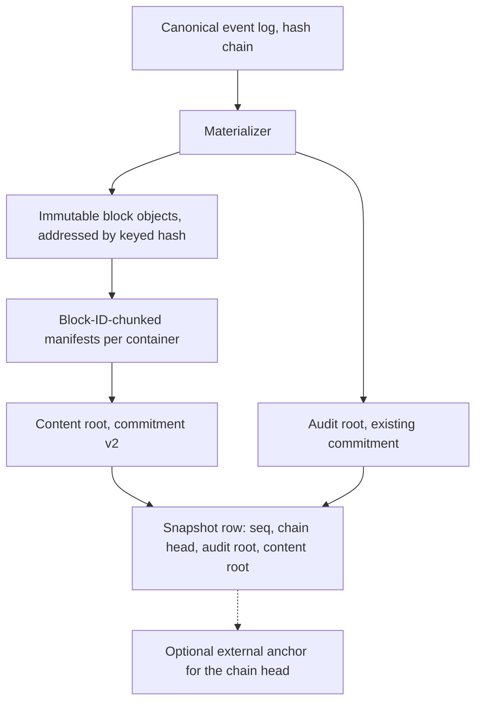

# Rich-text block versioning: literature review and architecture verdict

> Implementation update, 10 October 2026: [shared checkpoints v1](SHARED-CHECKPOINTS.md)
> now implement opt-in object reuse using stable-key radix maps. Default snapshots
> still use full JSON. The dated research assessment below predates that increment;
> the [evolution plan](ENGINE-EVOLUTION-PLAN.md) controls current product priorities.

Reviewed 23 September 2026. Part II (sections 16 to 21) was added the same day after further owner discussion of the non-CRDT stance, offline editing in Word and Excel, and the identity-carrier problem. A second pass added sections 19.6 and 19.7 (manifest-first reconciliation, content-control locking, and a calibration-first experiment) and revised the earlier passages they supersede.

Part I answers four questions from the owner. Is the block-based direction sound? What research and open-source work already covers the same ground? Which structures and algorithms fit formatting, provenance, conflict preservation, compression and speed? Does any platform already do what Dynodoc intends?

It builds on [RICH-TEXT-VERSIONING-RESEARCH.md](RICH-TEXT-VERSIONING-RESEARCH.md), [VERSIONING-CONFORMANCE.md](VERSIONING-CONFORMANCE.md) and [HANDOFF.md](HANDOFF.md) rather than repeating them. Sources already covered there (Peritext, Quill Delta, WordprocessingML runs, Yjs, Automerge's binary format, Upwelling, Dolt prolly trees, PROV-O) are only revisited where this review adds something. It changes no code and does not add a product capability.

The office-suite build decision (fork LibreOffice or not), the editor effort estimate, and the product/acquisition strategy are treated separately in [PLATFORM-AND-STRATEGY-REVIEW.md](PLATFORM-AND-STRATEGY-REVIEW.md). That review reframes the editor scope from authoring parity to rendering, diffing and review, which changes the priority of several items in section 14.

Open questions, experiments, facts to re-verify and unvalidated assumptions raised by this review are tracked in the [open research register](OPEN-RESEARCH-REGISTER.md).

---

# Part I. Blocks, formatting, history, compression and machine learning

## 1. Summary and verdict

The direction is sound, and it is older than it looks. The closest academic statement of the idea is Ignat and Norrie's *multi-level editing* (ETH Zurich, 2006 to 2008). They represent a document as a tree, keep each editing operation attached to the node it touches, apply any linear merge algorithm recursively level by level, and let the conflict unit be chosen per level (document, paragraph, sentence, word). Rönnau and Borghoff then applied state-based diff and merge with context fingerprints specifically to OpenDocument and Office Open XML files (2008 to 2012). Dynodoc's engine is a modern, audit-grade member of this family: stable identity, semantic events, a hash chain and review before canonical acceptance.

Three parts of the proposal need adjusting rather than adopting as stated.

**Segmenting "by the largest area with the same formatting" is already solved, and it should not define blocks.** The partition of text into maximal same-format runs is unique, has the minimum possible number of runs, and is found in one linear pass. The engine already does this; the recorded benchmark classifies 3,936,000 scalars in 32.86 ms. Parsing (53.68 ms) costs more than segmentation. Runs are an encoding. If they became units of identity or history, bolding one word would split a passage into three "new" objects that nobody wrote.

**"A Merkle tree for history" merges two different trees.** The *content tree* (blocks inside containers) should become a content-addressed Merkle DAG so snapshots share unchanged blocks and comparisons skip equal subtrees. The *version history* is a separate structure: a linear hash chain today, which suits one authority, and a commit DAG only if portable or offline histories arrive. The current snapshot Merkle root is a commitment, not a stored structure, so today's snapshots share nothing with each other.

**Compression effort should target snapshots and full-state work, not events.** One recorded formatting patch was 302 bytes against 9,924 bytes of full content. The production VPS held 557 events at the 22 September release. The measurable waste is duplicated full JSONB snapshots, browser full-state serialization and diffing, and JSON parsing.

Machine learning helps with aligning externally edited files, inferring semantic roles from presentational formatting, classifying edit intent and assisting reviewers. It is the wrong tool for identity, hashing, run segmentation or compressing the canonical archive.

No single shipping product found in this review combines what Dynodoc does. The nearest are Lix (open source, 0.x, claims semantic change control with branches for DOCX and XLSX), Simul Docs (commercial Word version control by comparing saved files), Ink & Switch's Upwelling and Patchwork (research prototypes) and the European Commission's LEOS (legislative drafting on Akoma Ntoso XML). The algorithms are mature. The integration for audit-grade, review-gated, mixed-script document work is where Dynodoc is distinctive, and where it could publish.

| Owner proposal | Verdict | Adjustment |
|---|---|---|
| Rich text as blocks, block-based editing | Right track | Keep blocks structural (paragraph, heading, list item, cell, row). Add split and join lineage so provenance survives Enter and Backspace (section 5.4). |
| Tree-based history with a Merkle tree | Partly right | Separate the content tree (content-addressed Merkle DAG, chunked by block ID) from the version history (hash chain now, commit DAG later). Section 7. |
| Segment blocks by the largest same-format area | Already optimal; not an identity rule | Keep maximal runs as a derived encoding. Evaluate mark spans (Peritext model) for formatting operations. Section 6. |
| Call formatting "block metadata or paradata" | Rename | "Block properties" and "inline marks" for formatting. Reserve "paradata" for authoring process data (who, when, session, tool path). Section 6.5. |
| A compression algorithm for heavy blocks | Right goal, different target | Content-addressed snapshots first; LZ4 TOAST for large values; dictionary zstd or columnar segments only when event volume justifies them. Section 10. |
| Machine learning instead of strict algorithms | Beside, not instead | Deterministic core; ML only in derived, reviewable layers. Section 11. |

**Part II in brief.** Dynodoc is not and should not become a CRDT system. It is server-ordered, optimistic-concurrency version control with human review, and the literature supports that stance for a single authority. Three results from the CRDT literature still apply as *merge rules and acceptance tests* rather than as a runtime: maximal non-interleaving (Fugue), Peritext's mark-boundary behavior, and cycle-free tree moves. Offline editing in Word or Excel does not reopen the decision, provided a re-upload becomes a reviewed proposal against a recorded base; the theory for this is bidirectional transformation ("matching lenses"), and contract platforms and Dynamics 365 already ship versions of it. There is no single reliable identity carrier inside a DOCX file. Word has been reported to replace paragraph IDs written by other tools on its first save, inline custom XML markup has been removed from Word since 2010, and even Zotero, after years of work, uses a different carrier per word processor. The stronger design, borrowed from the skeleton files of localization tools, does not ask the file to carry block identity at all: keep a manifest of what was sent, carry only the export ID redundantly, and diff the returned file against the manifest using a deliberately lossy reconciliation hash that is kept separate from the canonical hash. Locked content controls and a Word add-in are optional fidelity upgrades. Sections 16 to 21 give the evidence and the design; section 19.6 states the manifest-first approach and 19.7 the calibration to run first.

---

## 2. Method and evidence limits

About twenty targeted searches covered ACM, IEEE, arXiv, ACL Anthology, project documentation, crate registries and vendor pages. Venues and dates were confirmed from publisher, repository or bibliographic pages for the works marked *(verified)* in section 22. Part II added about a dozen further searches on Office identity carriers, round-trip products, bidirectional transformations, tamper-evident logging and interleaving. Classic references marked *(background)* come from prior knowledge and should be checked against the publisher before academic citation.

No benchmarks were run for this review. Dynodoc figures come from the recorded benchmark and release notes. Figures for other systems are those systems' own reports, not reproductions. Product capabilities come from vendor documentation and were not tested. The worked storage example in section 10.3 is arithmetic under stated assumptions, not a measurement.

---

## 3. Baseline: what the engine already does

This is summarized from the handoff so the recommendations below have a fixed reference point.

| Concern | Current implementation |
|---|---|
| Identity | ULID per structural node; spreadsheet cells are fields of stable row nodes. Nested patch paths are relative to a checked base, not permanent nested IDs. |
| Formatting | Runs coalesced so no two adjacent runs share an equal descriptor; descriptors interned per patch; unknown properties preserved. |
| Deltas | `RichTextPatch` v1: `Retain(count, style?)`, `Delete`, `Insert` over Unicode scalars, with before and after hashes, Myers alignment under a 20 ms deadline, full-field fallback when a delta is not smaller or not exact. |
| Merge | Stable-ID three-way comparison; disjoint ranges inside a paragraph combine; independent mark types combine; overlaps, boundary insertions, delete-versus-reformat and nested structural edits go to review. |
| History | Append-only events enforced by trigger; linear chain, genesis of 32 zero bytes; length-framed canonical content and actor feed SHA-256. |
| Snapshots | Full JSONB state plus a Merkle root over ordered node hashes including tombstones, with separate leaf and internal prefixes. Not content-addressed, no shared subtrees. |
| Provenance | `/structure` projection: block IDs, kinds, content hashes, run statistics and latest actor per targeted node. No range-level blame. |

---

## 4. The problem, decomposed

The owner named four challenges: detecting formatting, preserving it, provenance under multiple editors, and preserving conflicting edits. Six more sit beside them. Each row points to the section that treats it.

| Sub-problem | Question it asks | Section |
|---|---|---|
| Structure and identity | What is the unit that keeps an ID across edits? | 5 |
| Formatting representation | How are bold, style, color and heading level stored, compared and changed? | 6 |
| Detection and ingest | How is formatting read reliably from DOCX, paste and the editor? | 6.4, 12 |
| Preservation | What survives round trips, including unknown properties? | 6.6, 12 |
| Provenance | Who wrote this passage, through which tool, and when? | 8 |
| Conflict preservation | How are both sides of a disagreement kept, reviewed and recorded? | 9 |
| History and verification structures | How are versions stored, compared and proven untampered? | 7 |
| Storage | Where do the bytes go, and how are they reduced? | 10 |
| Speed | Where do the milliseconds go? | 10.1 |
| Governance | Erasure, schema evolution, access-scoped deduplication | 12 |

---

## 5. Blocks: the research lineage and the one design fork

### 5.1 Multi-level editing

Ignat and Norrie model a document as a hierarchy (document, paragraph, sentence, word, character) and log each operation against the node it refers to. Merging applies an ordinary linear algorithm recursively down the levels. Two consequences matter for Dynodoc.

First, conflict granularity becomes a policy rather than an accident of storage. Git treats two changes on one line as a conflict regardless of meaning; multi-level editing lets a team say "two edits in the same sentence need review, edits in different sentences of one paragraph merge." Dynodoc currently jumps from block level to scalar-range level. A sentence-level review policy between them is cheap to add and fits legal, policy and consent texts, where two disjoint edits inside one sentence can still change its meaning together.

Second, keeping operations attached to nodes makes awareness and attribution per unit natural, and the authors report efficiency gains over linear document representations. Dynodoc's per-block event targeting already has this property.

### 5.2 Structured-document diff and merge before CRDTs

The XML era solved much of the state-based problem, meaning diff and merge between versions without an operation log:

- Chawathe, Rajaraman, Garcia-Molina and Widom (SIGMOD 1996) defined change detection for hierarchical data with move operations. *(background)*
- XyDiff (Cobéna, Abiteboul and Marian, ICDE 2002) and X-Diff (Wang, DeWitt and Cai, ICDE 2003) gave practical XML diff. *(background)*
- Lindholm's DocEng 2004 paper derived merge rules from use cases, built a three-way XML merge and classified the conflicts it produces. *(verified via citation listing)*
- Rönnau, Pauli and Borghoff (DocEng 2008) merged XML versions with context fingerprints; Rönnau and Borghoff extended this to extracting tracked changes from office documents (Multimedia Tools and Applications, 2009) and to the XCC change-control framework (2012). Rönnau's dissertation is a full state-based diff/patch/merge framework. *(verified)*
- The ACM Symposium on Document Engineering ran a dedicated DChanges workshop on document change, which is the natural venue for Dynodoc results. *(verified)*

The lesson from this work: without stable IDs, state-based merge depends on matching heuristics (fingerprints, edit scripts, tree edit distance) that can mismatch. With stable IDs, matching becomes linear. Volume II made the same argument formally; the XML literature is its empirical history. Khanna, Kunal and Pierce's formal study of diff3 (FSTTCS 2007) is a useful caution that familiar merge tools satisfy fewer algebraic properties than people assume, which supports the handoff's refusal to claim properties that have not been tested. *(verified via citation listing)*

### 5.3 A modern analogue: Jupyter cell IDs

Notebooks hit the same wall. Cells had no identity, so version-control diffs were noisy and applications invented incompatible private ID schemes. Jupyter Enhancement Proposal 62 made a cell `id` a required field from nbformat 4.5. The notebook diff tool nbdime then added ID-aware matching in passes: strict matching requires equal IDs; later, looser passes let an ID-less cell match a cell that has one, so histories that predate IDs still align. *(verified)*

That multi-pass pattern transfers directly to re-importing Word files edited outside Dynodoc (section 11.2).

### 5.4 The design fork: tree of blocks or flat text with block markers

Automerge chose differently. Its rich text is a single character sequence with block markers inserted inline and formatting spans laid over the whole sequence; a marker is a map whose `parents` list encodes nesting. The Automerge team argues that rich text does not map cleanly onto a tree for merging purposes. *(verified)*

| Property | Tree of blocks (Dynodoc, ProseMirror, Fluid SharedTree) | Flat text with markers (Automerge) |
|---|---|---|
| Split a paragraph with Enter | A new node is created; text moves between node IDs | A marker is inserted; every character keeps its ID |
| Join with Backspace | One node absorbs another; the absorbed ID ends | A marker is deleted |
| Cross-paragraph selection or comment | Spans several nodes | One range |
| Block move, block permission, block review | Natural node operations | Range operations over markers |
| Questionnaire items, spreadsheet rows, tables | Natural | Awkward |
| Cost of an edit | Proportional to the block | Proportional to the change, with sequence metadata |

Dynodoc should keep the tree. Review, permissions, questionnaires and spreadsheets all rely on it. The tree's weakness is continuity across split and join, and it is fixable: record lineage.

```text
BlockSplit  { source: NodeId, created: NodeId, at_scalar: u32 }
BlockJoined { kept: NodeId, absorbed: NodeId, at_scalar: u32 }
```

These can be dedicated events or metadata on the existing structural events. Either way, blame and provenance marks (section 8) can follow text from the absorbed or split node instead of restarting attribution. If a CRDT layer is adopted later, map each block to a tree node holding a rich-text container (Loro offers a movable tree and a rich-text type), rather than flattening the whole document into one sequence.

---

## 6. Formatting: runs, marks and what to call them

### 6.1 The maximal-run partition is optimal and linear

Let a container's text be scalars `t1 ... tn`, each with an interned style `s(i)`. A partition into intervals is valid if every interval has one style. Any valid partition must place a boundary wherever `s(i) != s(i+1)`. The maximal-run partition places boundaries exactly there and nowhere else, so it has the minimum number of intervals and is unique. It is computed in one pass with `n - 1` comparisons, each constant time once styles are interned as integers.

So there is no better segmentation algorithm to find. The engine's invariant "no adjacent equivalent descriptors after coalescing" is this partition. The speed question moves elsewhere: in the recorded benchmark, parsing JSON took longer than classifying and interning the whole tree, and the handoff lists browser full-state serialization and diffing as the larger remaining costs.

### 6.2 Runs are an encoding, not identity

Bold one word in the middle of a run and one run becomes three. Unbold it and they coalesce back. If runs carried IDs or history, the record would show passages created and destroyed that nobody wrote. The handoff already forbids treating run boundaries as identity. This review agrees, and adds that the same holds for "blocks segmented by formatting": structure, not presentation, decides block boundaries.

### 6.3 Two ways to store formatting changes

| Aspect | Attribute per run (Quill Delta, OOXML `w:r`, `RichTextPatch` v1) | Mark spans (Peritext, Automerge, Loro) |
|---|---|---|
| "Bold this sentence" crossing five runs | Retains with new style references across five runs | One operation: `Mark{range, name, value}` |
| Intent visible in history | Inferred from style changes | Explicit ("bolded", "linked") |
| Overlapping marks (link crossing a bold boundary) | Split into many runs | Native |
| Typing at a boundary (does bold extend? does a link?) | Editor convention | Declared per mark: Automerge's `expand` option, Peritext's rules |
| Concurrent insert inside a reformatted range | Needs review (current policy) | Defined merge semantics in a CRDT |
| Rendering | Direct | Runs materialized from spans |
| Fit with a future CRDT layer | Needs translation | Direct |

A version-2 patch operation, `Mark{path, start, end, name, value, expand}`, would record formatting intent in one small event, make diffs read as intent, and align storage with the Peritext family if stage 20 is revived. Runs remain the materialized view and a good snapshot encoding. For the centralized, review-gated merge that exists today, v1 is adequate; v2 is an upgrade path, not a correction.

ProseMirror already emits intent-level steps (`ReplaceStep`, `ReplaceAroundStep`, `AddMarkStep`, `RemoveMarkStep`, `AttrStep`). Capturing these steps on the client and mapping them to engine operations would give mark operations for free and remove Myers from ordinary local editing. Myers would stay for imports and external states.

### 6.4 Three levels of formatting

Word resolves formatting through a chain: named style, then paragraph properties, then run properties, then direct overrides. The same layering suits Dynodoc:

1. A **document style table** of named descriptors (Heading 2, Quote, a house style), persisted at document level rather than only inside each patch.
2. **Block properties**: kind, heading level, alignment, list type, direction, a reference to a named style.
3. **Inline marks**: bold, italic, link, color, font, each with a value.

Persisting the style table gives dictionary compression across the whole history, and it turns "change the Heading 2 font" into one event instead of one per heading. The diff view then has to present that as a style change, not as hundreds of block edits.

### 6.5 Terminology: "block metadata" yes, "paradata" no

In survey methodology, *paradata* means data about the process of collecting data: keystrokes, timings, device, navigation. Couper introduced the term in 1998 and Kreuter's 2013 volume consolidated its analytic uses. *(background)* Formatting is not paradata. It is presentation, and the standard names are *block properties* (or node attributes) and *inline marks*.

The word fits something else Dynodoc records or could record: *authoring paradata*, meaning editing session, duration, device, and tool path (typed, pasted, imported from DOCX, accepted from a suggestion, generated by an AI assistant). Word stores a version of this itself: revision save IDs (`w:rsidR` and related attributes) mark which editing session last touched each paragraph and run. *(verified)*

Keeping three layers apart is worth writing into the model: **content** (text and structure), **presentation** (properties and marks) and **paradata** (process). Paradata is behavioral personal data. It should stay outside the content hash preimage, carry its own retention and consent rules, and never be required to replay content.

### 6.6 Canonical form for hashing and equality

Two representations of the same visible formatting should hash equally where the difference carries no meaning:

- **Mark order.** The research record notes that distinct mark orders are not treated as identical. ProseMirror orders marks by schema rank, but DOCX import or other adapters may not. Sort mark sets by a fixed rank at every adapter boundary so imports and editor output agree.
- **Unicode.** The engine correctly never rewrites user text. For matching, alignment and deduplication, derive a normalized shadow key and keep original bytes as canonical content. Bengali needs more than NFC: `য়` has a precomposed code point (U+09DF) that normalizes to U+09AF U+09BC, and khanda ta has both U+09CE and an older sequence using hasanta and zero-width joiner that NFC does not unify. The normalizer released with BanglaBERT (csebuetnlp) is a starting point for a Bengali matching key.
- **Grapheme boundaries.** Scalar offsets can fall inside a Bengali conjunct. The editor and adapters should snap formatting and selection boundaries to extended grapheme clusters (Unicode UAX #29) so a mark never splits a conjunct.

---

## 7. History and verification structures

### 7.1 Two trees, not one

| Tree | What it holds | Purpose | Current state |
|---|---|---|---|
| Content tree | Blocks inside containers at one version | Equality, diff, deduplication, inclusion proofs | Full JSONB per snapshot; one Merkle root, no stored internal nodes |
| Version history | Which version came from which, by whom | Audit, restore, branch and merge | Linear hash chain; drafts via stored bases |

The owner's "tree-based history with a Merkle tree" is really a proposal about the first tree. The second is already a chain, which is the correct shape for a single authority.

### 7.2 What the current snapshot root can and cannot do

A Merkle root proves integrity and supports inclusion proofs. It does not share storage unless the internal nodes are stored and addressed by hash, and today they are not.

Whether a stored version of the same tree would share well depends on leaf order, which should be checked in `snapshot.rs`. If leaves follow document position, one insertion re-pairs every later leaf and almost every internal hash changes. If leaves follow ULID order with tombstones retained, as the stage 15 specification described, new nodes mostly append on the right and existing positions stay put, so sharing would be good for appends and edits. Either way, tombstones in the leaf set mean two drafts with identical visible content can have different roots. That is correct for an audit commitment and wrong for a content-equality test.

The recommendation is therefore to keep the existing commitment unchanged as the **audit root**, and add a separate **content root** designed for sharing and comparison.

### 7.3 Candidate structures

| Structure | What it offers | Limits | Fit for Dynodoc |
|---|---|---|---|
| Git-style tree objects (container hash over its children list) | Simple, content-addressed, shares unchanged containers | Large flat containers rehash every child entry on each change | Good base; needs chunking for 8,000-block containers |
| Prolly trees (Noms, Dolt) | Content-defined chunk boundaries; history-independent shape; fast diff | Designed around key-sorted maps | Idea applies; key choice differs (7.4) |
| Merkle Search Trees (Auvolat and Taïani, SRDS 2019; used in the AT Protocol repository format) | Key-ordered, levels chosen by key hash; efficient reconciliation; Rust crate reports microsecond diffs on 100,000 keys | Ordered by key, not document position | Good for per-document indexes (blocks by ID), not for document order |
| Merkle-CRDTs (Sanjuán and others, 2020) | Merkle DAG of operations as a logical clock for replication | Aimed at decentralized networks | Relevant only if peer or offline replication arrives |
| Persistent in-memory trees (HAMT, RRB vectors) | Structural sharing in memory | Not hash-verified by default | Useful in the materializer, not for storage proofs |
| Event graph (Eg-walker, EuroSys 2025) | Stores original operations as a DAG; builds CRDT state only while merging concurrent branches; fast loading, long-branch merges | Published for plain text; the authors name rich text as a possible extension | Validates Volume II's "seal on close" pattern; reference for any future offline history |

### 7.4 Proposal: a block-ID-chunked content tree

For each container (document root, table, list, cell), keep its ordered children as a chunked Merkle sequence whose boundaries depend only on block IDs:

```text
leaf(block)      = H(0x00 || canonical(properties, marks or runs, child_root))
entry(block)     = (block_id, leaf(block))
boundary(id, L)  = low_k_bits(H(0x03 || L || id)) == 0     // expected chunk size 2^k at level L
chunk(entries)   = H(0x01 || encode(entries))
next level       = chunk the list of (first_block_id, chunk_hash) with boundary(., L+1)
content_root     = the single remaining hash; empty container = H(0x01 || [])
```

Nested containers put their own root into their parent's leaf, so the structure is a Merkle DAG that mirrors the document tree.

The useful properties follow from IDs being stable while content changes:

- A content-only edit never moves a boundary. It rewrites one leaf entry and the hashes on its path: logarithmic in the container size.
- Inserting or deleting a block changes its own chunk, occasionally merging or splitting with a neighbor, plus the path above.
- The shape depends only on the current ID sequence, so two drafts with the same visible content produce the same root. Equality is one comparison; a diff descends only into differing chunks.
- Chunks and blocks become immutable objects addressed by hash, so snapshots share everything that did not change.

Two cautions. Keep this as an additional, versioned commitment (`content_commitment_version = 2`) and do not alter existing snapshots or the audit root. And content-addressed deduplication across documents with different permissions is a known side channel: whether an upload deduplicates can reveal that identical content exists elsewhere (Harnik, Pinkas and Shulman-Peleg, IEEE Security and Privacy, 2010). *(background)* Scope deduplication to a document or organization, and address stored objects with a keyed hash (HMAC with a tenant key) while public commitments keep plain SHA-256.

This proposal has not been benchmarked. Section 10.3 estimates its effect.



### 7.5 The version history

Keep the linear chain for canonical history. Drafts already store their base. If portable histories, offline replicas or draft-to-draft review arrive, the natural next structure is a commit DAG where each commit hashes its parents, its content root, the event range it covers, its actor and time. Eg-walker shows that an operation DAG can load quickly and merge long branches. The gap the handoff already names still stands: without an externally anchored head (a signed head, an RFC 3161 timestamp or a transparency log), a privileged operator can rewrite the whole chain.

---

## 8. Provenance

| Approach | How it works | Strength | Cost or limit | Use in Dynodoc |
|---|---|---|---|---|
| Event attribution (current) | Each event carries an authenticated actor | Authoritative, auditable | Block granularity for "who changed this" | Keep as the authority |
| Provenance marks | A non-rendered mark such as `{author, event_seq}` rides along with text through edits, run-length encoded | Range-level blame at read time; reuses mark machinery | More marks per block; must follow split and join | Recommended next step. Etherpad's changesets carry authorship as a text attribute in an attribute pool, a long-running precedent *(background)* |
| Character IDs in a CRDT | Each inserted character's ID includes its author (Yjs, Loro, Automerge) | Attribution comes free in a live layer | Needs the CRDT layer; per-character metadata, compressed by run-length encoding | Only if stage 20 is revived |
| Post-hoc attribution (WikiWho) | Splits each revision into paragraphs, sentences and tokens and tracks their hashes through all revisions | Works on histories that have no event log; authors report 95 percent accuracy on revision-rich English Wikipedia articles; a Rust reimplementation processes a German Wiktionary dump in under four minutes on eight cores | Needs tokenization rules per language | For imported version series (a folder of DOCX drafts) and for evaluation |

Three details matter for Bangladesh and research teams:

- WikiWho's tokenizer was built for Wikitext. Bengali needs its own sentence rule (the danda, U+0964, ends a sentence) and word segmentation before it can be used.
- Dynodoc holds something rare: ground-truth provenance from authenticated events. That allows a real evaluation of post-hoc attribution methods on formatted, mixed-script documents, which is a publishable study (section 13).
- Imported author names from Word comments or revisions are source-file claims. The handoff already keeps them distinct from verified actors; provenance marks must carry that distinction too.

Tool-path paradata (typed, pasted, imported, suggested, AI-generated) is becoming the provenance question institutions ask most often. Record it as event metadata outside the content hash, as section 6.5 describes.

---

## 9. Preserving conflicting edits

The current policy surfaces overlaps for review instead of guessing. For audit and policy documents this is the right default. Automerge, by contrast, resolves same-name mark conflicts to a consistent but arbitrary value, which suits live collaboration but not legal or research records. *(verified)* Four refinements follow from the literature.

1. **Make pending conflicts first-class objects.** Store all candidate values in the conflict record (the multi-value register idea) so a draft can be shared while a conflict is pending, and record the resolution as an event that references its candidates. Nothing a person wrote is lost even if it is not chosen.
2. **Offer conflict granularity as policy.** Following Ignat and Norrie: block, sentence or range. Sentence-level review suits consent forms, policy clauses and legislation.
3. **Keep structural edits conservative.** Concurrent list or table restructuring already goes to review. The XML merge literature shows that move detection without IDs produces mismatches; with IDs, record moves explicitly rather than inferring them.
4. **Flag semantic conflicts.** Two edits can each be valid and still contradict each other ("shall" changed to "may" in one clause while another branch adds an exception that assumes "shall"). No structural algorithm detects this. A model can flag candidates for the reviewer (section 11), never decide them.

---

## 10. Compression and speed

### 10.1 Where the bytes and milliseconds go

| Evidence | Implication |
|---|---|
| A long-paragraph formatting patch was 302 bytes against 9,924 bytes of content | Event payloads are already compact |
| 557 events on the production VPS at the 22 September release | Event storage is not a current constraint |
| Parse 53.68 ms versus classify and intern 32.86 ms on the 8,000-block fixture | Parsing and serialization, not segmentation, dominate engine time |
| Handoff: browser full-state save and diff, snapshot duplication, large JSON responses, worker memory | These are the remaining costs to attack |
| PostgreSQL compresses a value through TOAST only when a row exceeds about 2 kB | Small events are stored uncompressed whatever the setting; large snapshots are compressed |

### 10.2 Techniques, in recommended order

| Order | Technique | Targets | Effect | Cost |
|---|---|---|---|---|
| 1 | Content-addressed blocks and block-ID-chunked manifests (section 7.4) | Snapshots | Snapshot size proportional to change, not document size; diff proportional to changed chunks | Medium |
| 2 | LZ4 column compression for large JSONB (snapshots, large block objects) | Large values | Faster and usually smaller than the default pglz; available since PostgreSQL 14; set per column; existing rows keep old compression until rewritten; a recent development-branch commit makes LZ4 the default where built in | Low |
| 3 | Capture ProseMirror steps as operations | Browser save, server diff | Removes full-state serialization and Myers from ordinary typing; records intent | Medium |
| 4 | Faster parsing (SIMD JSON parsers such as `sonic-rs` or `simd-json`) or a binary snapshot encoding | Engine parse time | Measure against the 53.68 ms baseline before adopting | Low to medium |
| 5 | Binary IDs | Row and index size | A ULID is 16 bytes in binary against 26 characters of text; inside compressed segments, map IDs to per-document small integers (Fluid Framework's ID compressor is a precedent) | Migration |
| 6 | zstd with trained dictionaries for cold event segments | Many small, similar JSON records | Dictionary training is designed for exactly this case; one dictionary per event type and schema version | Medium; interacts with the append-only trigger |
| 7 | Columnar operation-log encoding (Automerge binary format as reference) | Long histories, export and sync format | Highest ratios through run-length, delta and dictionary columns | High |
| 8 | Ropes or B-tree ropes (`ropey`, `crop`, `jumprope`) | Editing inside very large text containers | Only matters if 100,000-scalar blocks become common | Low |

### 10.3 Worked example (arithmetic, not measurement)

Assume the benchmark document (8,000 blocks, 6,030,116 JSON bytes, so about 754 bytes per block), 100 snapshots, and 1 percent of blocks (80) changed between consecutive snapshots. Storage before any byte-level compression:

| Design | First snapshot | Each later snapshot | Total for 100 |
|---|---|---|---|
| Full JSONB (current) | 6.03 MB | 6.03 MB | about 603 MB |
| Content-addressed blocks, flat manifest (8,000 entries of 16-byte ID plus 32-byte hash, 384 kB) | 6.4 MB | 60 kB of new blocks plus 384 kB manifest | about 50 MB |
| Content-addressed blocks, chunked manifest (expected 64 entries per chunk, about 125 chunks of 3 kB) with the 80 changes clustered in 5 chunks | 6.4 MB | 60 kB plus 15 kB plus about 6 kB | about 14 MB |
| Same, with the 80 changes scattered across 80 chunks | 6.4 MB | 60 kB plus 240 kB plus about 6 kB | about 37 MB |

Comparison cost follows the same pattern: a flat manifest compares 8,000 entries; the chunked tree compares 125 top-level entries and then descends into changed chunks only. Real edits cluster (people revise a section at a time), which favors the chunked design. These figures illustrate direction and scale; representative editing traces must decide the chunk size.

### 10.4 Two rules that keep compression safe

**Separate the hash preimage from the storage encoding.** The chain already hashes length-framed canonical content, so the storage encoding can change freely, provided decoding reproduces identical canonical bytes. Before switching any encoding, run a property test that decodes every historical event and recomputes every content and chain hash.

**A codec is part of the archive.** A lost zstd dictionary makes history unreadable. Store dictionaries immutably with their own hashes, reference them by ID from each segment, and include them in backups and in the reproducibility kit. Moving old events into compressed segments also collides with the append-only trigger. Treat it like erasure: a governed, audited maintenance procedure (for example detaching a verified partition after writing and re-verifying its archive), never a quiet relaxation of the trigger.

---

## 11. Machine learning: where it belongs

### 11.1 Principle

The canonical path (identity, hashing, event encoding, replay, storage) must be deterministic, fast, auditable and readable in twenty years without a model. Learned methods belong in derived layers whose outputs are suggestions a person can inspect, accept or ignore.

| Task | Use ML? | Reason | Approach |
|---|---|---|---|
| Run segmentation | No | The exact linear algorithm is optimal (6.1) | Keep coalescing |
| Block identity and hashing | No | Must be deterministic and auditable | ULIDs, SHA-256 |
| Compressing the canonical archive | No | Neural compressors run a model per token, need bit-exact probabilities on every machine for arithmetic decoding, and make model weights a permanent dependency of the archive. DeepMind showed language models can be strong compressors (ICLR 2024); later work documents non-determinism and prediction mismatch as practical obstacles | zstd, dictionaries, columnar encoding |
| Re-identifying blocks in externally edited DOCX | Yes, as the last tier | Word may drop IDs; text is paraphrased | Section 11.2 |
| Inferring headings and semantic roles from formatting | Yes | People format headings as bold 14 pt instead of using styles | Rules plus a small classifier on DOCX features; layout models trained on DocLayNet (KDD 2022) or tools such as GROBID for PDFs |
| Edit-intent labels for review triage | Yes | Reviewers want "meaning changed" separated from "fluency" | IteraTeR taxonomy and corpus (ACL 2022); Bengali needs its own labeled data |
| Change summaries in history | Yes, labeled as generated | Readable version notes | LLM summary linked to the underlying events |
| Conflict resolution suggestions | Assistive only | Proposes a merged wording | LLM or learned model proposes; a person decides; record as a suggestion event (MergeBERT, ESEC/FSE 2022, is the code-merge analogue) |
| Move and paraphrase detection for provenance | Yes | Cut and paste across blocks breaks lineage | Embeddings combined with WikiWho-style token matching |
| Semantic conflict hints | Assistive only | Contradictions between individually valid edits | Natural-language inference or LLM flags |

### 11.2 Re-importing Word files edited outside Dynodoc

Word writes a per-paragraph `w14:paraId` and a `w14:textId` that changes when the paragraph's content changes. One open-source editor project audited a 100-page document and found 483 of 484 paragraph IDs survived a round trip; that is a single project's measurement, not a guarantee. *(verified)* That supports a tiered matcher in the nbdime style:

1. Exact `paraId` match to a stored source anchor (import must record each block's source `paraId`). Part II found that Word replaced every `paraId` written by an external tool on its first save and kept its own values afterwards, so this tier is dependable only for paragraph IDs that Word itself generated. Section 19 replaces this list with a fuller design.
2. `paraId` present but `textId` changed: same block, content edited; diff it.
3. Normalized content hash match (using the Bengali-aware key from 6.6).
4. Token-overlap similarity with positional alignment (longest increasing subsequence over matched pairs).
5. Multilingual embedding similarity with an assignment step (Hungarian algorithm), above a threshold.
6. Anything left becomes insert or delete, and every tier 4 or 5 match is shown for confirmation.

This is where ML earns its place: it recovers identity that the file format lost, and a person confirms it.

---

## 12. Challenges beyond the original list

| Challenge | Why it matters | Current status | Suggested handling |
|---|---|---|---|
| Split and join continuity | Enter and Backspace change node identity; blame restarts | Not recorded as lineage | `BlockSplit` and `BlockJoined` lineage (5.4) |
| Cut and paste across blocks | Text moves between nodes and looks new | Delete plus insert | Move detection at capture time from ProseMirror slices; fallback matching (11) |
| Mark boundary behavior | Typing after bold or a link: extend or not | Editor convention | Declare per mark (`expand`), as Automerge does |
| Overlapping marks | Links crossing bold ranges | Handled as runs | Native in mark spans (6.3) |
| Anchored objects | Comments, footnote references, equations, images must survive edits | Implemented with limits | Anchor to block ID plus stable range; test anchors across split, join and reformat |
| Canonical ordering | Different mark orders produce false diffs | Not unified | Sort at adapters (6.6) |
| Unicode and Bengali | Conjuncts, precomposed letters, khanda ta, ZWJ and ZWNJ | Scalars counted, no rewriting | Grapheme snapping; Bengali matching key (6.6) |
| Named style changes | One definition change affects many blocks | Styles interned per patch | Document-level style table; present as one change (6.4) |
| Schema evolution | Editor versions differ (`office-v4` gate) | Version gate | Upcasting readers; Ink and Switch's Cambria lenses as reference |
| Erasure versus append-only | Legal removal conflicts with immutable history | Whole-document erasure removes the chain | Consider crypto-shredding: encrypt content per document or per data subject, keep content and chain hashes, destroy the key; the chain stays structurally verifiable while content becomes unreadable |
| Cross-tenant deduplication | Reveals that identical content exists elsewhere | Not applicable yet | Scope and key the object store (7.4) |
| Diff presentation for formatting | Readers need "made bold" rather than a text diff | Partial | Intent-level operations (6.3); Neuwirth and colleagues' *flexible diffing* (CSCW 1992) on letting writers choose diff granularity *(background)* |
| Semantic conflicts | Valid edits that contradict | Not detected | ML hints for reviewers (11) |
| Paradata privacy | Behavioral data is personal data | Not separated | Separate layer, retention rules, outside hashes (6.5) |

---

## 13. Does anyone already do this?

| System | Type | What it does | Where it differs from Dynodoc |
|---|---|---|---|
| Upwelling (Ink and Switch) | Research prototype | Private drafts as lightweight branches for rich text, with attributed changes | Research only; no audit chain, no office or questionnaire interchange |
| Patchwork (Ink and Switch) | Research prototype, used internally | Version control for writers: lightweight branches, retroactive branches, diff visualization, a chat-like history; later ported to a diagram editor toward "universal version control" | Lab tooling; not a product |
| Lix (Opral) | Open-source SDK, 0.x | Claims tracking, review, branches, merge and rollback across Markdown, DOCX, XLSX, JSON and PDF at the level of the paragraph, cell or clause, with history queryable through SQL | Closest analogue. Maturity of its DOCX handling is unverified; no hash-chained audit or research-instrument semantics found |
| Simul Docs | Commercial Word add-on | Saves a version on each Word save, compares versions, branches, merges into Word tracked changes; vendor reports over 7,000 users | State-based file comparison; no stable block identity or tamper-evident log |
| Tiptap Snapshot Compare | Commercial editor extension | Compares Yjs snapshots and highlights changes with author attribution | Snapshots and compare; no branch-review workflow or audit chain; paid subscription |
| Juro | Commercial contract platform | A Word file uploaded against a Juro-created contract is compared with the current version and shown as reviewable suggestions; the contract locks during review; a Word plug-in keeps tracked changes | Closest commercial analogue of the offline round trip (section 18); compares against the current version rather than the exported base; no stable block identity or audit chain found |
| Ironclad | Commercial contract platform | Imports counterparty redlines returned by email and supports accept or reject in its editor | Contract-specific; no semantic event log or research interchange found |
| Google Docs, Microsoft Word | Commercial | Suggestion mode, track changes, version history, named versions | Ink and Switch's own framing: useful but limited next to software version control; no branch and merge |
| Loro | Open-source library (Rust, JS, Swift) | Fugue text, Peritext-like rich text, movable tree, version control, time travel, shallow snapshots | A foundation, not an application; no office interchange or governance layer |
| Automerge | Open-source library | Rich text with marks and block markers, forks and merges, ProseMirror binding | A foundation; flat-text model (5.4) |
| Fluid Framework SharedTree | Open-source framework (Microsoft) | Beta branch, merge and rebase APIs on a shared tree; history rewind added in 2026 | A framework; no rich-text document product in scope |
| LEOS | Open-source government software (European Commission, EUPL) | Legislative drafting with comments, suggestions, version control and co-editing on Akoma Ntoso XML | Domain-specific and deliberately restrictive in structure; relevant to the public consultation roadmap |

**What is not new.** Blocks with stable identity, hierarchical conflict granularity, XML-style structured merge, rich-text CRDTs, Merkle commitments and branching for writers are all established.

**What appears unoccupied.** No shipping product found combines an append-only, hash-chained semantic event log with stable block identity; review-gated personal drafts with three-way merge and conflict records; formatting-aware compact deltas; permissioned provenance; and interchange with DOCX, XLSX, XLSForm and REDCap for research and policy teams working in Bengali and English. This is a finding of this search, not proof that nobody has built it privately.

**Publishable studies Dynodoc is well placed to run:**

1. Conflict rates and reviewer effort at block, sentence and range granularity on real research-team documents. Venues: ACM DocEng (DChanges), CSCW.
2. Storage and load time for event log plus content-addressed snapshots against Automerge and Loro encodings on the same editing traces. Venue: PaPoC at EuroSys.
3. Post-hoc attribution accuracy (WikiWho-style and embedding-assisted) evaluated against Dynodoc's authenticated event provenance, including formatted and mixed-script text.
4. A Bengali and English rich-text versioning corpus covering grapheme, normalization and dialect pitfalls. Venues: the Bangla Language Processing workshop series, LREC.

---

## 14. Recommended sequence

Each step is bounded and carries its own evidence, in line with the handoff's P1 list.

| Step | Change | Acceptance evidence |
|---|---|---|
| 1 | Measure storage by table and column (events, snapshots, TOAST, indexes, WAL) on a representative corpus | Byte breakdown recorded next to the existing benchmarks |
| 2 | Check leaf ordering in `snapshot.rs`; document the audit root's exact definition | Written definition plus a test that pins it |
| 3 | Capture ProseMirror steps and map them to engine operations; keep Myers for imports | Browser save no longer serializes the full state; replay and hash tests unchanged; p50 and p95 save latency on large documents |
| 4 | LZ4 compression on large JSONB columns | Size and read-latency comparison before and after; rewrite plan for existing rows |
| 5 | Content-addressed block objects and block-ID-chunked content roots (commitment v2) alongside the audit root | Identical content roots for drafts with equal visible content; diff cost proportional to changed chunks; old snapshots untouched and still verify |
| 6 | Split and join lineage; provenance marks; canonical mark ordering at adapters | Blame survives Enter, Backspace, reformat and cut and paste in property tests including Bengali text |
| 7 | DOCX re-import alignment with stored `paraId` anchors and tiered matching | Precision and recall on a corpus of real externally edited documents; confirmation UI for fuzzy matches |
| 8 | Mark-span patch v2 and a merge-rule acceptance corpus drawn from the CRDT literature (no CRDT runtime; see section 16.3) | Adversarial concurrent formatting, same-position insertion and concurrent move cases either merge by the stated rule or are surfaced for review |
| 9 | Optional ML review aids (edit intent, summaries, conflict and semantic hints) in a derived service | Never on the canonical path; outputs labeled; opt-in; evaluated on Bengali and English |
| 10 | Decision record: Volume II's V1 and V2 layering was inverted in practice (section 16.5) | Record in `docs/decisions/`; Volume II annotated to point to it |
| 11 | Reconciliation-hash calibration, then the identity experiment (sections 19.7 and 19.5) | Untouched blocks match after Word desktop and Word for the web saves; collision profile known; carrier survival and recovery rates per editor recorded before the round-trip design is finalized |
| 12 | DOCX round trip as a reviewed proposal: export record, carriers, manifest, noise cancellation, tiered alignment, coverage report (sections 18 and 19) | An unedited round trip yields zero proposed changes; false block matches near zero on the experiment corpus; every unimportable change class listed to the reviewer |
| 13 | XLSX round trip with hidden row IDs and checksums (section 20) | Sort, insert, delete, copy and stale-row cases produce correct proposals |
| 14 | Signed tree heads over the event log and an auditor export bundle (section 17) | An external party verifies a document's history and consistency between two published heads without database access |
| 15 | Optional Word add-in for live paragraph tracking (section 19.3, layer F) | Round trips through the add-in recover identity at the highest tier on the experiment corpus |

---

## 15. Open-source components

Licenses marked "verify" were not confirmed in this review. Confirm every license and its obligations before adoption.

| Component | What it offers | Language | License | Possible use |
|---|---|---|---|---|
| Loro | Rich text, movable tree, Fugue, version control, shallow snapshots | Rust, JS, Swift | MIT (verify) | Merge-rule and benchmark reference; runtime only if a tripwire in 16.6 fires |
| Automerge | Rich text marks and block markers, forks, binary format | Rust, JS | MIT | Encoding and mark-rule reference; runtime only if a tripwire fires |
| Yjs | Shared types, ProseMirror binding, run-length item merging | JS | MIT | Reference only under the current stance |
| diamond-types and the Eg-walker artifact | Event-graph text editing | Rust | verify | History and merge research reference |
| Fluid Framework SharedTree | Tree with branch, merge and rebase; ID compressor | TypeScript | MIT | Design reference for tree branching |
| `merkle-search-tree` crate | Merkle Search Tree with diff | Rust | verify | Per-document block index |
| Dolt | Prolly trees for versioned data | Go | Apache 2.0 (verify) | Chunking design reference |
| zstd | Dictionary compression for small records | C, bindings in Rust | BSD or GPLv2 | Cold event segments |
| WikiWho and `wikiwho` crate | Token-level authorship across revisions | Python, Rust | MIT (Python); verify (Rust) | Post-hoc attribution, evaluation |
| nbdime | Structured diff and merge with ID-aware multi-pass matching | Python | verify | Matching design reference |
| Lix | Change control for many file formats | TypeScript, Rust | verify | Competitive benchmark; plugin ideas |
| LEOS | Legislative drafting on Akoma Ntoso | Java | EUPL 1.2 | Public consultation reference |
| `ropey`, `crop`, `jumprope` | Rope and B-tree text buffers | Rust | verify | Very large text containers |
| `sonic-rs`, `simd-json` | Fast JSON parsing | Rust | verify | Engine parse time |
| csebuetnlp normalizer | Bengali text normalization | Python | verify | Matching keys |

---

# Part II. Asynchronous, human-vetted versioning and offline round trips

## 16. Not a CRDT: what the literature says about this stance

### 16.1 The stance, stated precisely

Dynodoc has a single authority and a total order per document. A client sends a change together with the base it was made against; the server checks that base, appends and broadcasts; a stale base is refused and the client refreshes. In the database literature this is optimistic concurrency control (Kung and Robinson, 1981): work proceeds without locks and is validated at commit. On the web the same pattern is a conditional request, where an `If-Match` precondition fails with status 412 once the resource has moved on (RFC 9110). *(background)*

A CRDT solves a different problem: reaching one state on replicas that have no referee. Its defining promise is that every concurrent pair of edits resolves automatically. Dynodoc makes the opposite promise for the pairs that matter: overlapping edits go to a person. Volume II already derived where that boundary lies. Typed operations on disjoint nodes commute without any library, and the pairs that do not commute are exactly the ones routed to review. The conflict surface is what the algebra predicts, not a limitation to apologize for.

### 16.2 Real-time visibility is not real-time convergence

The PRD's 100 ms target is about seeing committed events quickly. That is broadcast. Convergence is the harder property of merging edits made concurrently without coordination. Centralized editors separated the two long ago: the Jupiter system (Nichols and colleagues, UIST 1995) ordered edits through a server *(background)*, and the Eg-walker paper notes that Google Docs, Microsoft Office and Overleaf rely on server-based operational transformation *(verified)*. Dynodoc is simpler again, because it does not transform concurrent operations at all; it refuses stale ones or routes them to review. Writing this distinction into the architecture documents guards against building convergence machinery by accident.

### 16.3 Borrow the rules, not the runtime

Three CRDT results describe what a sensible merge must do whether or not a CRDT runs. They belong in Dynodoc as acceptance tests.

| Result | What it says | Dynodoc rule and test |
|---|---|---|
| Maximal non-interleaving (Weidner and Kleppmann, Fugue) | When two people independently insert passages at the same point, the merge must keep each passage whole and place one after the other, never intermixed character by character. The authors report that almost every CRDT and OT algorithm they surveyed interleaves. An earlier 2019 definition by Kleppmann and colleagues was later withdrawn by its authors as impossible for any algorithm to guarantee; use the Fugue definition. *(verified)* | Concurrent insertions at the same position already go to review, which satisfies the property trivially. If automatic ordering is ever added, a property test must show whole passages kept contiguous. |
| Peritext mark semantics | Whether typing at the edge of bold or a link extends the mark; what happens when text is inserted into a range that someone concurrently unformats; how overlapping marks combine. | Declare an `expand` rule per mark type. Test boundary insertion against concurrent unbolding, deletion of marked text and overlapping marks. Where a rule is ambiguous, surface for review. |
| Tree move (Kleppmann and colleagues, IEEE TPDS 2021) | Concurrent moves can create cycles; a move that would make a block its own ancestor must lose deterministically. | Concurrent moves of one block to different parents, and a move against a deletion of the destination's ancestor, become review conflicts. A merged result may never contain a cycle. |

Human review adds a fourth requirement. A reviewer can only vet what they can read, so the alignment behind a diff is a safety property, not a cosmetic one. Myers alignment minimizes edit count but can split words and pair unrelated fragments. Word or sentence tokenization before alignment, the semantic cleanup in Fraser's diff-match-patch library, and the histogram and patience algorithms (which Nugroho, Hata and Matsumoto found gave more meaningful diffs than Myers on code, EMSE 2020) are worth benchmarking on prose. *(background)*

### 16.4 Keep Git's concepts out of the interface

De Rosso and Jackson argued that Git is hard to learn because of its concepts, not only its commands (Onward! 2013). Their OOPSLA 2016 follow-up explained well-known difficulties as misfits between concepts and purposes, drew on about 2,400 Stack Overflow questions and a user study, and produced the Gitless redesign. *(verified)* Dynodoc's vocabulary table (personal draft, share changes, get latest) is a concept redesign in their sense. The research supports keeping it and not letting clone, remote or staging concepts back in through side doors.

### 16.5 Record the inversion of Volume II's layering

Volume II section D.3 presents the CmRDT convergence layer (L2) as the version-1 foundation and the merge engine (L1) as version 2. The build did the reverse: stage 20 was deferred and the three-way workspace merge ships. A decision record in `docs/decisions/` should state that the layering was inverted in practice and why: with a central authority, L2's guarantee was redundant, while L1's review semantics are the product. Volume II should link to it so new readers are not misled.

### 16.6 Tripwires that would reopen the decision

Three requirements would bring convergence machinery back, and they amount to one deferred decision rather than three: offline editing on field tablets that must merge without a referee; multi-cursor typing inside one paragraph (PRD non-goal NG8); and peer-to-peer or federated deployment in which institutions exchange edits as equals. Volume I already classed the CRDT layer as deferrable and additive, so declining it now costs nothing later.

---

## 17. No GitHub needed; the "remote" that matters is an auditor

Git combines a distributed storage model with a collaboration workflow. Most of what teams value in GitHub (pull requests, review threads, protected branches, blame views, permissions) was built on top of Git rather than inside it. Dynodoc implements that workflow directly on a central authority. The browser is a cache that can be discarded, not a replica that must be reconciled, and the stale-base check keeps it that way.

The one distributed-shaped requirement in Dynodoc's thesis is independent verification. The handoff already records that a privileged operator could rewrite the whole chain and its head. The literature addresses this exact threat:

- Kelsey and Schneier's work on secure audit logs (1999) established tamper-evident logging for forensics. *(verified via citation listing)*
- Crosby and Wallach (USENIX Security 2009) model an untrusted logger, including a malicious insider, kept honest by auditors. Their *history tree* is a Merkle tree over the append-only log that gives logarithmic-size proofs that an event is present and that today's log is consistent with an earlier commitment. They stress that tamper evidence only holds if commitments are actually audited, and often. *(verified)*
- Certificate Transparency (RFC 6962, revised as RFC 9162) turned the same structure into deployed infrastructure with signed tree heads, inclusion proofs and consistency proofs. *(background)*

A design that fits Dynodoc without replacing the chain: keep the linear chain; also maintain an append-only Merkle tree over event hashes in sequence order; sign a tree head periodically and at every `Deployed` event or named version; deliver heads to at least one party outside the operator (an auditor, a partner institution, a public transparency log or an RFC 3161 time-stamping service). An auditor export bundle then holds events, snapshots, signed heads and a verifier binary, and a third party can check inclusion and consistency without database access. This costs far less than any Git-style remote, and it is what makes the audit claim hold against an insider. It should come before anything remote-shaped on the roadmap.

---

## 18. Offline edits as reviewed proposals

### 18.1 The principle and its theory

Offline editing is safe when reconciliation is a *reviewed proposal against a recorded base*. What forces a CRDT is automatic merging, not being offline. A Word round trip is therefore a branch with a known base: the exported revision is the base, the returned file is the branch, the current team version is the other side, and the existing three-way merge applies.

The formal name for this is the view update problem, studied in programming languages as bidirectional transformation. A *lens* pairs a `get` (source to view) with a `put` (edited view plus remembered information back to an updated source). The remembered information, called the complement or residue, is whatever the view does not show. Barbosa, Cretin, Foster, Greenberg and Pierce's *matching lenses* (ICFP 2010) add the part Dynodoc needs: alignment. Before an edited view can be put back, its pieces must be matched to pieces of the source even after insertion, deletion and reordering; their framework makes the alignment strategy a parameter and states behavioral laws it must respect. *(verified)* Edit lenses (Hofmann, Pierce and Wagner, POPL 2012) and Ink and Switch's Cambria carry the idea to edits and schemas.

| Lens concept | Dynodoc equivalent |
|---|---|
| Source | The document's canonical state at the exported revision |
| View | The exported DOCX or XLSX |
| Complement | The server-side export record and manifest (section 19.3, layer C) |
| Alignment | Identity recovery for blocks and rows (sections 19 and 20) |
| `put` | Building a proposal from the returned file |
| GetPut law | Exporting and re-importing an unedited file must produce zero proposed changes |
| PutGet law | Exporting after acceptance must reproduce the returned content, within the supported subset |

Both laws become automated tests. The first is the practical test of noise cancellation.

### 18.2 Products that already do a version of this

| Product | What it does | Lesson for Dynodoc |
|---|---|---|
| Juro | For contracts created in Juro, an uploaded Word file is compared against the current version and the differences appear as suggestions; the contract is locked during review; the owner can apply everything or import selected changes. The upload route treats tracked changes as accepted before comparing; the Word plug-in keeps them. *(verified)* A third-party summary of Juro's documentation reports that formatting-only tracked changes, header and footer edits, table styling and image changes cannot be imported as suggestions, and that above 200 suggestions the contract is replaced rather than itemized. *(reported; not confirmed with Juro)* | Compare against the exported base, not only the current version. Keep tracked changes as explicit intent. Never replace wholesale silently, and list every change class that could not become a reviewable proposal. |
| Ironclad | Imports counterparty email replies and redlined attachments into the contract record, with accept and reject in its editor. *(verified)* | The return channel can be an upload link or email, tied to the export record. |
| Microsoft Dynamics 365 | Exports meant for re-import carry three hidden columns: record ID, a row checksum used to update only rows that changed, and a modified-on value. Rows changed in the system after export are rejected, and unchanged rows cause no action. *(verified)* | Direct precedent for spreadsheets (section 20). Dynodoc can improve on rejection by three-way merging stale rows. |
| Simul Docs | Versions every Word save and merges into Word tracked changes. *(verified in Part I)* | State-based comparison works without IDs but yields no durable identity. |
| Word Compare and Combine | Word's own tools compare two files or combine several reviewers' copies as tracked changes. *(background)* | Useful for users; identity-free. |
| XLIFF skeleton files (localization standard) | Extraction sends translatable units with IDs; the rest of the document stays in a skeleton; the translated document is rebuilt by merging the two. *(verified)* | The sender keeps the structure, so the returned file needs few identifiers (section 19.6). |
| Trados bilingual review | Exports a Word table of segment ID, status, source and target with Track Changes on; re-import reports segments changed since export, split into paragraphs or unmergeable. *(verified; user reports)* | A review-friendly export view suits controlled instruments; its failure messages map onto Dynodoc's stale-base, split and join cases. |

### 18.3 The flow

1. **Export.** Record `DocumentExported` with document, base sequence number and content root, exporter version, format, recipient and a unique export ID. Write carriers into the file (section 19). Issue an upload link bound to that export ID.
2. **Edit offline** in Word, Excel, LibreOffice or anything else.
3. **Return.** Upload through the link or attach to the document. Resolve the export ID from the link first, then from file carriers, then from fingerprints.
4. **Cancel noise.** Re-export the recorded base through the same exporter version and compare it with the returned file, so conversion artifacts appear on both sides and cancel.
5. **Recover identity and build a proposal** against the base: block and row operations, tracked changes as explicit intent, a confidence tier per matched block, and a coverage report of what could not be represented.
6. **Review.** The owner sees the three-way comparison with tiers and the coverage report, and accepts or rejects change by change.
7. **Accept.** Append canonical events attributed to the offline editor, with the acceptance itself recorded as an event.

A stale base is not a failure. It is a three-way merge with more distance between base and current.

---

## 19. The identity-carrier problem: evidence and a layered answer

### 19.1 What the evidence says about each carrier

| Carrier | Evidence | Assessment |
|---|---|---|
| `w14:paraId` | Defined in MS-DOCX as unique within a document part and below 0x80000000; Word generates values randomly. In one reported case, every paragraph ID written by an external application was replaced when Word saved the file after a comment was added, and Word's own values then stayed the same across later saves. One editor project measured 483 of 484 IDs surviving its own round trip. At least one other library drops these attributes on every save, and its maintainer reports that Word silently regenerates missing ones. *(verified)* | Dependable only for IDs Word generated itself. Not dependable as the carrier for a first export from Dynodoc. |
| `w14:textId` | Changes when a paragraph's text changes. *(verified in Part I)* | A free "this paragraph was edited" signal once the `paraId` is trusted. |
| Inline custom XML markup | Since the 2009 to 2010 updates that followed the i4i patent ruling, Word opens such files but removes the custom XML elements. Content controls were explicitly unaffected. *(verified)* | Not usable. |
| Custom XML parts | Earlier project research reported that Word for the web strips custom XML parts on save and that Document Inspector removes them. *(reported; verify)* | Document-level metadata at most; never the only carrier. |
| Content controls (`w:sdt` with a tag) | Microsoft recommended content controls as the replacement for custom XML tags after the i4i ruling, and the Word add-in API reads and writes them, including a setting that prevents deletion. *(verified)* They are visible unless given a hidden appearance, and pressing Enter inside a block-level control can leave two paragraphs in one control. *(background)* Survival in Word for the web, LibreOffice and Google Docs is untested here. | Strongest per-block carrier inside Word; suits high-stakes documents. Needs duplicate handling. Revised in section 19.7. |
| Bookmarks | Invisible, and hidden from the bookmark list when the name begins with `_`. *(background)* Zotero offers them for Word and LibreOffice exchange but describes them as brittle under editing at their boundaries. *(verified)* | Useful secondary hint; never sole evidence. Revised in section 19.7. |
| Fields (`ADDIN`) | Zotero's primary carrier in Word; LibreOffice uses reference marks instead; opening a Word document directly in Google Docs breaks the citations. *(verified)* | Proven inside Word; lost across editors. |
| `w:rsid*` | Records which editing session last touched a paragraph or run. *(verified in Part I)* | Paradata, not identity. |
| Word add-in paragraph IDs (`uniqueLocalId`) | WordApi 1.6 exposes paragraph add, change and delete events and a paragraph ID that is valid for the current session and differs across sessions and co-authors. *(verified)* | Exact tracking within a live session; needs reconciliation at session start. |

The broadest lesson comes from Zotero. After years of maintenance it still needs a different carrier per word processor and an explicit transfer procedure for Google Docs. **No single in-file carrier survives every editor and every edit.** A design that depends on one will fail silently for some users.

### 19.2 What "reliable" should mean

Two failure modes differ sharply in cost. A *missed* match turns an edited paragraph into a deletion plus an insertion: history is less precise, but nothing false is recorded and the reviewer sees it. A *false* match attributes one paragraph's history to another: it corrupts provenance and can mislead a reviewer. Reliability should therefore mean a near-zero false-match rate together with an honestly reported recovery rate, not recovering every block at any cost.

### 19.3 A layered design

*Section 19.6 later revised the emphasis: manifest-based alignment (layers C and D) is the primary path and in-file carriers are upgrades.*

**Layer A: document and base identity (make this practically certain).** Only one value is needed: the export ID. Carry it redundantly in the upload link, a custom document property, a document variable, a hidden bookmark name, the file name and, when an add-in is present, the add-in's document settings. The server-side `DocumentExported` record is authoritative, so any single surviving carrier suffices. If every carrier is lost, search the user's recent exports by whole-document fingerprint and ask for confirmation.

**Layer B: block hints (several, each fallible).**

- A `paraId` handshake. Whenever a Word-saved file is imported, record Word's own `paraId` for each matched block as a source anchor, and reuse those values on later exports of that block. The reported behavior suggests Word keeps IDs it generated itself; whether it keeps them after they pass through Dynodoc's exporter is the first hypothesis to test (section 19.5).
- ~~A hidden bookmark per block.~~ Withdrawn in section 19.7: typing over a bookmarked passage removes the bookmark.
- Content controls tagged with the ULID and given a hidden appearance, for documents where a stronger carrier is worth some editing friction.
- Consistency checks. A carrier that appears twice after copy and paste marks the later copy as new. A carrier on a paragraph whose text no longer resembles its manifest entry is downgraded to a hint.

**Layer C: the server-side export manifest (the lens complement).** For every exported block, store its ULID, the carriers written, a normalized text hash (using the Bengali matching key from 6.6), a similarity signature and its neighbors. Similarity signatures come from established near-duplicate detection: shingling and MinHash (Broder, 1997), SimHash (Charikar, STOC 2002) and winnowing (Schleimer, Wilkerson and Aiken, SIGMOD 2003). *(background)* Neighbor identities are Rönnau's context fingerprints (section 5.2): a paragraph whose previous and next blocks both matched is very likely the paragraph between them.

**Layer D: alignment with confidence tiers.**

```text
for each block B in the returned file:
  tier 1  carrier match, consistent with the manifest's similarity signature
  tier 2  paraId match with textId changed, similarity above threshold
  tier 3  exact normalized-text hash match, unique in both files
  tier 4  similarity plus context match, order preserved (longest increasing subsequence)
  tier 5  embedding similarity with assignment (optional), always confirmed by a person
  else    new block
manifest blocks never matched -> proposed deletions
two claims on one ULID        -> the best-scoring claim keeps it; the others are new blocks
```

Tiers 1 to 3 are identity. Tiers 4 and 5 are inference and must be labeled as inference in review. This makes the four-tier display from the earlier owner discussion concrete.

**Layer E: intent and noise.** Ask returning editors to keep Track Changes on, and import `w:ins` and `w:del` as explicit intent with their source author labels, which stay distinct from verified actors. Cancel conversion noise by comparing against a fresh export of the base (section 18.3, step 4).

**Layer F (optional): a Word add-in.** Inside Word, an Office add-in can follow paragraph add, change and delete events through the session, keep the ULID mapping current as the user edits, and submit a proposal directly, as Juro's plug-in route does. Its paragraph IDs are session-scoped, so it reconciles with layers A to D when a session starts. It requires installation and does not exist for LibreOffice or Google Docs, so it is the high-fidelity path, not the only one.

**Answer to the owner's question (first version; section 19.7 sharpens it).** There is no reliable carrier. There is a reliable *system*: layer A makes the export and its base certain; layers B and C give several independent chances to recover each block; layer D bounds false matches and reports confidence; layer E captures intent; layer F removes most guesswork for users who install it.

### 19.4 Coverage report: never drop anything silently

Every returned file produces a coverage report listing what was imported, what was imported by inference (tiers 4 and 5), and what could not be represented as a reviewable change: for example floating objects, section-level layout, unsupported fields or formatting outside the supported subset. Juro's reported limits show why this matters: a reviewer approving a set of redlines has not necessarily seen every change unless the system says so. Wholesale replacement of a document must never happen as a fallback. If an owner chooses it, that is an explicit, recorded decision.

### 19.5 The experiment that decides the numbers

Run this before finalizing the round-trip design. It is roughly a day of work for the first editor and a few days for the full matrix.

| Dimension | Values |
|---|---|
| Documents | One DOCX that originated in Word and one document created in Dynodoc, each about 30 pages with tables, lists, footnotes, and Bengali and English text |
| Editors | Word for Windows, Word for Mac, Word for the web, LibreOffice Writer, Google Docs (upload, edit, download) |
| Edit scripts | Typing; reformatting; splitting and joining paragraphs; moving a section; copying and pasting a paragraph; deleting; editing tables; Track Changes on and off; adding comments |
| Measures | Survival rate per carrier type; recovery rate per tier; false-match rate against a hand-labeled answer key; number of noise differences before and after cancellation |
| Hypotheses | H1: Word keeps `paraId` values it generated when they come back in a Dynodoc export. H2: hidden bookmarks survive a save in Word for the web. H3: content controls with hidden appearance survive Word for the web and LibreOffice. H4: Google Docs removes every per-block carrier, leaving layers A and C. H5: context fingerprints alone recover most unchanged and lightly edited paragraphs. |

The results decide whether the default is a mostly tier 1 system with fallbacks or a tier 3 and 4 system with occasional carriers. They are publishable as they stand (see section 13).

### 19.6 Revision: reconcile against a known copy (the skeleton pattern)

Further discussion and research changed the emphasis of section 19.3. The strongest design does not ask the returned file to carry block identity at all.

**The precedent.** Localization tools have sent documents through outside editors and merged them back for decades. In XLIFF, extraction splits a document into translatable content, sent out as units with IDs, and a *skeleton* that holds everything else; the translated document is rebuilt by merging the skeleton with the returned units. *(verified: description by the XLIFF technical committee)* The GALA TAPICC working group published an XLIFF 2 extraction and merging best practice in 2019. *(verified)* Translation tools also send reviewers ordinary Word files. Trados's bilingual review export is a four-column table (segment ID, status, source, target) with Track Changes switched on by default. Users on the vendor's community forum report its re-import refusing segments changed since export, segments that now contain paragraphs, and segments that cannot be merged. *(verified; user reports)* Those errors are Dynodoc's stale-base, split and join cases under other names. A user report on the Okapi Framework tracker describes an XLIFF merge that stopped matching segments after index-based matching gave way to heuristic analysis. *(verified)* The lesson: alignment heuristics are a source of regressions and need a fixed test corpus.

**The reframing.** Dynodoc is not recognizing an unknown document. It is diffing a returned file against its own record of what it sent. That turns bipartite matching into sequence alignment, which is monotonic apart from moves, and sequence alignment has a long, well-understood literature:

- Heckel (Communications of the ACM, 1978) matched lines that occur exactly once in each file, then extended matches to their neighbors. *(background)*
- Patience diff, introduced by Bram Cohen, takes unique common lines as anchors, keeps their longest increasing subsequence, and recurses between anchors; Git ships it alongside the related histogram algorithm. *(background)*
- XyDiff (section 5.2) matched identical XML subtrees by signature first, then propagated matches to parents and neighbors. *(background)*

Applied to blocks: exact reconciliation-hash matches that are unique in both the manifest and the returned file become anchors; the longest increasing subsequence of anchors fixes the order; anchors outside that subsequence are candidate moves, reported as moves rather than as a deletion plus an insertion; unmatched blocks between two anchors are compared by similarity within that window only; whatever remains is an insertion or deletion. Uniqueness matters for research instruments, where "Yes", "No" and "Don't know" can recur hundreds of times. Repeated hashes never serve as anchors and are resolved by position between unique neighbors.

**Two hashes, never confused.**

| Hash | Computed over | Used for |
|---|---|---|
| Canonical content hash (existing) | Complete stored metadata with strict canonical equality, unknown properties included | Event chain, replay verification, snapshots, deduplication |
| Reconciliation hash (new) | A deliberately lossy projection: normalized text (NFC plus the Bengali matching key of section 6.6, collapsed whitespace), block kind with heading or list level, and the marks that carry meaning (for example bold, italic, underline, links, superscript). It excludes fonts, sizes, colors, `rsid` and language attributes, and theme or style details that Word rewrites. | Matching returned blocks to the export manifest, and nothing else |

The reconciliation hash answers "is this recognizably the same block?", not "is it identical?". Too strict, and untouched paragraphs fail to match after a Word save; too loose, and different paragraphs collide. It must be versioned (the manifest records which projection it used), and its rules should come from measurement, not intuition.

**The manifest.** For each export, store `export_id → [(block_id, reconciliation_hash, ordinal, parent_id)]`: roughly 100 bytes per block, under 1 MB for the 8,000-block benchmark document, and content-addressed so repeated exports of a mostly unchanged document deduplicate. The base state itself can always be rebuilt from the event log. One choice remains: noise cancellation (section 18.3, step 4) needs either the exact exported file or an exporter that reproduces it bit for bit. Storing the exported bytes in the content-addressed object store is the simpler guarantee, because exporters change between releases.

**What changes in section 19.3.** Manifest-based alignment (layers C and D) becomes the primary path. In-file carriers (layer B) become fidelity upgrades that settle ambiguous cases. In an ordinary review round trip most blocks should come back unchanged and match exactly on the reconciliation hash; that expectation, and the false-negative rate on untouched paragraphs, are the first things to measure (section 19.7).

### 19.7 Revised carrier findings and a calibration-first experiment

**Content controls are better carriers than section 19.1 credited.** ISO/IEC 29500 defines a `w:lock` setting on content controls; with the value `sdtLocked`, the contents stay editable but the control itself must not be deleted. *(verified)* The Word add-in API exposes a hidden appearance and a setting that prevents deletion. *(verified)* For Word for the web, answers on Microsoft's Q&A site report that existing controls are preserved and displayed but cannot be created there, with some reports of newer rich-text support. *(reported and conflicting; test)* The costs are real:

- The lock describes behavior a conforming editor applies. Other editors may ignore it, and a Word user can remove it through the control's properties. *(background)*
- With a locked block-level control, deleting a paragraph leaves an empty control. Re-import must treat an emptied locked control as a proposed deletion.
- Pressing Enter inside a control can leave two paragraphs in one control, so duplicate handling (section 19.3) still applies.
- Thousands of locked controls in one document is an unusual configuration; measure Word's performance before relying on it.

Use them selectively, for controlled instruments where document chrome is acceptable, not for prose sent to outside reviewers.

**Bookmarks are weaker than section 19.1 suggested.** Word documentation from word.tips.net describes three behaviors. Selecting a bookmarked passage and typing or pasting over it removes the bookmark, and that is among the most common edits there are. Copying bookmarked text within the same document does not copy the bookmark, while cutting and pasting moves it. *(from the owner's earlier search; verify)* Per-block bookmarks are withdrawn from the recommended design. A single bookmark can still carry the export ID in layer A.

**The export ID, revised.** Carry it in the upload link, the file name, a custom document property, a custom XML part and a single content control in the footer. As a last resort, ask "which version did you start from?", defaulting to the user's most recent export of that document. Any one surviving source is enough, and the server's record of who exported what usually leaves a single candidate.

**Calibration comes first.** Add a step 0 to the experiment in section 19.5, before the full edit matrix:

| Step | Procedure | Measure | Pass condition |
|---|---|---|---|
| 0a | Export a real document; save it untouched in Word desktop and in Word for the web; re-import | Share of untouched blocks that fail to match on the reconciliation hash | Close to zero after tuning the projection (hypothesis H0) |
| 0b | Compute reconciliation hashes across real corpora, especially questionnaires with repeated choice labels | Distinct blocks that share a hash | Collisions confined to genuinely repeated text, which never serves as an anchor |
| 1 onward | The edit matrix in section 19.5 | Recovery per tier, false matches, moves detected | As in section 19.5 |

Step 0a takes a few hours and decides whether manifest-first reconciliation holds. If untouched paragraphs fail to match, the projection is wrong, and no amount of carrier engineering will compensate.

**The answer, sharpened.** The file does not need to carry block identity. Only the export ID has to survive, and it is carried redundantly. Everything else is recovered by diffing the returned file against a known copy using a lossy reconciliation hash, with locked content controls or a Word add-in as optional upgrades that settle ambiguous cases.

---

## 20. Spreadsheets: row identity

Dynamics 365 shows that hidden identity columns work at scale for business users (section 18.2). Adapted for Dynodoc:

- A hidden first column holds the row's ULID and a second holds a row checksum at export; the base sequence number is recorded once in the workbook and in the export record. Unchanged rows are recognized by checksum and produce no proposal, which satisfies the GetPut law.
- Exported data is formatted as an Excel table so sorting and filtering always move the hidden columns with their rows. The identity columns can optionally be protected.
- The usual cases are handled explicitly: a copied row carries a duplicate ID and the later copy becomes a new row; deleted rows become proposed deletions; inserted rows have no ID and become proposed insertions; rows changed on the server since export become three-way merge cases rather than rejections.
- Column identity uses a hidden header row of column IDs, matched by header text and position when it is lost.
- Research formats have natural keys worth using as a second signal: the XLSForm `name` column and the REDCap `field_name`. They can be renamed, so they support matching but do not replace IDs.

Excel lacks Word's paragraph-level carriers, which makes the hidden-column pattern simpler and, where users keep to the table convention, more dependable than the DOCX case.

---

## 21. A desktop client, if one is ever built

A desktop client with a local event log is the high-fidelity offline option: identity never leaves Dynodoc's model, so every change is tier 1. It still does not require a CRDT, provided reconnection means "submit my local events as a proposal against my recorded base". Because the engine is Rust and now published separately under MIT, a Tauri-based client could embed `engine-core` for local replay and hash verification. The cost is installation and a second client to maintain. The Word round trip should come first, because researchers will download DOCX files whether or not Dynodoc supports the return path, and today a re-upload risks becoming an overwrite rather than a proposal.

---

## 22. References

### Structured documents, merge and diff

- Ignat, C.-L. and Norrie, M. C. Multi-level editing of hierarchical documents. *Computer Supported Cooperative Work* 17 (2008) 423-468. doi:10.1007/s10606-007-9071-2. *(verified)*
- Ignat, C.-L. and Norrie, M. C. Flexible definition and resolution of conflicts through multi-level editing. CollaborateCom 2006. doi:10.1109/COLCOM.2006.361869. https://members.loria.fr/CIgnat/files/pdf/IgnatCollaborateCom06.pdf *(verified)*
- Rönnau, S., Pauli, C. and Borghoff, U. M. Merging changes in XML documents using reliable context fingerprints. DocEng 2008, 52-61. *(verified via citation listing)*
- Rönnau, S. and Borghoff, U. M. Versioning XML-based office documents. *Multimedia Tools and Applications* 43(3) (2009) 253-274. *(verified)*
- Rönnau, S. and Borghoff, U. M. XCC: change control of XML documents. *Computer Science: Research and Development* 27(2) (2012) 95-111. *(verified)*
- Rönnau, S. *Efficient Change Management of XML Documents.* Dissertation, Bundeswehr University Munich, 2010. https://athene-forschung.rz.unibw-muenchen.de/88983 *(verified)*
- Lindholm, T. A three-way merge for XML documents. DocEng 2004. *(verified via citation listing)*
- Khanna, S., Kunal, K. and Pierce, B. C. A formal investigation of diff3. FSTTCS 2007. *(verified via citation listing)*
- Chawathe, S. S., Rajaraman, A., Garcia-Molina, H. and Widom, J. Change detection in hierarchically structured information. SIGMOD 1996. *(background)*
- Cobéna, G., Abiteboul, S. and Marian, A. Detecting changes in XML documents. ICDE 2002. *(background)*
- Wang, Y., DeWitt, D. J. and Cai, J.-Y. X-Diff: an effective change detection algorithm for XML documents. ICDE 2003. *(background)*
- Pawlik, M. and Augsten, N. Tree edit distance: robust and memory-efficient. *Information Systems* 56 (2016). *(background)*
- Falleri, J.-R. et al. Fine-grained and accurate source code differencing (GumTree). ASE 2014. *(background)*
- Neuwirth, C. M. et al. Flexible diff-ing in a collaborative writing system. CSCW 1992. *(background)*
- Jupyter Enhancement Proposal 62: cell ID addition to notebook format. https://jupyter.org/enhancement-proposals/62-cell-id/cell-id.html *(verified)*
- nbdime pull request 639: cell IDs in diffing and merging. https://github.com/jupyter/nbdime/pull/639 *(verified)*

### Rich text, CRDTs and collaboration

- Litt, G., Lim, S., Kleppmann, M. and van Hardenberg, P. Peritext: a CRDT for collaborative rich text editing. *Proc. ACM Hum.-Comput. Interact.* 6(CSCW2), 2022. https://www.inkandswitch.com/peritext/ *(background; cited in the existing research record)*
- Gentle, J. and Kleppmann, M. Collaborative text editing with Eg-walker: better, faster, smaller. EuroSys 2025, 311-328. doi:10.1145/3689031.3696076. arXiv:2409.14252. Artifact: https://github.com/josephg/egwalker-paper *(verified)*
- Weidner, M. and Kleppmann, M. The art of the Fugue: minimizing interleaving in collaborative text editing. arXiv:2305.00583. *(verified; the Part I draft listed an extra author in error)*
- Nicolaescu, P., Jahns, K., Derntl, M. and Klamma, R. Near real-time peer-to-peer shared editing on extensible data types (YATA). GROUP 2016. *(background)*
- Automerge rich text documentation and schema. https://automerge.org/docs/documents/rich_text and https://automerge.org/docs/under-the-hood/rich_text_schema ; release post https://automerge.org/blog/rich-text/ *(verified)*
- Loro documentation and 1.0 announcement. https://loro.dev/docs and https://loro.dev/blog/v1.0 ; Eg-walker notes https://loro.dev/docs/advanced/event_graph_walker *(verified)*
- Fluid Framework SharedTree branching. https://fluidframework.com/docs/api/tree/treebranch-interface ; history and rewind: https://github.com/microsoft/FluidFramework/pull/28012 *(verified)*
- Ink and Switch. Upwelling. https://www.inkandswitch.com/upwelling/ ; Patchwork lab notebook. https://www.inkandswitch.com/patchwork/notebook/ *(verified)*
- Ink and Switch. Cambria: schema evolution in distributed systems with edit lenses. https://www.inkandswitch.com/cambria/ *(background)*

### Hashing, storage and compression

- Auvolat, A. and Taïani, F. Merkle Search Trees: efficient state-based CRDTs in open networks. SRDS 2019. https://inria.hal.science/hal-02303490 ; crate https://docs.rs/merkle-search-tree ; AT Protocol repository specification https://atproto.com/specs/repository *(verified)*
- Sanjuán, H., Pöyhtäri, S., Teixeira, P. and Psaras, I. Merkle-CRDTs: Merkle-DAGs meet CRDTs. arXiv:2004.00107, 2020. *(verified)*
- Dolt prolly trees. https://www.dolthub.com/blog/2024-03-03-prolly-trees/ *(cited in the existing research record)*
- Xia, W. et al. FastCDC: a fast and efficient content-defined chunking approach for data deduplication. USENIX ATC 2016. *(background)*
- Zstandard, small-data dictionary training. https://github.com/facebook/zstd *(verified)*
- PostgreSQL `default_toast_compression`. https://postgresqlco.nf/doc/en/param/default_toast_compression/ ; EDB, Configurable LZ4 TOAST compression. https://www.enterprisedb.com/blog/configurable-lz4-toast-compression *(verified)*
- Automerge binary format specification. https://automerge.org/automerge-binary-format-spec/ *(cited in the existing research record)*
- Harnik, D., Pinkas, B. and Shulman-Peleg, A. Side channels in cloud services: deduplication in cloud storage. *IEEE Security and Privacy* 8(6), 2010. *(background)*

### Provenance

- Flöck, F. and Acosta, M. WikiWho: precise and efficient attribution of authorship of revisioned content. WWW 2014. Code: https://github.com/wikiwho/WikiWho ; API notes: https://github.com/gesiscss/wikiwho_api_public ; Rust reimplementation: https://docs.rs/wikiwho *(verified)*
- W3C PROV-O. https://www.w3.org/TR/prov-o/ *(cited in the existing research record)*
- Etherpad (Easysync changesets and attribute pool). https://github.com/ether/etherpad-lite *(background)*

### Machine learning

- Du, W., Raheja, V., Kumar, D., Kim, Z. M., Lopez, M. and Kang, D. Understanding iterative revision from human-written text (IteraTeR). ACL 2022, 3573-3590. https://aclanthology.org/2022.acl-long.250 *(verified)*
- Delétang, G. et al. Language modeling is compression. ICLR 2024. arXiv:2309.10668. *(verified)*
- arXiv:2601.10678, on LLM non-determinism and prediction mismatch as obstacles for model-driven compression. *(verified, title not recorded in this review)*
- Pfitzmann, B. et al. DocLayNet: a large human-annotated dataset for document-layout analysis. KDD 2022. *(background)*
- GROBID. https://github.com/kermitt2/grobid *(background)*
- Svyatkovskiy, A. et al. Program merge conflict resolution via neural transformers (MergeBERT). ESEC/FSE 2022. *(background)*
- Bhattacharjee, A. et al. BanglaBERT. arXiv:2101.00204; normalizer https://github.com/csebuetnlp *(background)*

### Office formats, products and standards

- `w14:paraId` preservation audit (SuperDoc issue 3303). https://github.com/superdoc-dev/superdoc/issues/3303 ; OfficeCLI notes on `paraId` and `textId`. https://github.com/iOfficeAI/OfficeCLI/wiki/word-reference *(verified)*
- Lix. https://github.com/opral/lix ; https://docs.rs/crate/lix/0.7.0 *(verified)*
- Simul Docs. Microsoft AppSource listing; https://dev.to/simuldocs/version-control-for-microsoft-word--k8 *(verified)*
- Tiptap Snapshot Compare. https://tiptap.dev/docs/collaboration/documents/snapshot-compare *(verified)*
- LEOS, Legislation Editing Open Software. https://interoperable-europe.ec.europa.eu/collection/justice-law-and-security/solution/leos-open-source-software-editing-legislation *(verified)*
- Unicode Standard Annex 29 (text segmentation) and Annex 15 (normalization forms). https://www.unicode.org/reports/tr29/ and https://www.unicode.org/reports/tr15/ *(background)*
- RFC 3161 (time-stamp protocol), RFC 6962 (Certificate Transparency), RFC 3284 (VCDIFF). *(background)*

### Survey methodology

- Couper, M. P. Measuring survey quality in a CASIC environment. Joint Statistical Meetings, 1998 (origin of "paradata"). *(background)*
- Kreuter, F. (ed.) *Improving Surveys with Paradata: Analytic Uses of Process Information.* Wiley, 2013. *(background)*

### Part II additions

- Kung, H. T. and Robinson, J. T. On optimistic methods for concurrency control. *ACM Transactions on Database Systems* 6(2), 1981. *(background)*
- RFC 9110, HTTP Semantics (conditional requests, `If-Match`, status 412). *(background)*
- Nichols, D. A., Curtis, P., Dixon, M. and Lamping, J. High-latency, low-bandwidth windowing in the Jupiter collaboration system. UIST 1995. *(background)*
- Kleppmann, M., Gomes, V. B. F., Mulligan, D. P. and Beresford, A. R. Interleaving anomalies in collaborative text editors. PaPoC 2019. doi:10.1145/3301419.3323972. Author errata: https://martin.kleppmann.com/2019/03/25/papoc-interleaving-anomalies.html *(verified)*
- Weidner, M. and Kleppmann, M. The art of the Fugue (listed above), for the maximal non-interleaving definition. *(verified)*
- Kleppmann, M., Mulligan, D. P., Gomes, V. B. F. and Beresford, A. R. A highly-available move operation for replicated trees. *IEEE Transactions on Parallel and Distributed Systems*, 2021. *(background)*
- Nugroho, Y. S., Hata, H. and Matsumoto, K. How different are different diff algorithms in Git? *Empirical Software Engineering*, 2020. *(background)*
- Fraser, N. diff-match-patch and the "Diff Strategies" notes on semantic cleanup. https://github.com/google/diff-match-patch *(background)*
- Perez De Rosso, S. and Jackson, D. What's wrong with Git? A conceptual design analysis. Onward! 2013. *(verified)*
- Perez De Rosso, S. and Jackson, D. Purposes, concepts, misfits, and a redesign of Git. OOPSLA 2016, 292-310. doi:10.1145/2983990.2984018. Project page: https://sdg.csail.mit.edu/project/gitless *(verified)*
- Schneier, B. and Kelsey, J. Secure audit logs to support computer forensics. *ACM Transactions on Information and System Security* 2(2), 1999. *(background; cited as Kelsey and Schneier 1999 by Crosby and Wallach)*
- Crosby, S. A. and Wallach, D. S. Efficient data structures for tamper-evident logging. USENIX Security 2009, 317-334. https://www.usenix.org/conference/usenixsecurity09/technical-sessions/presentation/efficient-data-structures-tamper-evident *(verified)*
- RFC 9162, Certificate Transparency version 2.0. *(background)*
- Barbosa, D. M. J., Cretin, J., Foster, N., Greenberg, M. and Pierce, B. C. Matching lenses: alignment and view update. ICFP 2010; *ACM SIGPLAN Notices* 45(9), 193-204. https://www.cis.upenn.edu/~bcpierce/papers/alignment.pdf *(verified)*
- Hofmann, M., Pierce, B. C. and Wagner, D. Symmetric lenses, POPL 2011; Edit lenses, POPL 2012. *(verified via bibliography listing)*
- Foster, J. N., Greenwald, M. B., Moore, J. T., Pierce, B. C. and Schmitt, A. Combinators for bidirectional tree transformations. *ACM TOPLAS* 29(3), 2007. *(background)*
- Juro help: importing and exporting DOCX versions of a Juro document. https://intercom.help/juro/en/articles/16019850-importing-and-exporting-docx-versions-of-a-juro-document *(verified)*; third-party summary of Juro limits: https://agentman.ai/agentskills/connections/mcp-server/juro *(reported)*
- Ironclad support: Use Ironclad Editor (incorporating counterparty changes). https://support.ironcladapp.com/hc/en-us/articles/12274871100055 *(verified)*
- Dynamics 365 re-import hidden columns (record ID, row checksum, modified on). https://nishantrana.me/2022/07/20/import-data-import-data-wizard-few-key-points/ *(verified)*
- Open XML SDK issue 925: generated `paraId` values replaced by Word. https://github.com/OfficeDev/Open-XML-SDK/issues/925 ; issue 962 on `paraId` and `textId` rules: https://github.com/OfficeDev/Open-XML-SDK/issues/962 *(verified)*
- rdocx issue 130: a save drops `w14:paraId`, `w14:textId` and `w:rsid*`. https://github.com/tensorbee/rdocx/issues/130 *(verified)*
- Microsoft, [MS-DOCX] `paraId`. https://learn.microsoft.com/en-us/openspecs/office_standards/ms-docx/a0e7d2e2-2246-44c6-96e8-1cf009823615 *(from earlier project research)*
- Knowlton, G. What is "Custom XML?" and the impact of the i4i judgment on Word. Microsoft blog archive. https://learn.microsoft.com/en-gb/archive/blogs/gray_knowlton/what-is-custom-xml-and-the-impact-of-the-i4i-judgment-on-word ; KB 978951 summary: https://askwoody.com/tag/i4i *(verified)*
- Zotero documentation: Word plugin document preferences (fields or bookmarks); why citations become inactive. https://www.zotero.org/support/word_processor_plugin_usage and https://www.zotero.org/support/kb/citations_converted_to_plain_text *(verified)*
- Microsoft, Word JavaScript API requirement set 1.6 (`uniqueLocalId`, paragraph events). https://learn.microsoft.com/en-us/javascript/api/requirement-sets/word/word-api-1-6-requirement-set *(verified)*
- Broder, A. Z. On the resemblance and containment of documents. Compression and Complexity of Sequences, 1997. *(background)*
- Charikar, M. S. Similarity estimation techniques from rounding algorithms. STOC 2002. *(background)*
- Schleimer, S., Wilkerson, D. S. and Aiken, A. Winnowing: local algorithms for document fingerprinting. SIGMOD 2003. *(background)*

### Part II additions (sections 19.6 and 19.7)

- ISO/IEC 29500-1, section 17.5.2.23 (`w:lock`), as reproduced in the Open XML SDK documentation: https://learn.microsoft.com/en-us/dotnet/api/documentformat.openxml.wordprocessing.lockingvalues *(verified)*
- Microsoft, Word JavaScript API content control options (hidden appearance, prevent deletion). https://learn.microsoft.com/en-us/javascript/api/word/word.interfaces.contentcontrolcollectionloadoptions *(verified)*
- Microsoft Q&A, content control support in Word Online. https://learn.microsoft.com/en-us/answers/questions/4882709/content-control-support-in-word-online *(reported; answers conflict)*
- word.tips.net, Understanding and Using Bookmarks; Preserving Bookmarks During Replace Operations. https://word.tips.net/T001014_Understanding_and_Using_Bookmarks.html and https://word.tips.net/T000856_Preserving_Bookmarks_During_Replace_Operations.html *(from the owner's earlier search)*
- XLIFF technical committee mailing list, description of extraction, skeleton and merge (2002). https://lists.oasis-open.org/archives/xliff/200201/msg00005.html *(verified)*
- OASIS, XLIFF Version 2.1. https://docs.oasis-open.org/xliff/xliff-core/v2.1/xliff-core-v2.1.html *(background)*
- GALA TAPICC, XLIFF 2 Extraction and Merging Best Practice v1.0 (2019). https://lists.oasis-open.org/archives/xliff/201901/msg00003.html *(verified)*
- Okapi Framework issue 1117, XLIFF 2 merge after the change to heuristic matching. https://bitbucket.org/okapiframework/okapi/issues/1117/xliff2-filter-rainbowkit-target-does-not *(verified)*
- RWS Community, Trados bilingual review threads. https://community.rws.com/product-groups/trados-portfolio/trados-studio/f/studio/18215/trados-2017-export-update-for-bilingual-review-problems-editing-the-target-column-in-word and https://community.rws.com/product-groups/trados-portfolio/trados-studio/f/studio/14431/export-for-bilingual-review-errors *(verified; user reports)*
- Heckel, P. A technique for isolating differences between files. *Communications of the ACM* 21(4), 1978. *(background)*
- Cohen, B. Patience diff; Git's `--patience` and `--histogram` options. *(background)*
- Hunt, J. W. and Szymanski, T. G. A fast algorithm for computing longest common subsequences. *Communications of the ACM* 20(5), 1977. *(background)*
