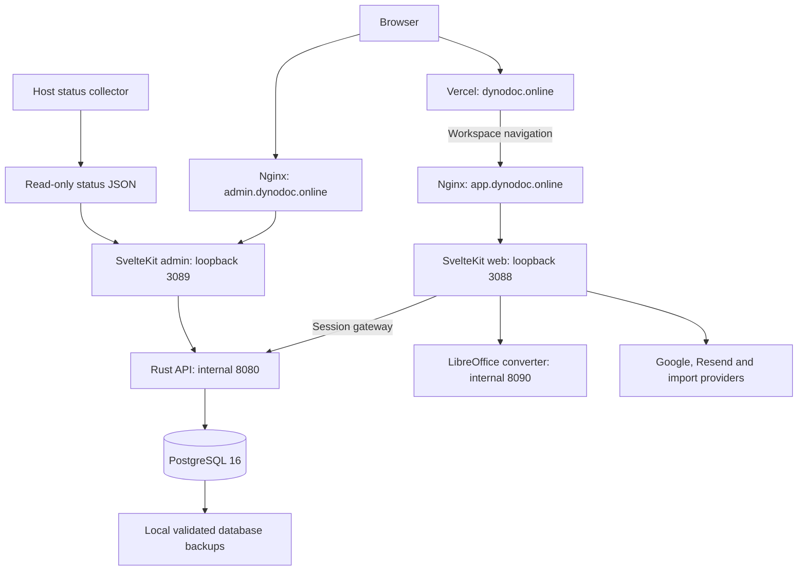

# Dynodoc engineering and product handoff

Prepared **21 September 2026**. Baseline: `main` at
`915b2ab36ca75c0dcdb55e9119453590b9b34935`.

This is a continuation guide for a developer, operator or coding agent taking over
the existing product. It distinguishes shipped code, recorded verification,
owner-confirmed configuration and work that still needs acceptance. Live-service
observations below are dated release records, not a new infrastructure audit
performed while writing this file. No secrets are included.

## Continuation: file push, change requests, presentations and UX fixes

On 27 September the owner asked for a GUI-testable Git-like workflow with real
local Word files from several people, a rebase feature, a PowerPoint-style editor,
UX fixes and a plain-language walkthrough. [Decision 008](decisions/008-change-requests-presentations-and-ux.md)
records the design; [release notes](CHANGE-REQUESTS-RELEASE.md) record exactly what
was verified on an isolated local stack; [the user guide](GIT-STYLE-WORKFLOW.md)
explains the workflow without Git terms. Migration `0020` is new; no applied
migration changed. The editor header is now `office-v5`. This work was
released as `9c1ec9d` and deployed to the VPS on 27 September with passing CI;
the release record lists the backup, rollback tags and live checks.

## Continuation: Office analysis and references

The owner subsequently authorized broad Office implementation and a push to `main`.
[Decision 007](decisions/007-office-analysis-and-references.md) and
[release evidence](OFFICE-EXPANSION-RELEASE.md) supersede earlier local-only wording
and the old charts/pivots/note-body deferrals. The new work adds the Excel reference
UI, native supported charts, pivot summaries, named ranges, data tools, server-checked
sheet protection, and Word note/contents editing. Full Office parity, native pivot
caches and live per-page footnote layout remain unfinished. Publication and runtime
status is recorded in the release record: `b0ab062` (including the `a413c20` UI
release and the immediate stream acknowledgement) is pushed to main and deployed
to the VPS workspace on 22 September, with passing frontend/authenticated/Rust CI
and live synthetic browser checks. The MIT engine is published independently.

## Continuation: web product operations

The subsequent release `e73db39` is committed, pushed and live on Vercel and the VPS.
Rust, frontend and authenticated browser CI pass. It is described in
[decision 005](decisions/005-product-operations-and-recovery.md) and
[release evidence](PRODUCT-OPERATIONS-RELEASE.md). Those records supersede the
baseline descriptions below for admin erasure, threaded discussions, recovery,
remembered draft exclusions, OpenAPI coverage and authenticated CI. The owner
approved whole-document erasure plus pseudonymous shared contributions for account
erasure, explicitly deferred off-site backups and limited the product to web-based
clients. Legal operator details are still missing. Baseline deployment/test counts
below remain historical; consult the release record for current evidence.

## Continuation: editable Office workspace and open engine

On 22 September the owner explicitly prioritized editable pagination and a workspace
close to the supplied Word screenshots. [Decision 006](decisions/006-editable-pages-and-open-engine.md)
supersedes the older P2 deferral for this work. The implementation adds compact
ribbons, a template/recent-files workspace, live editable pagination, numeric
conditional formatting and bounded XLSX workers. [Release evidence](EDITABLE-OFFICE-RELEASE.md)
distinguishes tested local changes from deployment and unresolved Office features.

The owner also explicitly authorized MIT relicensing and publication of the engine
as [ArefinAlter/dynodoc-engine](https://github.com/ArefinAlter/dynodoc-engine). The new
repository is public and builds independently. The application license remains
AGPL. [Extraction notes](ENGINE-EXTRACTION.md) document the retained compatible copy
and remaining dependency-boundary migration. Historical sections below describe
the earlier baseline and must not override this continuation.

## Contents

- [Start here](#start-here)
- [Product intent and owner requirements](#product-intent-and-owner-requirements)
- [Release baseline and documentation precedence](#release-baseline-and-documentation-precedence)
- [Architecture and data ownership](#architecture-and-data-ownership)
- [Version-control model and invariants](#version-control-model-and-invariants)
- [Implementation map](#implementation-map)
- [Office capabilities and exact limits](#office-capabilities-and-exact-limits)
- [Access, public sharing and administration](#access-public-sharing-and-administration)
- [Integrations and questionnaire support](#integrations-and-questionnaire-support)
- [Identity and provider configuration](#identity-and-provider-configuration)
- [Brand, public site, analytics and legal pages](#brand-public-site-analytics-and-legal-pages)
- [Deployment inventory and operational boundaries](#deployment-inventory-and-operational-boundaries)
- [Release and recovery runbooks](#release-and-recovery-runbooks)
- [Local development and verification](#local-development-and-verification)
- [Performance and storage evidence](#performance-and-storage-evidence)
- [Prioritized remaining work](#prioritized-remaining-work)
- [Regression traps and troubleshooting](#regression-traps-and-troubleshooting)
- [Owner inputs and next-session instructions](#owner-inputs-and-next-session-instructions)

## Start here

Dynodoc is a hosted **document version-control product**, with rich-text,
spreadsheet and questionnaire editors. Its distinguishing workflow is personal
drafts, formatting-aware comparison, selected sharing, overlap resolution,
attributable history and restoration without deleting prior work.

The engine and common office workflows exist and have been deployed. The product
is **not a complete Word, Excel, Google Docs or Google Sheets replacement**.
Character-level offline collaboration, advanced Office fidelity, real-provider
acceptance, off-site recovery and several production operations remain unfinished.
There is no defensible overall completion percentage. The historical pilot count
of **11/14 criteria** is a checklist count, not a measure of the work left.

Before changing anything:

1. Read this file, [current status](PROJECT-STATUS.md),
   [decision 004](decisions/004-document-version-control.md),
   [versioning conformance](VERSIONING-CONFORMANCE.md) and
   [office capabilities](OFFICE-EDITOR-CAPABILITIES.md).
2. Inspect `git status`, the current branch and recent commits. The worktree was
   clean at the start of this handoff; subsequent work may change that.
3. Preserve concurrent edits. The owner explicitly asked that another editor's
   SEO work be retained and integrated.
4. Use an isolated local database for tests. Never aim development authentication,
   destructive migration commands or a test suite at the live database.
5. Keep the current immutable event format and stable IDs compatible. Review
   browser readers, replay, merging and public projections together when extending
   the editor schema.

The highest-value next work is real-user/provider acceptance and recovery, followed
by measured large-document performance and deeper document-versioning workflows.
The detailed backlog below gives acceptance criteria rather than a claim that all
remaining features fit in one small implementation pass.

## Product intent and owner requirements

The owner's latest direction supersedes the original questionnaire-first brief:

- Lead with **version control for rich-text documents and spreadsheets**. Research
  remains an important use case, not the organizing identity of the product.
- Preserve wording, formatting, structure and provenance. Formatting runs should
  reduce redundant storage without becoming a technical burden on users.
- Make editing familiar to ordinary Word/Excel users. Use GUI actions such as
  personal draft, save version, share changes, get latest and review overlaps.
- Aim for broad office functionality: pagination, tables, comments, tracked text,
  IME, bidirectional/complex scripts, accessibility, font uploads and file fidelity.
  Describe actual support rather than promising complete parity.
- Keep a usable homepage on Vercel and the persistent workspace/backend on the VPS.
  Google and email are the first login methods; LinkedIn/GitHub are later options.
- Preserve the cream/off-white/light-blue visual language, readable sans serif
  typography, Word-blue and Excel-green accents, Lucide icons, explanatory visuals
  and accessible motion. Avoid decorative numbered marketing sections and generic
  research-only positioning. Practical numbered instructions remain appropriate.
- Support access hierarchy, recoverable removal, admin operations, public read-only
  sharing, onboarding and replayable help.
- Retain research connections, especially ODK Central and KoboToolbox; distinguish
  file interchange, one-time API import and live synchronization.

Earlier requests authorized committing/pushing to `main` and deploying into an
isolated VPS application while preserving existing services. They do not authorize
discarding another editor's work, deleting unrelated services or erasing live data.
The owner manages the registrar and Google/Resend accounts; account-console changes
must be distinguished from changes possible in this repository or on the VPS.

## Release baseline and documentation precedence

Repository: [ArefinAlter/dynodoc](https://github.com/ArefinAlter/dynodoc).

| Commit | Meaning |
| --- | --- |
| `915b2ab` | Latest baseline: font-attribution formatting correction and release validation record. |
| `470abbc` | Document-version-control positioning and expanded office editing; no new migration. |
| `1408074` | Formatting-aware rich-text patches, merge improvements, provenance projection, research and benchmarks; migration 0016. |
| `60fb7ef` | Expanded access, public sharing, lifecycle, onboarding and editing. |

These commits were pushed to `main` during the preceding implementation work.
The office runtime was deployed to the VPS, and the final Vercel deployment was
recorded successful. This handoff itself does not require a runtime rollout.

Use this precedence when documents disagree:

1. The owner's latest explicit requirements and accepted decisions.
2. Current executable code, immutable migrations and tests for actual behavior.
3. Decisions [004](decisions/004-document-version-control.md),
   [003](decisions/003-rich-text-versioning.md),
   [002](decisions/002-product-access-and-editing.md) and
   [001](decisions/001-research-team-demo.md), in their respective scopes.
4. [Decision 000](decisions/000-initial.md) and the
   [PoC PRD](dynodoc_poc_prd.md) for original scope and retained invariants.
5. Design volumes and sequential build documents for rationale and future work.

The original `AGENTS.md` PoC restrictions should not be used to undo the owner's
accepted document/spreadsheet expansion. The expansion also does not activate
public-consultation stages, ML services or the deferred CRDT stage by implication.
Applied migrations, append-only events and stable IDs remain binding constraints.

Useful references:

| Topic | Source |
| --- | --- |
| Product state and omissions | [PROJECT-STATUS.md](PROJECT-STATUS.md) |
| Office compatibility and release checks | [OFFICE-EDITOR-CAPABILITIES.md](OFFICE-EDITOR-CAPABILITIES.md) |
| Implemented mathematics and caveats | [VERSIONING-CONFORMANCE.md](VERSIONING-CONFORMANCE.md) |
| Algorithms, prior art, compact patches | [RICH-TEXT-VERSIONING-RESEARCH.md](RICH-TEXT-VERSIONING-RESEARCH.md) |
| Original engine theory | [Volume 1](02-versioning-design-vol1.md), [Volume 2](03-versioning-mathematics-vol2.md) |
| Permissions, lifecycle and new routes | [PRODUCT-WORKFLOWS.md](PRODUCT-WORKFLOWS.md) |
| Local setup and historical test log | [SETUP.md](../SETUP.md), [Taskfile.yml](../Taskfile.yml) |
| Hosted operation | [VERCEL-DEPLOYMENT.md](VERCEL-DEPLOYMENT.md), [DOMAIN-AND-BACKEND.md](DOMAIN-AND-BACKEND.md) |
| Provider configuration | [GOOGLE-AND-EMAIL-SETUP.md](GOOGLE-AND-EMAIL-SETUP.md) |
| Research transport and preview limits | [RESEARCH-CONNECTIONS.md](RESEARCH-CONNECTIONS.md), [file compatibility](research-compatibility.md) |

Some historical prose is stale. In particular, older README sections still describe
serif/terracotta styling and questionnaire-only scope; early setup entries say
provider credentials are missing; the initial search guide lists only three sitemap
pages; older deployment records mention eleven migrations. Use the current site
configuration and migration directory. There are **13 migration files** through
0016 at this baseline; the absent 0005–0008 are not permission to invent replacement
migrations. Historical Lighthouse scores and test counts describe their dated
release, not every subsequent change.

## Architecture and data ownership



The SvelteKit application serves public marketing, the workspace and the admin
site with different host/environment behavior. Vercel hosts the public surface;
it does not host the persistent engine or own the document database. Browser
document requests use the same-origin `/api/engine` gateway. The Rust API is private
to the Docker network; SSE carries document updates through the web gateway.

PostgreSQL holds documents, canonical events, snapshots, drafts, versions,
identities, memberships, operational audit and anonymous measurements. Original
files and shared font bytes are stored in **`document_upload.content`**. They are
included in database backups. There is no Dynodoc S3/MinIO bucket, Redis cache,
graph database, Python ML service or separate analytics database in this deployment.

Canonical editing flow:

1. Import or create content with stable structural node IDs.
2. The editor maintains a local view and sends authorized operations against a
   known base sequence. Full browser state comparison still participates in saving.
3. The API validates access, stale state, operations and applicable semantic rules.
4. The engine serializes canonical appends per document and chooses compact
   rich-text patches only when replay is exact and bytes are smaller.
5. Materialization and snapshots derive current state from recorded events.
6. SSE informs other clients; dirty edits retain their original base for review.
7. Draft sharing compares ancestor, team state and personal work; unresolved
   overlaps need an explicit choice.

## Version-control model and invariants

### Identity, structure and formatting

Four concepts must remain distinct:

- **Structural node:** stable ULID, parent, position and kind. Document/account
  identifiers are UUIDs; do not confuse the two identity types.
- **Formatting run:** adjacent text within a structural container sharing complete
  stored metadata. Bold, underline, links, font and color can split/coalesce runs.
- **Style descriptor:** metadata that may be interned for compact storage. Equal
  styles do not make two passages or their authorship the same object.
- **Semantic role:** an optional interpretation such as a question or citation.
  Formatting alone does not prove meaning.

Run boundaries are not permanent identity. A precise current range needs a stable
node, base revision and scalar range. Nested patch paths are relative to the exact
checked base; they are not stable nested-node IDs. Do not assign every character a
database row or replace structural IDs with content hashes.

### Canonical history

- Events are append-only. Never UPDATE/DELETE the canonical `event` table; database
  triggers enforce this. Add a compensating event for restoration or correction.
- `log::append_in_tx` locks the **document row** before allocating sequence numbers.
  Locking only the latest event fails for empty histories and concurrent allocation.
- Event content hashes use length-framed canonical semantic content and actor
  identity. The chain includes the predecessor; genesis is 32 zero bytes.
- Snapshots are derived full JSONB state with an ordered node Merkle commitment,
  including tombstones. They are not yet content-addressed shared subtrees.
- Suggestions become canonical content only through authorized acceptance; the
  acceptance and wrapped edit are transactional.
- Restore appends operations, including restored nodes. It does not reset history.
- Applied migration files are immutable. Add a new numbered migration when needed.

The linear event chain provides internal tamper evidence. A privileged operator
could replace the entire chain and its head without detection unless a trusted
external commitment exists. External anchoring/signatures are not implemented.
Not every timestamp, transport field, metadata change or administrative action is
covered by the document content hash. The operations audit is a separate log.

### Compact patch contract

`engine-shared/src/richtext.rs` defines version 1 of `RichTextPatch`:

```text
patch = { version, before_hash, after_hash, styles, edits }
edit = Text(path, operations) | Props(path, metadata) | Replace(path, subtree)
text operation = Retain(count, optional_style) | Delete(count) | Insert(text, style)
```

This sketch is explanatory; use the actual Rust type and shared fixtures for exact
serialized field names. Counts are **Unicode scalar values**, not UTF-8 bytes,
JavaScript UTF-16 code units or guaranteed grapheme boundaries. No normalization
should silently rewrite the user's text.

The engine checks version, hashes, paths, bounds, style indices, input consumption
and exact output. It regenerates derived plain-text labels under the patch contract.
Myers alignment uses the pinned `similar` implementation, with a 20 ms deadline
per text diff. Current guards include 100,000 scalars/container, 64 path levels and
10,000 patch edits/styles. The deadline is not a whole-request latency guarantee.
Unsupported shapes or uneconomical deltas fall back to a full-field event.

### Merge guarantees and limits

Independent fields, blocks and spreadsheet cells combine through stable-ID
three-way comparison. Compatible disjoint wording changes within paragraphs,
headings and code blocks can combine. Independent mark types/attributes can merge.
Competing values, overlapping text, ambiguous insertion boundaries, delete/reformat
cases and overlapping nested structural changes remain review conflicts.

Do not generalize the disjoint-write theorem to all structural operations. Shared
parents, deletion dependencies, uniqueness constraints and references need validation.
This implementation does not prove arbitrary commutativity, associativity, offline
convergence or intention preservation for all editor operations.

| Familiar Git concept | Product action | Actual boundary |
| --- | --- | --- |
| Init / clone | New document / Make a copy | A copy starts a new history. |
| Local / remote | Personal draft / Team version | Both are server-backed. |
| Branch / switch | Create draft / Open draft | Personal draft branches; shared branch review is limited. |
| Stage / ignore | Include in sharing / Keep for later | Selected blocks, without persistent ignore rules. |
| Commit | Save version | Named immutable checkpoint of recorded work. |
| Push / pull | Share changes / Get latest | Comparison against the stored ancestor. |
| Merge / conflict | Combine / Review overlaps | Human choices before conflicting changes land. |
| Checkout / revert | View version / Restore as new changes | Earlier history remains intact. |
| Blame / grep | Who changed this? / Find | Permission-scoped attribution and search. |

There is no Git wire protocol, portable history clone/fetch, arbitrary remote,
Git-compatible commit DAG, disconnected replica or CRDT typing layer. Draft rows
are append-only but receive the canonical chain guarantee only when shared.

### Ontology and provenance

The permissioned `GET /documents/{id}/structure` engine route derives node/parent
IDs, kinds, content hashes, run statistics and latest activity/actor references.
This is a lightweight relational projection, not a full RDF graph, inference
engine, semantic classifier or precise per-word blame service. W3C PROV-O informs
the design vocabulary; a separate graph service is not necessary in the edit path.
Future projections must be rebuildable from checkpoints, permission-aware and
unable to override canonical history.

## Implementation map

All paths in this section are relative to the repository root.

| Area | Primary files |
| --- | --- |
| Event serialization and invariants | `crates/engine-core/src/log.rs`, `materializer.rs`, `snapshot.rs`; `crates/engine-shared/src/richtext.rs` |
| Rich-text codec and mergers | `crates/engine-core/src/richtext.rs`, `workspace_merge.rs`, `merge.rs` |
| Governance and questionnaire validation | `crates/engine-core/src/governance.rs`, `integrity.rs`, `expr.rs`, `ops.rs` |
| Hosted documents/drafts/files/versions | `crates/engine-api/src/workspace.rs` |
| Hierarchy/lifecycle/public projections | `crates/engine-api/src/product.rs` |
| Admin/operations/auth/SSE | `crates/engine-api/src/admin.rs`, `audit.rs`, `auth/`, `stream.rs` |
| CLI verify/replay/snapshot/OpenAPI | `crates/engine-cli/src/main.rs` |
| Session and API boundary | `frontend/researcher/src/lib/server/session.ts`, `src/routes/auth/[...action]/+server.ts`, `src/routes/api/engine/[...path]/+server.ts` |
| Workspace coordination | `frontend/researcher/src/lib/components/workspace/WorkspaceEditor.svelte` |
| Document editor/ribbon | `RichEditor.svelte`, `OfficeRibbon.svelte` in that component directory |
| Sheets/questionnaires | `SheetEditor.svelte`, `QuestionnaireEditor.svelte`, `SurveyPreview.svelte` in that directory |
| Access/onboarding/public links | `frontend/researcher/src/lib/components/product/` |
| Versioned office schema | `frontend/researcher/src/lib/workspace/office.ts`, `office-extensions.ts`, `tracked-changes.ts` |
| DOCX and ZIP handling | Same workspace directory: `docx-import.ts`, `docx-import.worker.ts`, `docx-export.ts`, `bounded-zip.ts`, `office-import.ts`, `files.ts` |
| Spreadsheet model/calculation | Same directory: `sheet-model.ts`, `sheet-operations.ts`, `sheet-structure.ts`, `workbook-calculator.ts` |
| Local changes and rich-text replay | Same directory: `changes.ts`, `richtext.ts`, `richtext-fixtures.json` |
| Print | `PrintPreview.svelte`, workspace `print.ts`, `src/routes/print/+page.svelte` |
| Research/Forms server integrations | `frontend/researcher/src/lib/server/research.ts`, `research-vendors.ts`, `google-forms-map.ts` |
| Public SEO and marketing | `frontend/researcher/src/lib/seo/`, `src/lib/components/marketing/`, public `src/routes/` pages |
| Brand/font assets | `frontend/researcher/static/brand/`, `static/fonts/`, workspace `fonts.css` |
| Authenticated browser coverage | `frontend/researcher/e2e/{workspace,product,launch,richtext,office}.spec.ts` |
| Deployment and conversion | `infra/demo/`, `infra/converter/` |

The old `src/lib/components/editor/` four-view questionnaire UI remains in the
tree. Locate the active hosted workflow before changing a similarly named legacy
component. A dependency remaining in `package.json` does not establish that its
old path is active; for example, the current DOCX import uses native OOXML parsing.

## Office capabilities and exact limits

### Rich-text documents

| Area | Implemented | Still limited or absent |
| --- | --- | --- |
| Ribbon and formatting | Home/Insert/Layout/Review/View; headings 1–6, common emphasis, colors/highlight, fonts, lists/checklists, links, paragraph alignment/direction/spacing/indent | Every Word command, style/theme system and layout option |
| Tables | Common insertion/edit/context actions; supported spans, headers, fills and alignment | Complete complex Word table/layout fidelity |
| Pages | Versioned A4/Letter/Legal, orientation, uniform margins, plain header/footer, page numbers/language, explicit breaks | Live editable pagination, arbitrary sections and exact Word layout |
| Print/PDF | Isolated Paged.js preview and browser printing | Identical output on all browsers/printers; oversized blocks may differ |
| Text review | Track insertions/deletions within existing paragraphs; inspect/accept/reject; deleting pending insertion cancels it | Tracked moves/format changes, structural redlines and cross-paragraph revision semantics |
| Comments | Block comments, context-menu entry and imported inline Word comment marks | Full threaded replies/resolution/mentions/notifications and precise native comment range export |
| Scripts/input | Composition-aware saving, LTR/RTL/auto direction, self-hosted Noto script fonts | Certification across native IMEs, mobile keyboards, screen readers and all script combinations |
| Fonts | WOFF/WOFF2/TTF/OTF upload validated through FontFace; document sharing/copying | Embedded custom fonts in DOCX; licensed Microsoft fonts are not bundled |
| Equations | Inline/display LaTeX, text/source preservation | Native Word equation-object round trip or full TeX typesetting |
| Tabs/accessibility | Document tabs, keyboard ribbon navigation, labelled controls, basic authoring checks | Complete accessible-export and WCAG certification |

Editing remains continuous; pagination is a preview/print feature. While tracking
is enabled, unsupported structural edits are refused. Ordinary version history
still records structure and formatting when edited outside inline text tracking.

DOCX import resolves defaults, named/base styles and direct formatting, preserving
the documented subset of styles, lists, tables, links, raster images, revisions and
comments. It reads the final section's page settings/plain header/footer. Floating
images are placed after their paragraph. Footnote/endnote bodies, bibliography
fields, complete numbering/theme semantics and multi-section fidelity are open.
Original files remain important for unsupported constructs.

DOCX export uses `docx`; block comments are placed in a notes section instead of
invented precise character anchors. Imported revision/comment author labels are
source metadata, not authenticated Dynodoc identity. Font family names are written
without font binaries. The `.doc` path uses the isolated LibreOffice converter
before native DOCX handling.

### Spreadsheets

Supported work includes typed cells, formulas, common number/font/fill/alignment
formats, cell notes, range navigation, selection summaries, copy/paste, relative
formula fill, sheet lifecycle, row/column changes, supported validation, merge,
freeze, resize, hide, search/replace/filter and styled XLSX interchange.

HyperFormula retains its calculation graph and updates changed cells in batches;
style-only changes do not rebuild it. Structural changes rebase references and
shift layout anchors. Copying a sheet/document remaps stable merge-row anchors.
Merge refuses to discard nonempty cells. Sorting formula-containing workbooks or
merged sheets is refused to avoid corrupting references.

ExcelJS retains supported validation metadata; only the implemented inline list,
whole/decimal and text-length rules are evaluated locally. Unsupported expressions
must not be advertised as enforced. Charts, pivots, macros, external connections,
protected ranges, conditional formatting and full Excel function parity are open.
Printing uses all visible rows from state, not only the virtualized viewport;
hidden/filtered rows remain excluded.

### Resource guards

| Boundary | Baseline limit/behavior |
| --- | --- |
| Original upload | 10 MiB; request envelope up to 16 MiB |
| DOCX conversion worker | Transferable buffer and 45-second cancellation |
| ZIP | 10,000 entries; 32 MiB per selected expanded part; 64 MiB selected total |
| XML | Depth 128; DTD/entity declarations and duplicate ZIP paths refused |
| Embedded raster images | 1 MB each, 5 MB combined, supported types only |
| DOCX top-level blocks | 19,000 importer guard |
| Initial empty-document import | Up to 20,000 creation operations within the request byte limit |
| Ordinary operation batch | 5,000; UI operations apply smaller guards |
| Spreadsheet import | 3,000 rows/workbook and 100 columns |
| Fill / larger cell operations | Fill 2,000 cells; several paste/format/replace paths use 4,000-cell guards; operation count can exceed cell count |
| Shared fonts | 2 MB per font, 16 families/document |

These limits can reject valid large Office files. XLSX archive expansion is
preflighted, but ExcelJS conversion still runs on the main thread. A synthetic
parser benchmark does not prove that any 300–400-page source imports, saves and
renders in seconds. Verify constants and behavior before changing limits.

## Access, public sharing and administration

Organizations, teams and folders provide inherited owner/manager/editor/reviewer/
viewer roles. The strongest direct or inherited grant wins. A direct viewer grant
cannot restrict inherited editor access; remove or change the upstream grant.
Direct invitations and creator ownership remain after document moves. Managers
cannot remove/promote owners, and the last direct workspace owner is protected.
Hierarchy nesting is limited to twelve levels.

Creators and effective owners/managers control sharing, location, public copies
and Trash. Editors can edit content without granting access or deleting documents.
Backend authorization applies to reads, writes, streams, search and lifecycle;
hiding a button is never the security boundary.

**Trash is reversible removal.** It blocks ordinary access and future event delivery
and revokes public links. Restoring a document preserves history and does not revive
old links. Permanent erasure and backup-retention consequences need a separate
designed workflow; do not implement hard deletion by bypassing event invariants.

Public links expose an explicitly frozen team-version copy. Later edits require a
new publication. Options are 7/30/90 days or explicit revocation. Only the token hash
is retained, and the full link is shown once. Public copies exclude private history,
discussions, suggestions, deleted content, original files and connection metadata.

The office release additionally rejects publication with unresolved tracked text
and strips embedded Word comments, cell notes and private font references. Legacy
public snapshots are projected safely on read as well. Historical stored snapshots
are not rewritten. Public routes are noindex/no-store/no-referrer, and Nginx redacts
public token paths. Revocation cannot recall a previously downloaded copy.

The admin site requires an explicit API-side `ADMIN_EMAILS` allowlist. Public Google
registration does not confer admin access; an empty allowlist denies everyone.
The owner's supplied address is configured privately. Admin actions require typed
email/title confirmation and support account disable/restore and document Trash/
restore. Admins cannot disable themselves or another configured admin. Disabled
accounts lose old access/refresh/pending email credentials; restoration needs new
sign-in. Contribution attribution and retained content are not erased.

The dashboard reports services, disk, database/table/upload totals, records,
operations audit, backup/checksum status, page loads and web vitals. It is not a
SQL console, bucket browser, Docker control plane, secret viewer or unrestricted
reader of user documents. The web container receives only a read-only status file,
not the Docker socket.

## Integrations and questionnaire support

| Tool/path | Implemented | Acceptance or boundary |
| --- | --- | --- |
| ODK Central | HTTPS discovery, XLSForm source and main OData response import | Real project acceptance pending; not full repeat-table/media synchronization |
| KoboToolbox | Asset discovery, XLSForm and paginated response import | Real project acceptance pending; no writeback |
| REDCap | Metadata-to-dictionary and flat raw records | No full REDCap expression/runtime or longitudinal workflow parity |
| SurveyCTO | Wide response export with API credentials | Destination review-status behavior applies; questionnaire exchange uses files |
| SurveyMonkey | Discovery and bulk response snapshots | Nested answers remain JSON-valued columns; plan permissions need live validation |
| Google Forms | Separate read-only OAuth; definition or response import | Actual consent/import pending; grids flatten and branching/media/quiz settings need review |
| CSPro | CSV/XLSX interchange | No native dictionary, form, logic or CSDB integration |
| LaTeX / Overleaf | `.tex`/source ZIP import; `.tex`/project ZIP export | No Overleaf account sync, server TeX execution or complete project round trip |
| Google Docs / Sheets | Familiar editing model and common file formats | No claim of native Drive/Docs/Sheets account synchronization |

Research connectors are explicit user-initiated read imports. ODK/Kobo/other vendor
credentials are not retained. Google Forms has a separate short-lived encrypted
connection cookie. None of these paths provides scheduled reconciliation, incremental
sync or upstream writeback. Fixture tests are not real-provider acceptance.

Server requests require HTTPS and public routable addresses, pin resolved IPv4,
reject private/reserved destinations, redirects and cross-origin pagination, and
bound responses. Import errors must not echo tokens or upstream private bodies.
Response conversion guards spreadsheet formula injection. Current vendor response
imports cap at 10 MiB, 2,999 rows and 100 columns and fail explicitly when exceeded.

Questionnaire authoring includes broad XLSForm types, choices, groups/repeats,
appearance/parameters, validation and translation columns. The preview executes
only documented relevance, required, calculation and constraint expressions;
unsupported syntax is reported and there is no JavaScript `eval`. Answers remain
in browser memory. Repeat instances, advanced XPath/date functions, external data
and real field collection are not implemented. Validate exported instruments in
the destination platform before using them in fieldwork.

## Identity and provider configuration

Sessions use encrypted HttpOnly cookies and a same-origin server gateway. Backend
tokens are PASETO, not JWT. `/auth/session` obtains identity through authenticated
`/auth/me`; do not try to extract identity with a JWT decoder or expose tokens to
browser code. Refresh rotation and origin checks are part of the existing contract.
`DEV_AUTH` is forced false on public web/admin services.

### Confirmed setup and remaining checks

The owner confirmed Google **External → In production**, both login callbacks,
Forms API enablement, the Forms callback and both read scopes. Google client
credentials and the Resend key were transferred privately to the VPS. Provider
presence flags were verified, but successful real Google login, delivery and Forms
consent/import remain owner-browser acceptance tasks.

| Purpose | Exact configuration |
| --- | --- |
| Workspace login callback | `https://app.dynodoc.online/auth/google/callback` |
| Admin login callback | `https://admin.dynodoc.online/auth/google/callback` |
| Forms callback | `https://app.dynodoc.online/integrations/google/callback` |
| Ordinary sign-in scopes | `openid email profile` |
| Forms scopes | `https://www.googleapis.com/auth/forms.body.readonly` and `https://www.googleapis.com/auth/forms.responses.readonly` |
| Sender | `Dynodoc <signin@dynodoc.online>` |
| Provider flags | `/auth/options`: expect Google/email enabled, development disabled |

`GOOGLE_FORMS_API` is not used by the implementation; an API key does not authorize
access to private forms. Forms consent is separate from basic sign-in and may need
Google verification even when sign-in is published. Exact scope justifications and
a demonstration-video outline are already in the [setup guide](GOOGLE-AND-EMAIL-SETUP.md).

Forms connection state is account-bound, encrypted, HttpOnly and expires within an
hour; no refresh token/background sync is requested. Use an editor form URL/ID,
not a respondent `/d/e/` identifier. Disconnect/sign-out clears local connection
state; revocation at Google removes the upstream grant.

Resend SPF/DKIM/return-path DNS must match the provider dashboard. A send-only key
cannot list domains; a restricted-key response there does not prove mail failure.
The From address does not create an inbound support mailbox. Acceptance must test
delivery, exact HTTPS link origin, successful use, expiry and one-time use.

### Environment ownership

Never copy configured values into this file, source control, logs or chat.

| Location | Relevant names |
| --- | --- |
| VPS `infra/demo/.env` | `POSTGRES_PASSWORD`, `PASETO_LOCAL_KEY`, `WEB_SERVICE_KEY`, `SESSION_SECRET`, `CONVERTER_KEY`, `ORIGIN`, `GOOGLE_CLIENT_ID`, `GOOGLE_CLIENT_SECRET`, `RESEND_API_KEY`, `EMAIL_FROM`, `ADMIN_EMAILS`, optional token TTL |
| Web/container wiring | `ENGINE_API_URL`, `CONVERTER_URL`, `SOURCE_ARCHIVE_PATH`; admin `ADMIN_SITE`, `OPS_STATUS_PATH`, its own `ORIGIN` |
| Vercel public app | `PUBLIC_WORKSPACE_URL=https://app.dynodoc.online`; optional `PUBLIC_GOOGLE_SITE_VERIFICATION` |
| Local development | Root and frontend example env files; existing ignored `.env.local` is private configuration, not a template to publish |

Preserve independent existing keys when modifying configuration. Rotating session,
signing or database secrets is an operational change, not a routine build step.
Do not put VPS/database/provider secrets into the Vercel homepage project.

## Brand, public site, analytics and legal pages

Original SVG brand marks, favicons, PNG sizes and social assets live under
`frontend/researcher/static/`. Keep homepage, workspace and admin consistent.
The social SVG and generated PNG must both reflect the current message. Noto font
licenses and attributions are in `static/fonts/README.md`; never bundle Microsoft
font binaries just because the ribbon lists their family names.

The public SEO source is `src/lib/seo/site.ts`, with shared metadata/FAQ/structured
data/llms/IndexNow helpers. At baseline, indexable pages are `/`, `/features`,
`/why-dynodoc`, `/compatibility`, `/roadmap`, `/help`, `/privacy`, `/terms` and
`/cookies`. `/print`, workspace/admin/login/auth/API/integration/public-document
routes are excluded. App/admin hosts are nonindexable. Crawling directives do not
replace authorization.

Keep absolute homepage navigation pointed at `https://dynodoc.online` and workspace
navigation at `https://app.dynodoc.online`. A relative `/` on the app host reproduces
the previously reported “back to homepage stays on app” problem.

Search Console requires the owner's account and registrar TXT verification for a
Domain property, then submission of `https://dynodoc.online/sitemap.xml`. Existing
sitemap/metadata/IndexNow support is not proof of ownership verification or indexing.
Do not overwrite the concurrent SEO implementation while changing marketing copy.

Anonymous telemetry stores per-page-load categories and numerical web vitals in
PostgreSQL. It does not provide unique visitor identities, document contents or a
complete browsing history. The code sends no persistent identifier, full URL,
query, referrer or account/document ID. DNT/GPC and the measurement preference are
respected. Infrastructure may still have operational logs; do not turn the telemetry
payload description into a claim that the host never receives IP addresses.
The collector expires operational samples after 30 days. Missing/spoofed client
measurements mean these counts are unsuitable for billing or security decisions.

Privacy, terms and cookie pages exist but legal adoption remains incomplete. The
operator name, public contact/mail address, jurisdiction, hosting/subprocessor
locations, retention and review must be supplied. See [LEGAL-PAGES.md](LEGAL-PAGES.md).
Do not remove draft disclosures or present unconfirmed details as adopted policy.

## Deployment inventory and operational boundaries

| Item | Baseline |
| --- | --- |
| Public homepage | `https://dynodoc.online`, Vercel; root directory `frontend/researcher` |
| Workspace | `https://app.dynodoc.online/workspace` |
| Operations site | `https://admin.dynodoc.online` |
| VPS SSH endpoint | `103.191.50.32:22`; root access was owner-authorized; obtain credentials securely |
| Registrar DNS | Separate `app` and `admin` A records to VPS; apex/`www` remain Vercel |
| Deployment directory | `/opt/dynodoc-demo` |
| Compose project | `dynodoc-demo`; historical name retained intentionally |
| Compose definition | `infra/demo/compose.yml` with private `infra/demo/.env` |
| Database | PostgreSQL 16, internal network, volume `dynodoc-demo_database` |
| Workspace listener | `127.0.0.1:3088` → web container 3000 |
| Admin listener | `127.0.0.1:3089` → admin container 3000 |
| API/converter | Internal 8080/8090; no public host ports |
| Source download mount | `/opt/dynodoc-demo/source.tar.gz` → `/app/source.tar.gz` read-only |
| Operations mount | `/opt/dynodoc-demo/ops/status.json` → admin `/app/ops/status.json` |
| Backup schedule | Recorded cron: daily 02:17 server local time, Europe/London; check live schedule when operating |
| Collector | Host task each minute; status older than three minutes shown stale |

The engine/conversion Docker networks are internal, with web egress separately
available. Application/converter services use read-only filesystems, dropped
capabilities and bounded temporary storage. The converter has CPU/memory/PID limits.
PostgreSQL remains persistent and private.

Nginx host files are represented in `infra/demo/nginx-*.conf`. The old sslip.io
hostname redirects to the corresponding app path. Recorded Certbot renewal checks
passed on 19 September; then-current app/admin certificates expired 18 December
2026. Recheck current certificates/timers rather than treating that as a guarantee.
The workspace access log excludes query strings to avoid routine OAuth/token logging.

Unrelated VPS applications that were preserved during the last release include
`server-api-1`, `server-db-1`, `server-minio-1` and
`chakma-platform-chakma-annotation-1`. **That MinIO belongs to another application.**
Do not stop, repurpose or claim it as Dynodoc storage. Avoid unscoped Docker cleanup,
`docker compose down -v`, live migration resets and replacing shared Nginx config.

### Recorded deployment evidence

The 21 September office rollout preserved **478 canonical events and 5 uploads**
across its before/after check. These are historical preservation counts, not current
usage totals. Public homepage content, workspace/admin HTTPS health, unauthenticated
admin redirect and a bundled Bengali font were checked. No production document
mutation was needed for that rollout's checks. A validated pre-release database
backup was taken, and source manifest verification passed.

The 19 September backend exercise had separately verified persistence through
container recreation, original-file byte equality, named versions, hash integrity,
DOC conversion and a restore into a temporary database. It used synthetic content;
it did not constitute Google/Resend acceptance. Backups remain on the same VPS.

## Release and recovery runbooks

These are procedures for a future authorized release, not commands already run
as part of writing this handoff. Use the actual candidate SHA and verify each
dependent step finishes before continuing.

### Read-only inspection

On the VPS:

```sh
cd /opt/dynodoc-demo
docker compose --env-file infra/demo/.env -f infra/demo/compose.yml ps
docker compose --env-file infra/demo/.env -f infra/demo/compose.yml logs --tail 100 web api
curl --fail --silent --show-error https://app.dynodoc.online/healthz
curl --fail --silent --show-error https://admin.dynodoc.online/healthz
curl --fail --silent --show-error https://app.dynodoc.online/auth/options
```

Inspect log output privately. Avoid `docker compose config` or environment dumps
in shared logs because resolved configuration can expose secrets. Health/provider
flags confirm service/config presence, not complete workflow or provider success.

### Prepare and deploy

1. Inspect worktree changes; preserve concurrent work. Run checks appropriate to
   the candidate and record source SHA, migration additions and client compatibility.
2. Record current container/image IDs, unrelated services and schema/data counts.
   Retain prior source/images for recovery and run `./infra/demo/backup.sh` on the
   VPS **before** applying migrations or replacing application containers.
3. Package the intended working source locally:

   ```sh
   python3 infra/demo/package-source.py /tmp/dynodoc-source.tar.gz
   tar -tzf /tmp/dynodoc-source.tar.gz
   sha256sum /tmp/dynodoc-source.tar.gz
   ```

   The packager includes tracked and nonignored new source, excluding private env,
   keys, dumps, dependencies and build artifacts, with `SOURCE_MANIFEST.sha256`.
   Consequently it can include uncommitted files: inspect the package, not only
   the current commit. An exclusion filter is not a replacement for secret review.
4. Transfer to a temporary server path, wait for transfer completion, compare the
   archive checksum, inspect entries and retain the existing source archive.
   Extract reviewed source into `/opt/dynodoc-demo`; preserve `infra/demo/.env`.
   Save the candidate archive at `source.tar.gz` for source-download consistency.
5. Run `sha256sum -c SOURCE_MANIFEST.sha256` there. Build the intended services
   before replacing running ones:

   ```sh
   docker compose --env-file infra/demo/.env -f infra/demo/compose.yml build api web admin
   ```

6. Select rollout order from compatibility requirements. For the existing office
   privacy changes, the backend projection/publication guard must protect data when
   new review metadata appears. For a future **new event variant**, compatible
   readers/replayers must be deployed before writers emit it. Avoid a generic
   “API always first” or “frontend always first” rule.
7. Once the candidate and ordering are compatible, replace only the application
   services that changed. For an ordinary mutually compatible build:

   ```sh
   docker compose --env-file infra/demo/.env -f infra/demo/compose.yml up -d --no-deps api web admin
   ```

   Rebuild/recreate the converter only if required by its own change. PostgreSQL
   does not need recreation for frontend, auth-provider or hostname changes.
8. Check health, auth options, anonymous document rejection, ordinary-user admin
   denial, public-copy privacy and intended user workflows. Compare existing
   data counts/hash evidence and check unrelated applications independently.
9. Confirm Vercel's separate build status and public content, canonical metadata,
   sitemap, icons and cross-host navigation. A successful VPS release does not
   imply the homepage deployed, or vice versa.
10. Record release evidence, remaining acceptance and the actual rollback target.

`office-v2` gates old cached editors. Tell users with unsaved text to preserve it
before reloading. Do not remove the guard merely to make an obsolete tab work.

### Backups and restore exercise

`infra/demo/backup.sh` creates PostgreSQL custom archives, validates `pg_restore
--list`, writes SHA-256 checksums and retains approximately 14 days of this app's
dated backups. The dump contains original files/fonts as well as content/history.
It does not back up the private env file; protect that separately. Structural
validation alone is weaker than a successful application-level restore exercise.

Restore only into a new, explicitly selected database, following
[VERCEL-DEPLOYMENT.md](VERCEL-DEPLOYMENT.md). For example, first ensure this exercise
name is unused, then:

```sh
docker compose --env-file infra/demo/.env -f infra/demo/compose.yml exec -T postgres createdb -U dynodoc dynodoc_restore_check
docker compose --env-file infra/demo/.env -f infra/demo/compose.yml exec -T postgres pg_restore -U dynodoc -d dynodoc_restore_check < backups/YOUR_BACKUP.dump
```

Compare migrations, table counts, original-file hashes, named versions and document
chain verification against recorded expectations. Use a compatible isolated API
against the restored database for workflow checks. Remove only the deliberately
created exercise database after inspection; never overwrite live data for a drill.
The CLI's `verify DOCUMENT_UUID` checks a chain; `replay` prints private document
content and should not be used in public/shared diagnostic output.

Off-site backup, tested recovery objectives and external failure alerts remain open.
Same-host archives do not cover host loss. Define destinations/access/retention and
perform a restore before claiming these operational requirements are satisfied.

### Rollback

Preserve compatible previous images and source before rollout. Code rollback is
safe only when the older readers understand the current schema, event variants and
editor fields. New compact events cannot be erased to make an older binary happy.
Prefer a forward fix or a reader-compatible rollback. A database restore loses
post-backup work and requires an explicit recovery decision; it is not a routine
response to a frontend defect. Do not rotate existing secrets or replace volumes
as part of rollback.

## Local development and verification

### Toolchain and commands

- Rust **1.96.0**, pinned in `rust-toolchain.toml`.
- PostgreSQL 16; SQLx CLI needed for task-based local migrations.
- Node **22** in `.nvmrc`/CI; Node **24** in current web image/Vercel instructions.
- pnpm **10**; use the committed lockfile and avoid casual package upgrades.
- Use `task`, not `make`. The local compose file is `infra/docker-compose.yml`;
  production uses the separate `infra/demo/compose.yml`.

```sh
task setup
task dev
task test
task lint
task fmt-check
```

Configure independent local secrets and the private frontend environment using
the example files and [SETUP.md](../SETUP.md). `task setup` is not production
provisioning. `task migrate-reset` is destructive and **development-only**.

For focused frontend verification from `frontend/researcher`:

```sh
pnpm install --frozen-lockfile
pnpm lint
pnpm format:check
pnpm test:unit
pnpm build
```

Authenticated browser scenarios require a separately running **isolated** API,
database and web instance. Enable `DEV_AUTH=true` only on that local web instance,
use matching service/session configuration, and configure synthetic
`admin@example.test` in the test API's `ADMIN_EMAILS` where admin coverage needs it.
Set the web server's `ORIGIN` to match its test URL. With that stack running:

```sh
PILOT_E2E=true PLAYWRIGHT_BASE_URL=http://localhost:4173 pnpm test:e2e
```

Playwright otherwise builds/starts a preview at 4173; that alone does not supply
the authenticated backend stack. The configuration uses one worker and 60-second
test timeouts. Direct browser-test POST requests need the matching `Origin` and
document requests need `x-dynodoc-editor: office-v2`. Do not weaken CSRF checks
to accommodate a test helper.

### Recorded release checks

| Check | Result and limitation |
| --- | --- |
| Frontend unit suite | 101 passed for office release. |
| Authenticated/browser scenarios | All 34 passed across the full run and focused reruns; do not describe this as a single uninterrupted final full-suite run. |
| Frontend quality/build | Formatting, ESLint, Svelte/TypeScript checks and production Node build passed; zero Svelte errors/warnings. |
| Local database-backed API suite | 33/34 passed on Windows/Docker; strict write-plus-SSE <100 ms test timed out, including isolated rerun. Threshold was not weakened. |
| Linux Rust CI | Full workspace tests, strict SSE test, formatting, clippy and build passed for `470abbc`. |
| Accessibility | Automated axe A/AA checks on selected public/workspace/editor/admin views; not full manual/device or exported-document certification. |
| Real services/accounts | Google/Resend/Forms and live study-account acceptance remain open. |

Evidence links:

- [Rust CI for 470abbc](https://github.com/ArefinAlter/dynodoc/actions/runs/35573658171).
- [Frontend CI for 915b2ab](https://github.com/ArefinAlter/dynodoc/actions/runs/35574051066).

The first frontend run for `470abbc` failed on an extra blank line in font
attribution Markdown; `915b2ab` fixed it. Standard frontend CI does not set
`PILOT_E2E=true`, so authenticated suites are skipped there. Keep local isolated
stack evidence distinct from green CI. A strict SSE test passing in Linux CI
does not establish a production 100 ms latency SLO.

`e2e/office.spec.ts` covers Word review/undo/RTL and persisted page settings, actual
two-page preview with Bengali font loading, formula fill/merge/freeze/navigation,
native DOCX worker import, IME/concurrent-edit protection, offscreen-row printing
and concurrent spreadsheet editing. Other suites cover roles, drafts, sharing,
public copies, lifecycle, onboarding and integrations using fixtures.

### WSL/Windows notes from the implementation environment

The repository is `/mnt/b/dynodoc`, also visible as `B:\dynodoc`. Existing frontend
dependencies were Windows-installed. Linux tools/builds used a temporary Linux
copy so they did not overwrite the owner's dependency tree. Temporary tool/browser
directories under `/tmp` are conveniences, not repository prerequisites.

If recreating that setup, copy source excluding `node_modules`, generated build
directories and private `.env.local`, install Linux dependencies separately and
copy back only intentional changes. Include Markdown in formatting checks/copyback:
missing the font attribution file caused the release's initial CI failure.

Windows `cargo.exe` may require WSL interop access and explicit environment passing
through `WSLENV`. A running Windows API binary can be locked during a build; stop
only the test process you own, not every Rust or Node process. Keep heavy SQLx
database-creation tests separate from browser tests to avoid resource contention.

The previous disposable PostgreSQL instance on 55435 and test API/web on 8087/4173
were stopped after verification. Do not assume those services or a particular WSL
gateway address still exist. The original developer database was preserved.

Git credential helpers may differ between Windows and WSL. Use the authenticated
environment's helper without printing tokens or changing global credential config.
Wait for staging/commit/push/transfer processes to complete before dependent steps.

## Performance and storage evidence

Rich-text engine measurements are recorded in
[the benchmark JSON](benchmarks/richtext-2026-09-21.json) and
[the research record](RICH-TEXT-VERSIONING-RESEARCH.md). An optimized Windows Rust
run used 8,000 blocks, 24,000 runs, three styles, 3,936,000 scalars and 6,030,116
JSON bytes, with one warm-up and nine measured iterations:

| Operation | Recorded median |
| --- | --- |
| Parse already available JSON | 53.68 ms |
| Classify parsed tree/intern styles | 32.86 ms |
| Build and verify example formatting patch | 0.156 ms |
| Replay that patch with hashes | 0.060 ms |
| Merge separate edits in a short paragraph | 0.019 ms |

One long-paragraph example shrank 9,924 bytes of full content to a 302-byte patch,
about 97% smaller. This excludes event envelopes, row/index/WAL cost, snapshots and
backups. It is not an installation-wide compression ratio.

`pnpm bench:office` generated 8,000 paragraphs with two runs each, Bengali/Arabic
text and 400 page-start flags. The repetitive ZIP was 26,520 bytes; output was
8,000 blocks and 3,336,023 JSON bytes. Five Node parse times were 716, 616, 642, 588
and 611 ms: median 616 ms. RSS after five conversions was 607,129,600 bytes,
including Vite/Node and unreclaimed allocations. It is not isolated worker peak
memory or per-document storage usage. The fixture has no complex tables/images;
page-start flags do not validate a real 400-page document's layout.

Improvements already made include immutable ProseMirror JSON reuse, copy-on-write
local state, changed-block comparisons, style interning, compact history patches,
bounded diff search, range-maximum position lookup and retained formula calculation.
Remaining costs include initial full materialization, browser full-state save/diff,
snapshot duplication, large JSON responses, worker memory and main-thread XLSX work.

Measure parse, classify, save, first usable render and full render separately with
real mixed-content fixtures. Record p50/p95, peak memory, event/snapshot/WAL bytes
and ten-user contention before advertising a large-document guarantee. Future
content-addressed snapshots, client patches or asynchronous jobs need replay,
permission and recovery tests as well as throughput numbers.

## Prioritized remaining work

The priorities below are proposed sequencing, not new promises or evidence of
completion. Each item should become a bounded change with its own validation.

### P0 — Establish trustworthy public operation

| Work | Acceptance criterion |
| --- | --- |
| Real auth/email | Ordinary Google account signs into workspace; designated admin signs into admin; nonadmin denied; real Resend link arrives, works once and expires; no development bypass. |
| Real Forms/provider import | Owner-controlled synthetic Forms and ODK/Kobo examples pass consent/import; counts, choices, translations, repeats and unsupported settings checked against source. Extend to other vendors before promising them accepted. |
| Off-site backup/recovery | Encrypted/access-controlled external backup destination, observable failures, agreed recovery objectives and successful isolated restore including files, versions and chain verification. |
| Manual accessibility/input | Keyboard and screen-reader sessions; native desktop/mobile IMEs; Bengali/Arabic/Hebrew mixed-direction examples; focus, tables, dialogs and export issues recorded and corrected. |
| File acceptance corpus | Representative DOCX/XLSX files across Office/LibreOffice/Google export; loss reports, round-trip comparisons and large-file memory/latency results. |
| Legal and retention | Owner supplies details and reviews policies; real removal/backup retention behavior matches adopted language. |
| Monitoring/security | Actionable service/backup/certificate alerts; permission and upload threat review; browser error visibility without private content/token leakage. |
| Continuous acceptance | Run authenticated isolated-stack tests in CI, beyond the currently skipped default; preserve deterministic concurrency/privacy regressions. |

### P1 — Strengthen the central version-control product

- Persist/recover unsaved browser work and design safe offline reconciliation;
  distinguish recovery from full live CRDT collaboration.
- Add shared draft/branch review, persistent inclusion/exclusion rules and richer
  side-by-side text/format/structure comparison with accessible conflict controls.
- Extend provenance to useful range-level history without treating offsets or run
  boundaries as permanent identity. Keep imported labels distinct from verified actors.
- Profile and reduce full-state serialization/materialization and duplicated
  snapshots. Compare incremental client patches and content-addressed storage using
  measured workloads; preserve replay and old-reader compatibility.
- Strengthen metadata/permission audit, durable idempotency/retry behavior and
  optional independently retained/signed chain heads.
- Add comments with replies, resolution, mentions and notifications with precise
  access and anchoring behavior.
- Expand generated OpenAPI to the product/lifecycle/admin routes documented in
  `PRODUCT-WORKFLOWS.md`; matching the old generated spec does not cover new routes.

For each versioning change, demonstrate concurrent wording/format/structural edits,
review of genuine overlap, stable identity, deterministic replay, append-only
restoration and privacy across old/new readers and public snapshots.

### P2 — Broaden office editing deliberately

- Live editable pagination and multi-section layouts, with an explicit engine and
  licensing choice. Paged.js preview is not that engine; paid Tiptap products have
  not been licensed or adopted.
- Footnotes/endnotes, citations/bibliography, tracked formatting/moves/structural
  changes, richer styles/themes and more faithful numbering/floating objects.
- Better DOCX equations/comments and accessible exports with a documented
  supported subset and reviewable loss reporting.
- Charts, pivots, conditional formatting, protected ranges, richer validation,
  formula-aware sort and broader Excel compatibility.
- Move expensive XLSX conversion off the main thread or to an appropriately
  isolated job path, with cancellation and resource limits.

Do not add inert ribbon controls merely to resemble Office. Every visible command
needs saved/reloaded behavior, undo/review semantics, file interoperability rules
and appropriate keyboard/accessibility behavior.

### Later roadmap and explicitly deferred systems

Scheduled/incremental research sync and writeback need provider-specific conflict
and permission designs. Full field survey runtime, advanced expressions/media and
repeat data handling are separate from authoring and preview.

NotebookLM-like retrieval/learning tools, an agentic document environment, instrument
validation/gallery, statistical tests, survey field implementation and geospatial
features are requested future directions, not shipped services. Public consultation,
civic identity, moderation/deliberation, Python ML and CRDT stage 20 remain deferred.
Do not let these displace the document-version-control product without a new decision.

## Regression traps and troubleshooting

| Symptom or tempting change | Check / required behavior |
| --- | --- |
| Old tab receives 409 | Preserve unsaved content, reload into `office-v2`; do not bypass the compatibility header. Original-file GET exemptions are intentional. |
| Concurrent remote edit silently overwrites local input | Keep the original save base while dirty/composing or editing a sheet cell; defer remote replacement and require stale-write review. |
| Svelte reactive loop after cell editing change | `SheetEditor` editing callbacks use `untrack`; avoid pulling parent dirty/revision dependencies into a reactive effect. |
| Undo appears locally but does not persist | Cached ProseMirror JSON still needs change detection against previous node membership; a WeakMap cache alone is insufficient. |
| Text changes become false attributed authorship | Review marks/imported author strings are labels; authenticated event actors are authoritative. |
| Public copy leaks comments/revisions/fonts | Check `product.rs` publication guard and read projection, including already published snapshots; never fix by rewriting history. |
| Print preview controls disappear | Keep print-only UI CSS out of the stylesheet Paged.js processes; its transformation can make print rules active on screen. |
| Bengali/Arabic preview differs or is blank | Ensure fonts finish loading before page layout; verify actual iframe fonts, not only the outer editor. |
| Only visible viewport rows print | Generate print content from sheet state, respecting filters/hidden flags, not virtual DOM rows. |
| Copied sheet merges point to original rows | Remap stable row anchors when copying; clone private font upload references for document copies. |
| Formula sort or merge would discard data | Preserve current refusal behavior until a complete reference/data-preservation algorithm is tested. |
| Homepage link remains on app host | Use the absolute canonical public URL, not a relative root link. |
| Admin statistics look stale | Check collector/status file age and mount; do not expose the Docker socket to solve it. |
| Google enabled flag but login fails | Check exact callback, origin and actual provider consent; flags only show credential presence. |
| Resend key cannot list domains | Send-only restriction is expected; inspect domain verification in the owner dashboard and test actual delivery. |
| Formatting passes locally but CI fails | Check every changed file, including Markdown copied from a temporary Linux build. |
| Rust binary rebuild fails on Windows | Stop the owned test API process holding the executable; avoid broad process termination. |
| Strict SSE timing test flakes | Separate heavy test loads and compare native Linux; retain the threshold and record environment differences. |
| Source manifest mismatch after transfer | Wait for upload/extraction completion; verify archive and every manifest entry before using the build. |
| Old server files persist after archive extraction | Archives overlay files; review removed/renamed paths explicitly without deleting env, backups, ops or unrelated services. |

## Owner inputs and next-session instructions

The owner has already supplied the domain, app/admin DNS records, intended sender,
first admin identity, Google publication/callbacks and Forms scopes. Do not restart
those setup questions unless evidence shows the configuration changed. Retrieve
credentials securely from existing private configuration; never ask for passwords
or tokens to be pasted into a handoff or public issue.

Still needed are actual browser/account acceptance, representative user-owned
documents and workbooks, legal/operator details, off-site backup arrangements and
manual accessibility/load sessions. Commercial component licenses or a substantial
architecture replacement would require an explicit choice if pursued; none is
assumed by the current implementation.

For a next coding session, use this continuation brief:

> Continue Dynodoc from the current repository, preserving concurrent work. The
> product is document version control with familiar rich-text and spreadsheet
> editing; research is a use case. Read `docs/HANDOFF.md`, decision 004, office
> capabilities and versioning conformance before changing architecture. Preserve
> append-only events, stable ULIDs, immutable applied migrations and compatibility
> with recorded events. Do not claim full Office parity, offline CRDT, real-provider
> acceptance or production latency guarantees without evidence. Implement a bounded
> next item from the remaining work, verify it on an isolated stack, update support
> documentation and report exactly what was tested and what remains. If deploying,
> preserve the isolated `dynodoc-demo` database and unrelated VPS applications;
> back up first and record compatible rollback and release evidence.

Update this handoff when a release materially changes the architecture, operational
contract, compatibility limits or verification state. Keep historical observations
dated rather than turning them into claims about current live state.
