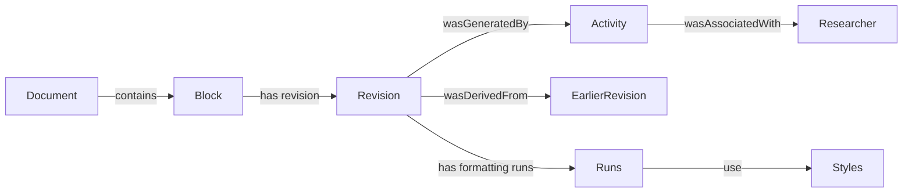

# Rich-text version control: research, model and implementation

Reviewed 21 September 2026. The product promise is **version control for documents
that preserves wording, formatting and the people behind changes**, in an editor
that researchers already understand. Blocks are an engine concern; researchers
work with documents, personal drafts, selected changes and named versions.

This is an engineering design and implementation record, not a claim that all
rich-text versioning algorithms are novel or that the full platform is finished.

For the prior-art check on the block model, segmentation, compression and the
machine-learning question, see the
[algorithm and architecture research review](RICH-TEXT-ALGORITHM-RESEARCH-REVIEW.md).

## What we already researched, and what was missing

`02-versioning-design-vol1.md` already discusses stable identities, semantic events,
Notion's block tree, Yjs/Automerge, compact columnar encoding, content-addressed
objects, Merkle structures and prolly trees. Its staged approach recommends buying
the difficult convergence machinery and building the research-specific semantics.

`03-versioning-mathematics-vol2.md` covers delta propagation, disjoint-field
commutativity, sequence ordering, the cost of naive per-character objects, Merkle
commitments and deduplication. These are useful foundations, not a proof that the
current application implements every described protocol. CRDT stage 20 was skipped.

Before this increment, Tiptap already represented styled text with text nodes and
marks. Stable top-level block IDs existed, but a content edit wrote a whole JSON
paragraph; the merge treated that paragraph as one indivisible field. A derived
plain-text label could be written again too. Consequently two independent wording
edits in one paragraph conflicted, and formatting-only changes could duplicate the
entire passage in history. There was no specific run-level delta contract, bounded
rich-text merge policy, classifier benchmark, or lightweight document ontology API.

## Relevant prior work

| Primary source / implementation | Finding and decision for Dynodoc |
|---|---|
| [Microsoft WordprocessingML](https://learn.microsoft.com/en-us/office/open-xml/word/structure-of-a-wordprocessingml-document) | Word already groups text into runs sharing properties. The research opportunity is not inventing the existence of runs; it is versioning their changes with clear identity, provenance and review semantics. |
| [ProseMirror model](https://github.com/ProseMirror/prosemirror-model), especially [Fragment](https://github.com/ProseMirror/prosemirror-model/blob/master/src/fragment.ts) | The editor's structured tree and text marks are a useful interchange model. Adjacent text with matching markup can coalesce. Keep this model rather than reducing the document to HTML or plain text for versioning. |
| [Quill Delta](https://quilljs.com/docs/delta), [standalone implementation](https://github.com/slab/delta) | Retain/delete/insert operations describe text and formatting without repeating unchanged text. Adopt the principle, with a Dynodoc-specific versioned schema; this is not Quill wire compatibility. Reversal needs the base/history, since deleted content is not included in a delete count. |
| [Peritext paper](https://www.inkandswitch.com/peritext/cscw-publication.pdf), [prototype](https://github.com/inkandswitch/peritext) | Concurrent text and formatting have subtle boundary and intent rules. Use this work as a future CRDT acceptance reference. The current centralized merger deliberately reports ambiguous boundaries for review rather than claiming those guarantees. |
| [Automerge](https://github.com/automerge/automerge), [binary format specification](https://automerge.org/automerge-binary-format-spec/) | Histories contain substantial repetition. Dictionaries, run-length encoding and delta-coded columns can exploit it. Adopt per-event style interning now; evaluate an existing CRDT engine and its binary format before building a custom replicated store. |
| [Yjs](https://github.com/yjs/yjs) | Shared types and editor integrations are a credible alternative for a future live collaboration layer. That layer would still need an adapter to Dynodoc's authorized, reviewable semantic history. It does not automatically supply our branch review protocol. |
| [Upwelling](https://www.inkandswitch.com/upwelling/) | Version control for writing has prior research, including private drafting and attributed changes. Position Dynodoc around the research workflow and instrument/document provenance rather than an unsupported claim to be the first rich-text version-control system. |
| [Dolt's prolly trees](https://www.dolthub.com/blog/2024-03-03-prolly-trees/), [JSON versioning](https://www.dolthub.com/blog/2024-07-15-json-prolly-trees/) | Content-addressed trees can share unchanged chunks and skip equal subtrees during comparison. This is a later snapshot/storage optimization; a text style hash is not a replacement for a block ID. |
| [W3C PROV-O](https://www.w3.org/TR/prov-o/) | Entity, Activity and Agent provide a small vocabulary for revision provenance. A relational projection can use these relationships without introducing a graph database or duplicating the event log. |
| [similar 2.7 diff API](https://docs.rs/similar/2.7.0/similar/fn.capture_diff_slices_deadline.html) | Use the existing Myers implementation with a deadline rather than a quadratic dynamic-programming matrix. The dependency is pinned. A coarse diff remains replayable but may require more human conflict resolution. |

No external source code was copied into the new codec. Existing project dependencies
and their licensing obligations remain applicable. The only added Rust dependency
is `similar = 2.7.0`, already present transitively in the lockfile.

## Model: identity, structure, formatting and meaning

Use four distinct concepts:

- **Structural block:** a stable node ULID, parent, position and kind. A heading's
  level and paragraph alignment belong to its structural properties.
- **Formatting run:** an adjacent text range with the same complete stored metadata,
  including marks, font, color, link attributes and unknown extension properties.
- **Style descriptor:** reusable metadata. Equal descriptors may share storage;
  this never merges the identities of two passages or their authorship.
- **Semantic role:** optional research meaning such as consent, eligibility,
  question or citation. Formatting can provide evidence for a role but does not
  prove it. Semantic enrichment must be separate from deterministic parsing.

For a container, let `T` be its Unicode scalar sequence and
`R = [(length, style), ...]` its ordered runs. Require positive run lengths,
`sum(length) = |T|`, and no adjacent equivalent descriptors after coalescing. Empty
text has no runs. Inline atoms, mathematics, lists, tables and their unknown
properties remain structured data; do not flatten them irreversibly into text.

Run boundaries are not durable identity: inserting text or applying bold may split
or combine runs. For the current system, a precise location is a stable node ID,
base revision and scalar range. A future CRDT binding must use its stable sequence
anchors for concurrent/offline ranges. Do not give every character a PostgreSQL
row or treat an offset as a permanent identifier.

Metadata equality is conservative JSON equality with object-key canonicalization.
It does not equate `12pt` with `16px`, resolve theme fonts, or treat distinct mark
orders as identical. Those transformations can change document semantics and need
their own import/schema rules. Unknown properties are preserved by the engine;
this does not imply that the current editor can display every Word feature.

## Implemented event and algorithm contract

`engine-shared/src/richtext.rs` defines `RichTextPatch` version 1:

```text
RichTextPatched(node_id, patch)
patch = { version: 1, before: SHA256, after: SHA256, styles: [...], edits: [...] }
edit  = Text(child_path, operations) | Props(child_path, metadata)
      | Replace(child_path, full_subtree)
operation = Retain(count, optional_style_index)
          | Delete(count) | Insert(text, style_index)
```

Paths use child indices inside the **exact checked base**, not permanent nested
identity. Counts use Unicode scalar values, not UTF-8 bytes or JavaScript UTF-16
code units. Bengali, Arabic, combining accents and emoji are exercised in tests.
Scalar ranges may split a grapheme; editor selection and cursor rules remain the
editor's responsibility. No Unicode normalization rewrites the user's text.

The Rust engine checks the version, before hash, path, style references, bounds,
complete input consumption, resource limits and after hash. Application produces
a new value and only commits a successful result. It also regenerates the derived
plain-text `label`; the next redundant label write can be omitted. A patch's label
semantics are explicit and do not change the interpretation of historical events.

For new full-field content writes, the API attempts a delta and records it only
when serialized bytes are smaller **and** replay reproduces the requested JSON
exactly. Otherwise it records the existing `FieldEdited`. This avoids schema loss,
including accidental coalescing of source distinctions. Small paragraphs can
therefore continue to use full values; compact encoding is not always cheaper.

Myers computes text alignment on scalar sequences. Equal regions carry any changed
style reference; replaced regions carry only deletions and newly inserted text.
Styles referenced multiple times are transmitted once per patch. Nested tables
and lists can use path-based deltas when their tree shape permits; arbitrary
structural changes fall back to subtree or full-field replacement.

Per-container limits: 100,000 scalars; 64 path levels; 10,000 patch edits/styles.
Each text diff receives a 20 ms deadline. This is a bound for the diff search,
not a 20 ms bound for an entire request with many containers. Hashing and exact
replay still inspect the affected block. Temporary scalar/style indices are O(n);
they are not persisted per character. Large full-field values remain supported
through fallback within the existing HTTP limits.

### Merge rules

The workspace performs three-way comparison against the stored ancestor:

| Concurrent situation | Behavior |
|---|---|
| Different structural blocks or spreadsheet fields | Existing semantic merge |
| Separate text ranges inside a paragraph, heading or code block | Combine using base-coordinate edit intervals |
| Bold and italic, or font family and color, independently changed | Merge mark types and attributes property by property |
| Different values for the same color, wording or other property | Review conflict |
| Delete/replace text while another branch reformats it | Review conflict |
| Concurrent insertion at the same position or a reformatted boundary | Conservative review conflict |
| Both branches alter nested list/table structure | Review conflict; no guessed alignment of moved children |

The derived label does not create a second conflict after content merges. Stable
node IDs, tombstones, governance checks and append serialization remain unchanged.
The original questionnaire merger can expand compact events against a branch base,
but the application uses `workspace_merge` for the richer behavior above.

This is not a proof of arbitrary commutativity, associativity, convergence or
intention preservation. Repeated text may have multiple valid diff alignments;
the algorithm chooses an alignment and uses conservative overlap checks. A CRDT
or transaction-anchor model is required for stronger collaboration guarantees.

## Lightweight ontology and provenance

`GET /documents/{id}/structure` requires document membership. It returns a revision
sequence, stable block IDs and parent IDs, kinds, per-block content hashes,
formatting-run statistics, and the latest recorded content activity/actor for each
targeted node at that sequence. It is derived on demand; no graph database runs
in the edit path and no graph is allowed to override canonical history.

Conceptual mapping:



The current API exposes containment and latest activity references, not a full RDF
export, inference engine or complete per-word blame graph. Full history remains in
the member-only event endpoints. A document-content hash is a revision commitment,
not the same thing as the event-chain head. Raw actor IDs do not authorize access
to another user's documents. Future cross-document citations must enforce both
documents' permissions and avoid leaking private labels through graph edges.

Suggested future relational projections are `block_revision`, `style_descriptor`,
`run_span`, `reference_edge` and `operation_span`. Build them asynchronously from
event sequence checkpoints, with unique idempotent keys and rebuild tests. Use
PostgreSQL foreign keys and indexes first; consider a graph service only after
measured graph-query workloads justify it. Semantic similarity, retrieval and
embeddings belong in an optional derived subsystem, never in revision identity.

## Speed and storage evidence

Run `cargo run --release -p engine-core --example richtext_bench`.
The checked-in [raw result](benchmarks/richtext-2026-09-21.json) uses Windows x86_64,
Rust 1.96.0, an optimized build, one warm-up and nine measured iterations. Timings
are medians from this machine, not a service-level guarantee. The synthetic fixture
is 8,000 paragraph/heading blocks, 24,000 formatting runs, three distinct styles,
3,936,000 scalars and 6,030,116 JSON bytes. “400 pages” is only the analogy of twenty
blocks per page; the benchmark does not paginate a real Word file.

| Measured operation | Median |
|---|---:|
| Parse already available JSON | 53.68 ms |
| Classify parsed tree and intern style metadata | 32.86 ms |
| Construct a formatting patch for a long paragraph, including verification | 0.156 ms |
| Replay that patch, including hashes | 0.060 ms |
| Merge separate edits in a short paragraph | 0.019 ms |

In the long-paragraph example, the full content is 9,924 JSON bytes and the patch
302 bytes (about 97% smaller). These exclude the event envelope, PostgreSQL row,
indexes, WAL, snapshots and backups. This is one formatting-heavy example, not a
universal compression ratio. Text replacement can be large and should use fallback.

The classifier walks the parsed tree and counts scalars without creating per-word
objects. Style interning uses a BTreeMap: O(text bytes + metadata serialization +
runs × log(distinct styles)), plus the traversal stack. The frontend's repeated
suffix scans for block positions were replaced with a range-maximum tree: O(B)
construction and O(log B) successor lookup, instead of repeated O(B) scans/slices.
It still serializes the edited document tree to discover changes; transaction-range
capture is a follow-on optimization.

### What the timing does not establish

The benchmark excludes DOCX unzip/OOXML conversion, browser work, upload bandwidth,
database writes, hash-chain insertion, snapshots, rendering, and concurrent users.
The later office-editor increment replaces the Mammoth HTML route for DOCX with
native OOXML parsing in a dedicated, cancellable browser worker, bounded ZIP
expansion/XML depth and common style inheritance. This improves formatting and
review metadata preservation but does not establish exact Word layout fidelity.
See [office-editor evidence and limitations](OFFICE-EDITOR-CAPABILITIES.md).
Original uploaded bytes remain available for reference.

The current 10 MB file limit and 16 MiB batch request limit, repeated SQL appends
and whole-document snapshots remain real end-to-end constraints.
This increment permits up to 20,000 creation operations in one atomic initial import
into an empty document; ordinary editing retains the 5,000-operation limit. This
removes the old operation-count rejection for an 8,000-block import, provided its
complete request fits the byte limit. It does not establish end-to-end import speed. **Arbitrary 300–400 page
files importing and saving in seconds is not yet an established product capability.**

## Git capabilities and remaining engineering

The ordinary-user vocabulary remains: New document, Make a copy, Personal draft,
Open draft, Include in sharing, Keep for later, Save version, Share changes,
Get latest, Review overlaps, Restore version, Who changed this?, Find.
See [the precise capability map](VERSIONING-CONFORMANCE.md). Compact deltas improve
those workflows; they do not implement Git's wire protocol, arbitrary remotes,
offline clone/fetch, persistent ignore rules, nested stable IDs or signed heads.

Remaining increments, in dependency order (updated after the office-editor work):

1. **Import fidelity and throughput:** DOCX worker conversion, bounded ZIP/XML,
   style inheritance and conversion reports are implemented. Still needed:
   resumable import jobs with progress, validation and an atomic publication step.
   Keep originals and source anchors. Add real, permissioned 300/400-page fixtures.
2. **Incremental client edits:** unchanged ProseMirror nodes now reuse serialized
   blocks, local state uses copy-on-write, and IME composition defers saves/remote
   application. Still needed: capture compact transaction ranges and map
   UTF-16 positions to the versioned offset contract. Send small patches with an
   explicit client protocol version. Keep stale-base checks and draft recovery.
3. **Shared storage:** immutable block/style objects and structurally shared
   snapshots; benchmark ropes/piece trees and content-defined chunks against
   representative editing traces. Do not adopt every advanced structure at once.
   Initial creation and materialized nodes currently still contain full JSON.
4. **Nested identity and provenance:** stable IDs for inner paragraphs, cells and
   atoms; range attribution across split/join/move; cross-block staged patches;
   full portable revision ancestry and trusted external head anchoring.
5. **Live/offline convergence:** evaluate Automerge/Peritext and Yjs with a shared
   adversarial corpus (concurrent formatting boundaries, deletion, repeated text,
   Unicode, atom movement). Choose the library from correctness and workload data.
6. **Performance acceptance:** report p50/p95 parse/classify/import/save/render and
   peak memory separately under ten simultaneous users on the actual VPS. Define
   bytes, runs, nodes, images and table size alongside pages. Establish a budget
   such as classification <1 s and full import <5 s on an agreed corpus before
   advertising it; those numbers are targets, not verified guarantees.

## Verification and rollout

The new Rust suite covers exact replay, compact size, Unicode, nested path patches,
invalid/stale hashes, malformed bounds, independent wording and formatting merges,
conflicting formatting, structural conflicts, classifier boundaries and randomized
Unicode inputs. A shared fixture file is checked by Rust and the TypeScript fold.
The API integration test verifies SQL materialization, the new migration, compact
canonical events, history replay, hash-chain verification and access control.

Migration 0016 extends the event type constraint and adds the provenance lookup
index. Migrations 0001–0015 and existing payloads are unchanged. Deploy readers that
understand the new event before enabling new writes, refresh active editor sessions,
and retain a fresh backup. New browser clients send `x-dynodoc-editor: office-v2` (previously `richtext-v1`);
the web gateway refuses document API requests from older tabs with a message to
copy unsaved text and reload. Original-file download links are exempt. Deploy web
and admin readers first, then the API, so no old stream remains when new events start. Once a compact event is recorded, rolling back to an old
binary that cannot decode it is unsafe; retain compatible readers or roll forward.
No history deletion or rehash is a rollback mechanism. Browser replay checks bounds
but relies on the Rust authority for cryptographic base/result validation.
